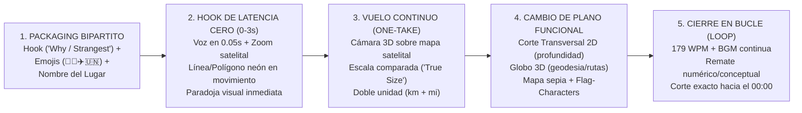

# FASE 2 — Síntesis Ejecutiva y ADN del Canal (`@GeoGlobeTales`)

> **Rol:** Orquestador de Análisis de Contenido — Nicho Geografía  
> **Canal auditado:** [`@GeoGlobeTales`](https://www.youtube.com/@GeoGlobeTales/shorts) (`164 Shorts` publicados)  
> **Muestra auditada:** **Top 20 Shorts más vistos del canal** (`#01` a `#20`, desde `61.0M` hasta `21.8M` de reproducciones)  
> **Volumen de evidencia procesada:** **`665,483,374` vistas acumuladas** (`33.27M` de media/Short) · **`15,969,890` likes** · **`187,648` comentarios** · `1,449` segundos de vídeo (`1080x1920 @ 60fps`) · `4,335` palabras transcritas con marcas milimétricas · `20` mosaicos `storyboard.jpg` y `hook_3s.jpg` auditados visualmente.

---

## 1. Control de Calidad y Resolución de Contradicciones (Auditoría del Orquestador)

### 1.1 Verificación de Cobertura y Evidencia

| Subagente | Archivo Entregado | Cobertura (`IDs`) | Verificación de Evidencia Observable | Estado |
|---|---|---|---|---|
| **Agente 0 (Scout)** | [`00_indice_videos.md`](00_indice_videos.md) | `20 / 20` | URLs, fechas UTC, métricas con fecha `2026-10-28`, descripciones y hashtags literales. | **APROBADO** |
| **Agente 1 (Guion)** | [`agentes/01_guion.md`](agentes/01_guion.md) | `20 / 20` | 5 bloques con `[MM:SS.dd]`, WPM (`179.3` media), arquetipos geográficos y auditoría científica. | **APROBADO** |
| **Agente 2 (Hook)** | [`agentes/02_hook_retencion.md`](agentes/02_hook_retencion.md) | `20 / 20` | Inspección visual de `hook_3s.jpg`, latencia cero (`0.00s–0.08s`), 5 tipos de hook y *seamless loop*. | **APROBADO** |
| **Agente 3 (Edición)** | [`agentes/03_edicion.md`](agentes/03_edicion.md) | `20 / 20` | Paradigma *One-Take Map Flight* (`GEOlayers 3` + `Google Earth Studio`), cortes 2D y receta en código. | **APROBADO** |
| **Agente 4 (Texto)** | [`agentes/04_texto_subtitulos.md`](agentes/04_texto_subtitulos.md) | `20 / 20` | Subtítulo minimalista en `y ≈ 73%` (`2–4 palabras`) y sistema de *Map Callouts* en doble unidad (`mi + km`). | **APROBADO** |
| **Agente 5 (Audio)** | [`agentes/05_audio.md`](agentes/05_audio.md) | `20 / 20` | Telemetría EBU R128 (`-18.3 LUFS` media), música continua de pulso y catálogo de SFX cartográficos. | **APROBADO** |
| **Agente 6 (SEO)** | [`agentes/06_packaging_seo.md`](agentes/06_packaging_seo.md) | `20 / 20` | Fórmulas de título con banderas/emojis (`🤯😱✈️🌍`), bloques de 25–33 hashtags y primer frame. | **APROBADO** |
| **Agente 7 (Audiencia)** | [`agentes/07_audiencia.md`](agentes/07_audiencia.md) | `20 / 20` | Citas reales con `@autor` y likes, orgullo nacional, correcciones de usuarios y banco de ideas. | **APROBADO** |
| **Agente 8 (Rendimiento)** | [`agentes/08_rendimiento.md`](agentes/08_rendimiento.md) | `20 / 20` | Rankings por vistas (`61M`–`21.8M`), contraste Top 3 vs. Bottom 3 y 6 hipótesis cuantitativas. | **APROBADO** |

### 1.2 Resolución de Contradicciones Aparentes en la Telemetría

1. **¿Por qué `ffmpeg scene > 0.3` detecta solo entre `0 y 7 cortes` en vídeos súper dinámicos de 60 a 103 segundos?**
   - *Tensión detectada:* La telemetría automática de cambio de escena (`scene > 0.3`) devuelve `0 cortes` en `#03` (`47.0M` vistas), `#04` (`38.5M`), `#08` (`33.4M`), `#12` (`30.4M`), `#16` (`27.1M`), `#18` (`23.6M`) y `#19` (`22.3M`). En un análisis superficial parecería que el vídeo es estático.
   - *Veredicto del Orquestador:* Al inspeccionar los 20 `storyboard.jpg`, se comprueba que `@GeoGlobeTales` opera bajo el paradigma de **Plano Secuencia Cartográfico (*Continuous One-Take Map Flight*)**. En lugar de cortar entre láminas desconectadas, la cámara virtual sobrevuela sin cortes el mapa satelital (`Esri World Imagery` en `GEOlayers 3`) haciendo *zoom-in*, *zoom-out*, paneo e inclinación 3D, mientras sobre el lienzo emergen un promedio de **22 a 35 capas gráficas animadas por minuto** (fronteras de neón, flechas, banderas 3D, siluetas comparativas). Los pocos cortes que superan `scene > 0.3` ocurren únicamente cuando el vídeo salta del mapa satelital a una **sección transversal 2D a pantalla completa** (ej. el corte submarino de 900m en `#15` Gibraltar o las raíces del suelo en `#07` Dust Bowl) o a un **vuelo 3D de Google Earth Studio** (`#08` Himalaya).
2. **¿Por qué `silencedetect <= -32 dB` detecta `0 a 5 silencios` en casi todos los vídeos pese a que el narrador hace pausas entre frases?**
   - *Veredicto del Orquestador:* A diferencia de `@cdmauro2010` (que deja la voz 100% desnuda sobre silencio digital `-inf dB`), `@GeoGlobeTales` utiliza una **cama musical continua (*ambient electronic / puzzle pulse*) a `-24 dB / -28 dB`** más una cadena constante de **SFX de interfaz cartográfica** (*whooshes* de cámara, *pops* de banderas, *clicks* de contadores y trazos de línea) que rellenan todos los huecos entre oraciones.
3. **¿Son mejores los Shorts de `60 segundos` exactos o los Shorts extendidos de `80 a 103 segundos`?**
   - *Veredicto del Orquestador:* Ambos formatos coexisten con éxito masivo, pero cumplen funciones distintas:
     - **El formato de `60 segundos exactos` (`12 de los 20 vídeos`)** es el motor principal del canal para explicar **una sola paradoja o línea geográfica** (`#02` Tapón del Darién `48.2M`, `#04` Línea del 80% de EE. UU. `38.5M`, `#05` Islas Diómedes `36.7M`, `#08` Tíbet `33.4M`).
     - **El formato extendido de `81 a 103 segundos` (`8 de los 20 vídeos`)** se reserva para **narrativas multi-etapa o catálogos de 4–5 anomalías** y logra el #1 y #3 absolutos del canal (`#01` 27 años caminando `103s` → `61.0M` vistas; `#03` Las fronteras más raras de España `97s` → `47.0M` vistas; `#09` Isla Märket `98s` → `31.1M` vistas).

---

## 2. Diferencias Estructurales: Nicho Geografía (`@GeoGlobeTales`) vs. Nicho Historia (`@cdmauro2010`)

Dado que este proyecto inaugura un **nuevo nicho de Geografía separado del canal de Historia**, es fundamental no mezclar las reglas de ambos. Lo que hace triunfar a un Short de Geografía de `40 millones de vistas` es radicalmente distinto en ritmo, cámara, subtítulos y audio a un Short de Historia:

| Dimensión | Nicho HISTORIA (`@cdmauro2010` / `@DuskRevela`) | Nicho GEOGRAFÍA (`@GeoGlobeTales`) |
|---|---|---|
| **Pregunta nuclear del espectador** | *«¿Qué decisión tomó este líder bajo presión y qué habrías hecho vos?»* | *«¿Por qué el mapa del mundo tiene esta anomalía física o frontera absurda?»* |
| **Duración óptima** | `177–180 segundos` (3 minutos fijos) | **`60 segundos`** (1 anomalía) o **`80–100 segundos`** (ruta/catálogo de 5 rarezas) |
| **Velocidad de locución (`WPM`)** | Pausada y solemne: **`155–162 WPM`** | Rápida, enérgica y densa: **`175–190 WPM`** (`179.3 WPM` de media) |
| **Arranque en el Segundo `00:00`** | Pre-hook diegético sin voz (`1.6s–3.0s`) + `[Mes de Año]` | **Latencia Cero (`0.00s–0.08s`)**: voz inmediata + *zoom-in* con línea/polígono neón |
| **Paradigma de Edición Visual** | **Montaje por corte duro** (`35–45 cortes/vídeo`) sobre fondo oscuro `#0D0D0D` | **Plano Secuencia Cartográfico (*One-Take Map Flight*)** sobre mapa satelital 3D |
| **Ubicación y estilo de Subtítulos** | Tercio superior (`Y = 18%`), `5–7 palabras`, con *Figma Bounding Box* | **Tercio inferior (`Y = 73%`)**, **`2–4 palabras`**, blanco limpio sin caja para no tapar el mapa |
| **Diseño Sonoro (`BGM` + `SFX`)** | `0% música` en el cuerpo + silencios dramáticos de `0.7s` (`-21.0 LUFS`) | **Música continua de intriga/pulso** + **SFX cartográficos cada `2.5s`** (`-18.3 LUFS`) |
| **Mecanismo de Cierre** | Pregunta ética de Tribunal Dividido (*«¿Vos qué habrías hecho?»*) | **Cierre en Loop Perfecto (*Seamless Loop*)** con el dato/giro final sin despedida |
| **Potencial de Tráfico Orgánico** | Alto y fiel en habla hispana (`150k–450k` vistas/Short) | **Masivo y transfronterizo (`20M–61M` vistas/Short)** porque el mapa es un lenguaje visual universal |

---

## 3. El ADN de `@GeoGlobeTales` en 1 Página: Los 5 Pilares de su Fórmula

1. **La Paradoja Visual en el Mapa ("Lo que ves en el mapa esconde un secreto"):**
   Todos sus vídeos de +20M de vistas parten de una **anomalía geométrica o física que cualquier persona puede ver en un mapa en 2 segundos**: una línea recta que divide el 80% de la población de EE. UU. (`#04`), un hueco de 106 km sin carretera en el Darién (`#02`), un vacío sin aviones sobre el Tíbet (`#08`), una frontera en zigzag alrededor de un faro en la isla Märket (`#09`), un corredor extraño en Oklahoma (`#17`) o una línea recta de nado de 32.000 km de Pakistán a Rusia (`#19`).
2. **El Vuelo Cartográfico Continuo (*One-Take Map Flight*) con Capas de Neón:**
   El espectador nunca pierde la orientación espacial porque la cámara no hace cortes bruscos: vuela desde la vista continental hasta el detalle local (un faro, una isla de 3 hectáreas, un pueblo de 54 habitantes) iluminando fronteras con **trazos de neón de alto contraste** (cian `#00E5FF`, rojo `#EF4444`, amarillo `#FACC15`, verde `#22C55E`) y rellenos semitransparentes o rayados en diagonal.
3. **Traducción Visual de la Escala y de la Tercera Dimensión:**
   - Para explicar **superficie o longitud**, nunca deja un número suelto: mete **4 siluetas de Francia dentro del Tíbet** (`#08`), estira **la silueta de Chile desde Londres hasta Bagdad** (`#06`), o compara **las islas de Dubái con el Vaticano** (`#14`).
   - Para explicar **altitud o profundidad submarina/subterránea**, pasa a un **diagrama lateral 2D limpio** (los `900 m` del Estrecho de Gibraltar en `#15`, la fosa de Lombok entre el elefante y el canguro en `#13`, el avión bajando de `33,000 ft` a `10,000 ft` frente a los `14,800 ft` del Tíbet en `#08`).
   - Para explicar **esfericidad y rutas ortodrómicas**, abre el plano a un **Globo 3D en el espacio** (`#12` Chimborazo vs. Everest, `#19` ruta Pakistán–Kamchatka).
4. **Doble Unidad Sistemática (`Imperial + Métrico`) y Subtítulo Minimalista (`Y = 73%`):**
   Cada cota en pantalla muestra **`millas + kilómetros`** o **`pies + metros`** (`2,4 mi (3,8 km)`, `14,800 ft (4,500 m)`), satisfaciendo simultáneamente a la audiencia de EE. UU. y del resto del mundo. Y sus subtítulos ocupan solo **2 a 4 palabras en blanco limpio en la parte media-baja (`y ≈ 73%`)**, dejando libre todo el centro y tercio superior para el mapa.
5. **Ritmo Acústico de Alta Densidad (`179.3 WPM`) + Cierre en Bucle (*Seamless Loop*):**
   Con `3 palabras por segundo`, cama musical continua y efectos *whoosh/pop* cada `2.5 segundos`, no da margen al abandono. Al llegar al último segundo, remata la idea y corta en seco sin despedirse, haciendo que el vídeo vuelva a empezar en `00:00` antes de que el usuario deslice el dedo.

---

## 4. Qué Copiar, Qué Adaptar y Qué Evitar para Nuestro Canal de Geografía

| Qué COPIAR (Mecánicas ganadoras universales) | Qué ADAPTAR (A nuestro canal en español y motor en código) | Qué EVITAR (Puntos débiles detectados en `@GeoGlobeTales`) |
|---|---|---|
| **1. Arranque en `0.00s` con línea o polígono en movimiento sobre el mapa:** Empezar con la cámara ya en movimiento trazando una línea brillante (`X` roja en el Darién, línea del 80%, frontera en zigzag) mientras suena la primera palabra. | **1. Unidades de medida (`Métrico primario + referencia local`):** En español, mostrar **`kilómetros y metros` como cifra principal** (ej. `3,8 km` / `4.500 m`) y acompañar con comparaciones de países hispanos (*«del tamaño de Andalucía»*, *«como ir de Madrid a Moscú»* o *«de Buenos Aires a Lima»*). | **1. Errores ortográficos y de tipeo en los rótulos del mapa:** En `#17` escribió `5 YEAI` (cortado) y en `#18` puso en el subtítulo `"1,191 peopel"` mientras el icono del mapa mostraba `258` habitantes (lo que generó burlas y confusión en comentarios). |
| **2. El truco de "Siluetas Comparativas de Tamaño" (*True Size Overlay*):** Superponer la silueta translúcida de un país conocido dentro o encima de otro para que el cerebro entienda la escala en 1 segundo. | **2. Velocidad de habla adaptada al español (`165–175 WPM`):** El inglés tiene palabras monosílabas más cortas (`179 WPM` en inglés equivale en densidad silábica a **`165–172 WPM` en español**). Mantener un ritmo ágil y dinámico pero 100% articulado. | **2. Mezclar vídeos de guerra pura dentro del canal de Geografía:** Vídeos como `#16` (*Why North and South Korea Are Still at War*) o la Independencia de las 13 Colonias diluyen el posicionamiento geográfico y pisan nuestro otro canal de Historia. Si se toca una frontera conflictiva, el protagonista debe ser **el relieve y la línea cartográfica**, no la crónica bélica. |
| **3. Combinación de Vista Satelital Cenital + Corte Transversal 2D Lateral:** Cuando se hable de fosas marinas, estrechos, montañas o túneles, pasar durante 8–12 segundos a un corte lateral 2D con cotas de profundidad/altitud. | **3. Motor de renderizado 100% programático (`Remotion + MapLibre/D3-Geo + Three.js`):** En lugar de depender de animar a mano en After Effects + GEOlayers, construir componentes reutilizables en código (vuelo sobre teselas satelitales, trazado SVG con *glow*, corte 2D paramétrico y globo 3D). | **3. Abuso de bloques de 30 hashtags genéricos e irrelevantes:** `@GeoGlobeTales` pega listas fijas donde incluye `#usa #states` incluso en vídeos sobre España (`#03`), Corea (`#16`) o la Línea de Wallace (`#13`). Usar **5 a 8 hashtags 100% específicos del lugar y fenómeno geográfico**. |
| **4. Estructura de Título Bipartita con 2–3 Emojis Visuales:** Combinar la incógnita (`¿Por qué...?` / `La frontera más extraña de...`) + bandera del país + `🤯` / `🌍` + el nombre propio del lugar. | **4. Cierre híbrido (Loop + Micro-pregunta de identidad geográfica):** Cerrar con el dato circular que conecta con el segundo `00:00`, pero dejando en la última frase (o en el comentario fijado) un gancho de orgullo local (*«¿Y desde tu país cuál es la frontera más rara que tenés cerca?»*). | **4. Inconsistencia de estilo en personajes (mezclar muñecos 3D de IA, emojis de WhatsApp y *Flag-characters* en el mismo vídeo):** En `#06` (Chile) mezcla emojis de WhatsApp con banderas, muñecos 3D generados por IA y banderas con ojos. Definir una **línea gráfica limpia y consistente**. |

---

## 5. Oportunidades y Huecos Estratégicos (Dónde Dominar el Nicho en Español)

1. **Hueco #1 — El Gigantesco Vacío de Geografía Física y Fronteras de Hispanoamérica y España:**
   - *Evidencia:* Cuando `@GeoGlobeTales` toca un tema del mundo hispano, explota en vistas: **Tapón del Darién (`#02`, `48.2M` vistas)**, **Las fronteras más raras de España (`#03`, `47.0M` vistas)**, **Por qué Chile es tan largo y delgado (`#06`, `34.1M` vistas)**, **Volcán Chimborazo en Ecuador (`#12`, `30.4M` vistas)** y **Estrecho de Gibraltar (`#15`, `28.3M` vistas)** suman **`188 millones de vistas`** (el 28% del Top 20). Sin embargo, el creador apenas conoce las decenas de anomalías geográficas de América Latina y España (la Isla Martín García —única frontera terrestre entre Argentina y Uruguay—, el Rincón de Artigas, el enclave de Os de Civís a donde solo se llega por Andorra, por qué no hay ningún puente sobre el río Amazonas, la línea donde el río Negro y el Solimões no se mezclan, la Triple Frontera, el Salar de Uyuni o el Lago Maracaibo).
2. **Hueco #2 — Corrección de la Distorsión de Mercator Aplicada al Mundo Hispano:**
   - *Evidencia:* Las comparaciones de escala real (*True Size*) retienen a la audiencia de forma hipnótica. Mostrar en pantalla cómo **Argentina es casi del tamaño de toda la Unión Europea**, cómo **México cabría desde Londres hasta Estambul**, o cómo **Colombia y Perú superan a Francia, Alemania y España juntas** activa de inmediato la compartición viral y los comentarios por orgullo regional.
3. **Hueco #3 — Ingeniería Geográfica y Megaproyectos Imposibles:**
   - *Evidencia:* `#02` (Carretera Panamericana en el Darién, `48.2M`), `#07` (El muro de 220 millones de árboles de EE. UU., `33.9M`) y `#15` (Por qué no hay puente en Gibraltar, `28.3M`) demuestran que la fórmula **`«¿Por qué no construyen un puente/carretera/canal en [Lugar]?»`** es una mina de oro. Temas como **por qué no hay ni un solo puente sobre los 6.400 km del río Amazonas**, **cómo funciona las esclusas de agua dulce del Canal de Panamá**, **por qué el estrecho de Magallanes perdió su tráfico** o **por qué Bolivia sigue teniendo Armada naval en el lago Titicaca** tienen tracción garantizada.
4. **Hueco #4 — Rigor en los Datos Demográficos y Cifras en Pantalla:**
   - *Evidencia:* En `#18` (`c1q6jnTsxn8`), cientos de usuarios señalaron en comentarios que el cartel sobre Point Roberts decía `258` habitantes mientras el narrador decía `"1,191 peopel"` (con falta de ortografía). Cuidar al 100% la concordancia entre el rótulo del mapa y la voz nos dará un acabado televisivo superior.
