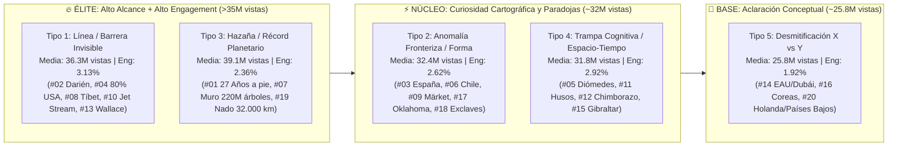

# Agente 2 — Hook, Retención y Arquitectura del Bucle (`@GeoGlobeTales`)

> **Objeto de estudio:** Los **Top 20 Shorts históricos** de `@GeoGlobeTales` (`665,483,374` reproducciones acumuladas; media de `33.27M` vistas/Short y `2.65%` de engagement).
> **Enfoque del informe:** Disección milimétrica de los primeros 3 segundos (`[00:00]` a `[00:03]`) en audio, mapa y psicología cognitiva (20/20 vídeos), taxonomía cuantitativa de los **5 Tipos de Hook Geográfico**, ingeniería de **re-hooks cada `2.5–3.5s` sobre vuelo continuo de cámara sin cortes duros (`1.8 cortes/vídeo`)**, anatomía del *seamless loop* sin CTA invasivo y manual de aplicación para nuestro canal de Geografía en español.

---

## 1. El Paradigma de Retención de `@GeoGlobeTales`: Continuidad Espacial vs. Corte Duro

El hallazgo técnico más importante al auditar los registros de vídeo (`cortes.log`, `cortes_015.log` y `.en-orig.vtt`) de `@GeoGlobeTales` es que **rompe por completo la regla convencional de edición de Shorts basada en cortes de cámara cada 2 segundos**:

- **Cortes duros de escena (`scene > 0.3`):** Media de apenas **`1.80 cortes por vídeo`** en toda la muestra (`n = 20`). Siete vídeos superventas —incluyendo `#03` (*Spain's Borders*, `47.0M`), `#04` (*USA 80% Line*, `38.5M`) y `#08` (*Planes Over Tibet*, `33.4M`)— tienen exactamente **`0 cortes duros`** de principio a fin.
- **Transiciones suaves o de cámara (`scene > 0.15`):** Media de **`6.20 por vídeo`** (principalmente giros de cámara orbital 3D o paso del mapa cenital a un corte transversal 2D).
- **Latencia de ataque de voz (`Voice Attack Latency`):** Media de **`0.098 segundos`** (`98 milisegundos` desde el primer fotograma hasta el primer fonema). Ningún vídeo supera los `0.24 s` de silencio inicial, y 4 vídeos arrancan en el milisegundo `0.000–0.040 s`.

> [!IMPORTANT]
> **¿Por qué un canal de Geografía retiene más con `0–2 cortes` que con `40 cortes`?**
> Porque en Geografía el cerebro del espectador necesita **orientación espacial continua**. Si se corta bruscamente de plano, el ojo pierde la referencia de dónde está en el mapa. `@GeoGlobeTales` mantiene **un único lienzo cartográfico en vuelo continuo (`GEOlayers 3` + `Google Earth Studio`)** y sustituye los cortes de escena por **apariciones gráficas sincrónicas (*Map Pop-ins*) cada `2.5 a 3.5 segundos`**.

---

## 2. Disección de los Primeros 3 Segundos (`[00:00]` a `[00:03]`) — Cobertura 20/20

En `@GeoGlobeTales`, la ventana crítica de decisión (`Swipe-vs-Stay`, `0.00 s` a `3.00 s`) ejecuta una **tríada simultánea**:
1. **Estímulo Auditivo (Latencia Cero):** La primera palabra entra antes de `0.20 s`, pronunciando el nombre propio del país/océano o el adjetivo extremo (`"impossible"`, `"strangest"`, `"80%"`, `"invisible line"`) antes del segundo `2.50`.
2. **Estímulo Visual (`hook_3s.jpg`):** El mapa nunca aparece desnudo; en el fotograma `00:01` ya existe una **anomalía cromática de alto contraste** (una línea láser cian/roja, un polígono parpadeante, una `X` roja gigante o signos `???` amarillos).
3. **Brecha de Curiosidad (*Curiosity Gap*):** Presenta un hecho visualmente evidente en el mapa cuya causa física o histórica el espectador desconoce.

### 2.1. Matriz Maestra de los Primeros 3 Segundos (20/20 Shorts)

| # | ID | Latencia Voz | Qué se Oye en `[00:00.00 – 00:03.50]` (Transcripción `.vtt`) | Qué se Ve en el Mapa (`hook_3s.jpg`) | Brecha de Curiosidad Abierta (*Curiosity Gap*) | Tipo de Hook |
|---|---|---|---|---|---|---|
| **01** | `mtXDt-TJht4` | `0.08 s` | *"This man has been walking for 27 years to become the only person..."* | Recorte hexagonal de vídeo real de Karl Bushby caminando sobre el mapa satelital de Europa con rótulo rojo `27 years walking` y ruta amarilla desde Chile (`1998`). | ¿Cómo puede alguien tardar 27 años caminando y cómo cruzó los océanos y estrechos sin usar transporte? | **Tipo 3:** Hazaña / Ruta Extrema |
| **02** | `ulmKClgP85g` | `0.04 s` | *"Did you know that it's physically impossible to cross from North America to South America by road?"* | Línea amarilla discontinua bajando desde Alaska hasta chocar contra una `X` roja incandescente entre Panamá y Colombia (`The Darien Gap`). | Si Norteamérica y Sudamérica están unidas por tierra, ¿por qué es físicamente imposible cruzar en coche? | **Tipo 1:** Línea / Barrera Invisible |
| **03** | `f3DnZlduEoE` | `0.08 s` | *"Did you know Spain is the country with the strangest borders? On the map..."* | Mapa oscuro de Europa donde España se ilumina en naranja rayado con el rótulo `NOT as simple as it looks` y signos `?` en los Pirineos. | España parece una península normal con solo dos vecinos (Francia y Portugal); ¿qué fronteras ocultas tiene? | **Tipo 2:** Anomalía Fronteriza |
| **04** | `p5DfhG_DKSk` | `0.12 s` | *"Why do 80% of all Americans live east of this line, while only 20%..."* | Mapa de EE. UU. con contador animado hasta `80%`, 10 siluetas humanas y una línea vertical cian brillante partiendo el país en azul (`80%`) y naranja (`20%`). | ¿Por qué la mitad occidental de EE. UU. está casi vacía a partir de una línea vertical tan recta? | **Tipo 1:** Línea / Barrera Invisible |
| **05** | `kBR3Wi-fmns` | `0.12 s` | *"Not all Americans know that the US and Russia are actually much closer..."* | Línea láser fucsia cruzando todo el Atlántico entre EE. UU. y Rusia que luego gira bruscamente hacia el Estrecho de Bering uniendo Alaska y Siberia. | ¿Cómo van a estar EE. UU. y Rusia a solo 2 millas de distancia y conectados a pie si están en lados opuestos del mapa? | **Tipo 4:** Trampa Cognitiva / Espacio-Tiempo |
| **06** | `mB1U5W8nwTg` | `0.00 s` | *"Let's take a look at Chile. Um, not this chili, this Chile."* | Un ají/chile rojo picante (`Chili`) aparece por broma sobre Sudamérica y es reemplazado por la larguísima silueta roja de `Chile` superpuesta de Londres a Bagdad. | Disrupción humorística inmediata + ¿cómo llegó un país a ser tan absurdamente largo y estrecho? | **Tipo 2:** Anomalía Fronteriza / Morfología |
| **07** | `v-LJaB8y438` | `0.16 s` | *"Why did the US build a giant wall stretching from Canada all the way to Texas..."* | Franja roja brillante cruzando EE. UU. de norte a sur desde Canadá hasta Texas que se transforma en una muralla verde de árboles. | ¿Cuándo construyó EE. UU. un muro gigante de Canadá a Texas y por qué lo hizo de árboles en vez de hormigón? | **Tipo 3:** Hazaña / Megaproyecto |
| **08** | `yCNSI_EUDow` | `0.19 s` | *"Why do all the airplanes in the world avoid flying over this zone?"* | Polígono rojo sobre el Tíbet rellenado con 4 siluetas azules de Francia y radar de `Flightradar24` con cientos de aviones amarillos rodeando el hueco. | El impacto visual del "agujero negro" de aviones sobre China/Tíbet obliga a quedarse para saber por qué ningún avión pasa por ahí. | **Tipo 1:** Línea / Barrera Invisible |
| **09** | `o4-ZkUMD0eQ` | `0.00 s` | *"This is Sweden and this is Finland. They share a border on land and at sea..."* | Mapa de Suecia (verde) y Finlandia (azul) haciendo un zoom vertiginoso hacia una roca diminuta en el mar Báltico donde la frontera hace una `S` absurda (`???`). | ¿Por qué dos países serios dibujaron un zigzag ridículo en una roca del tamaño de un estacionamiento? | **Tipo 2:** Anomalía Fronteriza |
| **10** | `tnpjwJ3hcfY` | `0.12 s` | *"Why do all the planes flying over the Atlantic choose this specific narrow path?"* | Hilera de aviones blancos en fila india sobre el Atlántico Norte y lupa sobre `Flightradar24` con signos `???` amarillos. | Si el cielo es abierto, ¿por qué todos los aviones transatlánticos van en fila por el mismo pasillo estrecho? | **Tipo 1:** Línea / Barrera Invisible |
| **11** | `t1DECN9zS_8` | `0.08 s` | *"You probably know that the Earth is divided into 24 time zones, but why..."* | Mapamundi con 24 franjas verticales de colores que de pronto se retuercen y deforman de manera caótica sobre los continentes. | Si la Tierra gira en 24 horas exactas, ¿por qué el mapa de los husos horarios parece un rompecabezas deformado? | **Tipo 4:** Trampa Cognitiva / Espacio-Tiempo |
| **12** | `XpYfmHoPEAs` | `0.08 s` | *"Have you ever wondered which country is closest to space? Well, it seems simple..."* | Mapa mundial inclinado con líneas punteadas subiendo hacia el rótulo `closest to SPACE` y una lupa apuntando al Monte Everest entre China y Nepal. | El espectador piensa "es Nepal/Everest", pero el narrador dice *"Or maybe not"*, activando el reto al ego intelectual. | **Tipo 4:** Trampa Cognitiva / Geodesia |
| **13** | `O96MiXxXz6k` | `0.08 s` | *"Can you believe that there is an invisible line that is not crossed by fish..."* | Línea roja/rosa neón parpadeando entre Borneo/Bali y Célebes/Lombok en Indonesia con siluetas de animales a cada lado. | ¿Cómo puede existir una línea invisible en el mar que ni siquiera los peces ni los pájaros se atreven a cruzar? | **Tipo 1:** Línea / Barrera Invisible |
| **14** | `TIP_4hrzLTk` | `0.00 s` | *"Many people don't know the difference between the UAE, Abu Dhabi, and Dubai."* | Mapa del Golfo Pérsico iluminando el contorno de `UAE` y dividiéndolo en 7 piezas numeradas con escudos/banderas. | Apela a una duda real y cotidiana del espectador global: ¿Dubái es un país, una ciudad o la capital de los Emiratos? | **Tipo 5:** Desmitificación (`X vs Y`) |
| **15** | `yMplWGXdA3Q` | `0.04 s` | *"Have you ever wondered why there is no bridge between Europe and Africa?"* | Puente 3D animado tendido sobre el Estrecho de Gibraltar con una cota de apenas `14 km (8.7 mi)` entre España y Marruecos. | Si están a solo 14 km y existen puentes de 165 km, ¿por qué nadie ha unido Europa y África? | **Tipo 4:** Trampa Cognitiva / Ingeniería |
| **16** | `b-2lOYwi9q8` | `0.00 s` | *"Do you know why North and South Korea are enemies? They have no diplomatic..."* | Península de Corea partida en rojo (`North Korea`) y azul (`South Korea`) con alambrada y el rótulo gigante `ENEMIES`. | Promete explicar en menos de 90 segundos sobre el mapa cómo un solo país se partió en dos enemigos irreconciliables. | **Tipo 5:** Desmitificación Geopolítica |
| **17** | `9bu4pyTeNxM` | `0.12 s` | *"Why does Oklahoma have this strange panhandle, and why is it not part of Texas?"* | Mapa de EE. UU. en azul destacando en amarillo y rojo la estrecha tira rectangular de `OKLAHOMA` sobre el norte de Texas. | Cualquiera que haya visto el mapa de EE. UU. ha notado ese "mango de sartén" encima de Texas; ¿por qué se lo quitaron a Texas? | **Tipo 2:** Anomalía Fronteriza |
| **18** | `c1q6jnTsxn8` | `0.24 s` | *"This is the 49th parallel, which separates the United States and Canada..."* | Línea láser azul trazando el paralelo `49°` de costa a costa con dos círculos amarillos de alerta donde la línea corta penínsulas. | ¿Cómo es posible que existan pueblos de Estados Unidos completamente rodeados por Canadá por culpa de una línea recta? | **Tipo 2:** Anomalía Fronteriza |
| **19** | `6yqQ2N7Yy1Q` | `0.04 s` | *"Have you ever wondered what's the longest distance you could swim in a straight line..."* | Mapamundi con líneas rectas amarillas rebotando entre continentes y un primer intento por el Pacífico (`18,100 km`). | Desafío mental tipo acertijo visual: ¿por dónde se puede trazar la línea recta de agua más larga del planeta sin tocar tierra? | **Tipo 3:** Hazaña / Récord Computacional |
| **20** | `yIZtQa92Bj4` | `0.24 s` | *"Do you know the difference between Holland and the Netherlands?"* | Mapa de Europa occidental iluminando los Países Bajos con la ecuación `Netherlands ≠ Holland` y signos `???` junto a `Dutch`. | Resuelve el triple embrollo lingüístico más famoso de la geografía europea: ¿Holanda, Países Bajos o *Dutch*? | **Tipo 5:** Desmitificación (`X vs Y`) |

---

## 3. Taxonomía de los 5 Tipos de Hook Geográfico y Rendimiento Cuantitativo

Agrupando los 20 Shorts según el mecanismo psicológico de su gancho, obtenemos una radiografía exacta de **qué tipo de Hook genera más reproducciones (alcance bruto) y cuál genera mayor porcentaje de interacción (engagement)**:

| Rango | Categoría de Hook Geográfico | Vídeos (`n = 20`) | % Muestra | Vistas Totales | Promedio de Vistas / Short | Engagement Medio `(L+C)/V` | Diagnóstico Estratégico |
|---|---|---|---|---|---|---|---|
| **1º (Techo Viral)** | **Tipo 3 — Hazaña / Récord o Megaproyecto en el Mapa** (*Extreme Route / Mega-Wall*) | `#01, #07, #19` (`n = 3`) | `15%` | `117,234,868` | **`39,078,289`** | `2.36%` | **Máximo potencial de viralidad masiva (`61.0M` en `#01`).** Combina la escala planetaria del mapa con un desafío físico extremo (caminar 27 años, plantar 220M de árboles, nadar 32.000 km). |
| **2º (Mejor Equilibrio)** | **Tipo 1 — La Línea / Barrera Invisible** (*Invisible Line & Forbidden Zone*) | `#02, #04, #08, #10, #13` (`n = 5`) | `25%` | `181,695,498` | **`36,339,100`** | **`3.13%`** | **El motor más rentable y consistente del canal.** Trazar una línea o polígono donde algo se detiene (población, aviones, carreteras, animales) garantiza `>30M` de vistas y el mayor engagement (`3.13%`). |
| **3º (Volumen Constante)** | **Tipo 2 — Anomalía Fronteriza / Morfología Extraña** (*Strange Border & Exclaves*) | `#03, #06, #09, #17, #18` (`n = 5`) | `25%` | `161,810,073` | **`32,362,015`** | `2.62%` | **El sello de identidad cartográfica.** Hacer zoom a una frontera absurda (España `#03`, Chile `#06`, Märket `#09`, Panhandle `#17`) activa la curiosidad visual pura del amante de los mapas. |
| **4º (Alto Engagement)** | **Tipo 4 — Trampa Cognitiva / Paradoja Espacio-Temporal** (*Geoid, Time & Engineering Paradox*) | `#05, #11, #12, #15` (`n = 4`) | `20%` | `127,293,949` | **`31,823,487`** | **`2.92%`** | **Rompe creencias previas del espectador.** Desmentir que el Everest sea el punto más cercano al espacio (`#12`) o mostrar que EE. UU. y Rusia están a 3.8 km y 21h (`#05`) dispara los guardados y compartidos (`3.81%` en `#11`). |
| **5º (Base Educativa)** | **Tipo 5 — Desmitificación Conceptual / Geopolítica** (*X vs. Y Clarifier*) | `#14, #16, #20` (`n = 3`) | `15%` | `77,448,986` | **`25,816,329`** | `1.92%` | **Suelo sólido de vistas (`21.8M–28.5M`), menor ratio de likes.** Son vídeos de alta utilidad educativa (EAU vs Dubái, Holanda vs Países Bajos) que atraen búsquedas recurrentes. |

---

## 4. Ingeniería de Retención Intermedia: Re-Hooks cada `2.5–3.5s` sobre Vuelo Continuo

¿Cómo logra `@GeoGlobeTales` evitar que el espectador deslice el dedo entre el segundo `10` y el segundo `55` sin recurrir a cortes bruscos de cámara? La auditoría de fotogramas (`1 fps`) combinada con las marcas de tiempo de `.en-orig.vtt` revela un **sistema de doble metrónomo**:

### 4.1. Metrónomo 1 — Micro-Estímulos Cartográficos (*Visual Map Pop-ins*) cada `2.5 a 3.5 segundos`
Sobre el movimiento fluido de la cámara 3D, **nunca pasan más de `3.5 segundos` sin que un nuevo elemento vectorial se dibuje o ilumine sobre el terreno** acompañado de un efecto sonoro sutil (*whoosh*, *pop*, *pencil draw* o *riser*):
- **Ejemplo cronometrado en `#04` (`p5DfhG_DKSk` — `0 cortes duros` en 60s):**
  - `[00:00.1 – 00:03.0]`: Contorno azul de EE. UU. + contador `80%` + 10 siluetas humanas.
  - `[00:03.1 – 00:06.0]`: Trazado láser de la línea vertical del Meridiano 100° partiendo el mapa en azul (`80%`) y naranja (`20%`).
  - `[00:06.1 – 00:12.5]`: Iluminación en amarillo de la costa oeste (`California`, `Oregon`, `Washington`) con contador `11%` (`36,000,000`).
  - `[00:12.6 – 00:18.5]`: Oscurecimiento del interior occidental destacando el rótulo `9%` (`30,000,000`).
  - `[00:18.6 – 00:23.0]`: Pop-in del escudo y silueta de `New York City` para anclar la escala poblacional.
  - `[00:23.1 – 00:31.0]`: Elevación 3D en relieve dorado de las `Rocky Mountains` de norte a sur.
  - `[00:31.1 – 00:40.0]`: Animación de nubes entrando desde el `Pacific Ocean` que chocan contra las montañas y desaparecen (`Rain Shadow`).
  - `[00:40.1 – 00:50.0]`: Corriente de flechas blancas y nubes subiendo desde el `Gulf of Mexico` que gira a la derecha sin cruzar la línea.
  - `[00:50.1 – 01:00.0]`: Aparición de iconos rojos de gota tachada (`💧🚫`) sobre el oeste árido y retorno al mapa demográfico general.

### 4.2. Metrónomo 2 — Los 4 Tipos de *Re-Hook Verbal* cada `12 a 18 segundos`
Cada vez que una explicación parcial está a punto de cerrarse (lo que daría permiso psicológico al usuario para hacer *swipe*), el guion inserta un **Re-Hook Verbal** que abre una segunda o tercera brecha de curiosidad:

1. **El Re-Hook de "Falsa Respuesta Derribada" (`The Bait-and-Switch` — Segundo `20–30`):**
   - En `#12` (*Closest to Space*), dedica los primeros 27 segundos a explicar por qué el Everest mide casi 9.000 m entre Nepal y China, y justo en `[00:27.20]` suelta en seco: ***"But that's wrong. You see, our planet is not actually round."*** Este giro obliga al espectador a quedarse los 55 segundos restantes.
   - En `#19` (*Longest Swim*), plantea primero cruzar el Pacífico o ir de polo a polo y en `[00:11.52]` corta: ***"But in reality, according to computer modeling, the longest straight path actually stretches from Pakistan to Russia."***

2. **El Re-Hook de "Pregunta Secundaria de Ingeniería/Seguridad" (`The Second-Order Problem` — Segundo `30–35`):**
   - En `#10` (*Jet Stream*), tras explicar en el segundo `30` qué es la corriente en chorro, el espectador ya tendría su respuesta; inmediatamente en `[00:31.32]` el narrador lanza un segundo misterio: ***"But how do they avoid collisions, especially since radars don't work over the Atlantic?"***

3. **El Re-Hook de "Superación en Escalera" (`The Escalation Pivot` — Cada `18s` en catálogos):**
   - En `#03` (*Spain's Borders*), cada vez que termina de explicar un enclave usa un conector de escalada:
     - `[00:21.12]`: *"And moving further west, you'll find **an even more surprising case**: Pheasant Island."*
     - `[00:51.84]`: *"But Spain has **another hidden neighbor, and it's much larger**: the United Kingdom."*
     - `[01:14.56]`: *"But despite this, Spain is **the only European country that shares a land border with Africa**..."*

4. **El Re-Hook de "Cambio de Perspectiva Dimensional" (`2D Map → Cross-Section / 3D Globe`):**
   - Cuando el ojo se acostumbra a la vista cenital del mapa, el vídeo cambia el eje de la cámara a un **corte transversal lateral 2D** (`#07` raíces de pradera vs. arado en `[00:31]`; `#08` avión bajando de `33,000 ft` a `10,000 ft` contra el Everest en `[00:28]`; `#13` fosa marina entre elefantes y canguros en `[00:40]`; `#15` pilares de `900 m` bajo el Estrecho de Gibraltar en `[00:27]`).

---

## 5. Anatomía del Cierre: *Seamless Loop* y Cero CTAs Invasivos

El análisis de los últimos 5 segundos (`last_4_segments`) de los **20 Shorts (`20/20`)** confirma tres leyes estrictas de retención al final del vídeo:

### 5.1. Ausencia Total de Despedidas y CTAs (`0/20` Vídeos)
En ninguno de los 20 vídeos existe una frase de cierre promocional (*"If you liked this video, subscribe"*, *"Follow for more geography facts"*, *"What do you think? Leave a comment"*). El canal sabe que cualquier palabra que anuncie "el vídeo ya terminó" provoca el deslizamiento inmediato en el último segundo, destruyendo el ratio de re-visualización (*Loop Rate*).

### 5.2. Corte al Filo del Último Fonema y Empalme en Bucle (*Seamless Loop*)
En los 12 vídeos de `60 segundos`, la última palabra termina exactamente entre `[00:58.92]` y `[00:59.52]`, dejando apenas `0.4s` de cola musical antes de saltar al milisegundo `00:00.04` del inicio:
- En `#02` (*Darien Gap*), el vídeo termina en `[00:59.12]` con `"...significantly increasing the risk of kidnapping"` e inmediatamente suena `[00:00.04]` `"Did you know that it's physically impossible to cross..."`.
- En `#05` (*Diomede Islands*), termina en `[00:59.48]` con `"...and become a kind of time traveler"` mientras el mapa vuelve a mostrar el Estrecho de Bering del segundo `00:00`.
- En `#19` (*Longest Swim*), el cierre en `[00:57.84]` muestra la línea recta de `20,000 miles` sobre el globo 3D, empalmando con la pregunta inicial sobre cuál es la distancia más larga para nadar en línea recta.

### 5.3. El "Remate de Fricción" en el Último Segundo (*Last-Second Comment Trigger*)
En lugar de pedir comentarios explícitamente, `@GeoGlobeTales` coloca en los últimos 3 segundos un **dato provocador, irónico o hiperbólico** que impulsa al espectador a abrir la caja de comentarios mientras el vídeo se reproduce en bucle de fondo:
- **`#06` (Chile, `[01:19.20]`):** Cierra con la bandera de Bolivia diciendo ***"Dude, where is my ocean?"*** → Miles de comentarios bromeando sobre el mar de Bolivia mientras el Short corre en bucle.
- **`#11` (Husos horarios, `[00:57.76]`):** Cierra con ***"As a result, western cities like Kashgar are still dark at 10:00 a.m."*** → Los dos comentarios más votados (`88,000` y `56,000 likes`) reaccionan directamente a esta última frase.
- **`#15` (Estrecho de Gibraltar, `[00:51.08]`):** Introduce la palabra ***"So officially, all these factors make the construction... economically unfeasible"*** → El público capta el guiño de *"officially"* y llena los comentarios debatiendo las razones políticas entre Europa y África (`92,000 likes` en el comentario principal).
- **`#18` (Pueblos de EE. UU. en Canadá, `[00:56.52]`):** Termina diciendo ***"and if you cross it [the street], you will be immediately arrested"*** → Decenas de miles de usuarios abren los comentarios para debatir o desmentir el arresto inmediato (`93,000` y `42,000 likes`).

---

## 6. Manual de Conclusiones Accionables para Nuestro Canal de Geografía en Español

Para replicar y superar las métricas de retención de `@GeoGlobeTales` en nuestro proyecto de **Geografía en español**, debemos aplicar de forma obligatoria este protocolo de 7 reglas en cada producción:

1. **Regla de los `100 Milisegundos` (Latencia Cero):**
   - Prohibido iniciar con silencios, respiraciones o introducciones musicales. La primera sílaba del narrador debe sonar entre **`0.00 s` y `0.10 s`**, simultáneamente con el primer impacto sonoro y la iluminación del polígono o línea en el mapa.
2. **Priorizar los Hooks Tipo 1 (Línea/Barrera Invisible) y Tipo 2 (Anomalía Fronteriza):**
   - Representan el `50%` del Top 20 y combinan el mayor promedio de vistas (`32.4M–36.3M`) con el mayor engagement (`2.62%–3.13%`). En el ámbito hispanohablante e internacional existen decenas de minas de oro vírgenes bajo este formato (Línea de Heihe-Tengchong, el rincón de las Tres Fronteras, el exclave argentino de Martín García, Llívia y Pheasant Island en español, el vacío aéreo del Amazonas o del Tíbet).
3. **El Mapa del Segundo `00:01` Debe Contener una "Pregunta Gráfica":**
   - El fotograma inicial nunca debe ser un mapa político estático. Debe mostrar desde el segundo 1 **una línea de alto contraste partiendo un territorio en dos colores opuestos**, un polígono rojo con `X` / `🚫✈️`, o un zoom extremo a un borde con signos `???` amarillos.
4. **Cero Cortes Duros Innecesarios — Vuelo Continuo con *Pop-ins* cada `3.0 s`:**
   - En lugar de cortar de plano como en el nicho de Historia, debemos mantener un **vuelo de cámara continuo sobre el mapa satelital** donde cada `2.5–3.5 segundos` aparezca una nueva capa visual (silueta de comparación de escala, flecha de viento, contador numérico o corte transversal 2D).
5. **Insertar el "Pivote del Segundo 25" (*Mid-Video Re-Hook*):**
   - Entre el segundo `22` y el `32`, el guion debe incluir obligatoriamente un giro verbal (*"Pero esa no es la verdadera razón..."*, *"Sin embargo, aquí surge un problema aún mayor..."*, o un cambio de vista cenital a **corte lateral 2D** de elevación/profundidad).
6. **Incluir 1 Ancla de Escala Hispana por Vídeo:**
   - Adaptar el recurso del *"Costco parking lot"* o *"5 times the size of France"* a referencias instantáneas para el espectador hispanohablante global: *"más grande que toda España"*, *"5 veces el tamaño de la Ciudad de México"*, *"del tamaño de dos canchas de fútbol"* o *"se extendería desde Madrid hasta Moscú / desde Tijuana hasta Bogotá"*.
7. **Cierre en Seco con *Trigger* de Comentarios en el Último Segundo:**
   - Eliminar el 100% de las despedidas y peticiones de suscripción. Terminar el guion con el dato más chocante, paradójico o irónico en el segundo `58.5–59.5` mientras la cámara regresa al encuadre exacto del segundo `00:00`.
