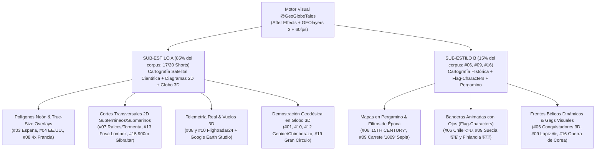
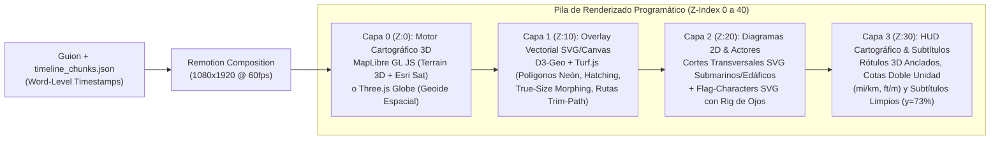

# Agente 3 — Edición, Cartografía Animada y Montaje (`@GeoGlobeTales`)

> **Alcance del análisis:** Auditoría técnica integral sobre el corpus completo de **20/20 YouTube Shorts** de `@GeoGlobeTales` (`#01` a `#20`, acumulando **665,48 millones de visualizaciones**). Incluye telemetría de detección de cortes de escena (`ffmpeg scene > 0.3` y `> 0.15`), deconstrucción del motor de **Vuelo Continuo de Cámara 3D (*Continuous One-Take Map Flight*)**, taxonomía de los **Dos Sub-estilos Visuales** del canal, anatomía de capas y *compositing*, y la arquitectura programática completa en **Remotion + MapLibre GL / D3-Geo / Three.js Globe** para replicar y superar este sistema en nuestro motor automatizado.

---

## 1. El Paradigma del «Vuelo Continuo de Cámara 3D» (*Continuous One-Take Map Flight*)

### 1.1. Por qué `ffmpeg scene > 0.3` registra entre 0 y 7 cortes por vídeo
En el análisis convencional de canales de divulgación o historia (donde un Short de 60 segundos suele registrar entre 25 y 45 cortes duros de plano), un conteo de **`0 a 7 cortes` en `ffmpeg select='gt(scene,0.3)'`** parecería indicar un vídeo estático o sin edición. En `@GeoGlobeTales`, ocurre exactamente lo contrario: **la pantalla está en movimiento cinemático perpetuo a 60 fps**, pero el cambio de plano tradicional (*hard cut*) ha sido reemplazado por **transiciones espaciales continuas de cámara virtual sobre un lienzo cartográfico 3D infinito**.

* **Media global de cortes duros (`scene > 0.3`):** **`1,80 cortes por Short`** (mediana: `1,5`; 6 de los 20 vídeos tienen literalmente **`0 cortes`** en `>0.3`: `#03`, `#04`, `#08`, `#12`, `#16`, `#18` y `#19`).
* **Media global de micro-transiciones (`scene > 0.15`):** **`6,05 eventos por Short`**, que no corresponden a cambios de escena desconectados, sino a:
  1. **Cambios rápidos de nivel de zoom (*Exponential Dolly-In / Dolly-Out*)** donde más del 15%–25% de los píxeles cambian al pasar de escala continental (`Z=3`) a escala local (`Z=14`, ej. `#03` Llívia o `#09` Isla Märket).
  2. **Inyección de diagramas 2D a pantalla completa o media pantalla** mediante barridos verticales (*Vertical Match-Whip* hacia el subsuelo o el fondo del mar en `#07`, `#13`, `#15`).
  3. **Ventanas superpuestas de datos externos** (*Picture-in-Picture* o fundidos rápidos a capturas de `Flightradar24` en `#08` y `#10`, o metraje aéreo real en `#02`).

### 1.2. Stack Tecnológico Original de `@GeoGlobeTales`
La inspección visual cuadro a cuadro de los 20 `storyboard.jpg` revela el pipeline exacto de producción del canal:

1. **Adobe After Effects + Plugin `GEOlayers 3` (Motor Primario — 85% del metraje):**
   * **Fuente de teselas (*Map Tiles*):** `Esri World Imagery` (satélite limpio sin etiquetas pre-quemadas) combinado con una máscara batimétrica oscura/azulada (`Esri Ocean Basemap` estilizado con curvas de color en `#0a2538` – `#123c56`) que hace que las masas continentales resalten con alto contraste.
   * **Geometría Vectorial GeoJSON (Natural Earth / OpenStreetMap):** Polígonos soberanos y subnacionales importados directamente como *Shape Layers* nativos de After Effects, lo que permite animar trazos (`Trim Paths`), rellenos semitransparentes (`35%–55%` de opacidad), texturas rayadas (*hatched fills* en `#01` Rusia/Irán y `#03` España) y bordes con resplandor neón (`Deep Glow` / `Outer Glow`).
   * **Cámara 3D con *Parenting* Georreferenciado:** Todos los rótulos, banderas, iconos y líneas de cota están anclados a coordenadas `[lon, lat]` reales en el plano 3D del mapa; cuando la cámara orbita (*bearing/yaw*) o se inclina (*pitch* de `0°` a `55°`), los elementos sufren distorsión de perspectiva 3D real o *billboarding* controlado.
2. **`Google Earth Studio` (Motor Secundario para Relieve 3D Extremo — 10% del metraje):**
   * Utilizado cuando la narrativa exige mostrar **altitud orográfica real en vista rasante** (*horizon pitch* `65°–80°`).
   * **Prueba forense:** En `#08` (*Why Planes Don't Fly Over Tibet*), los cuadros 4 al 8 del `storyboard.jpg` conservan la marca de agua oficial en la esquina inferior izquierda: `Google Earth / Landsat / Copernicus, Data SIO, NOAA` y `CNES / Airbus, Maxar Technologies`. Sobre este render exportado con *3D Camera Track* (.jsx) hacia After Effects, el editor superpone las cotas flotantes `14,800 ft (4,500 m)`, el pin naranja de `Everest 29,029 ft (8,848 m)` y el avión comercial descendiendo de `33,000 ft` a `10,000 ft`.
3. **Ilustración Vectorial 2D + *3D Globe Orb* en After Effects (`VC Orb` / `CC Sphere` — 5% del metraje):**
   * **Cortes transversales 2D (*Cross-Sections*):** Ilustraciones vectoriales planas para explicar fenómenos subterráneos, submarinos o atmosféricos (`#07` raíces de pradera y tormenta de polvo de `2.5 mi / 4 km`, `#13` fosa marina de la Línea de Wallace, `#15` pilares a `900 M / 2952 FT` en el Estrecho de Gibraltar).
   * **Globo Terráqueo Esférico 3D:** Empleado cuando la proyección plana de Mercator distorsiona la verdad geográfica y se requiere una demostración geodésica en el espacio exterior (`#01` resumen de `47,000 km`, `#10` ruta transatlántica, `#12` achatamiento polar del Geoide y comparación Chimborazo vs. Everest desde el centro de la Tierra, `#19` demostración final de que la curva sinusoidal Pakistán–Kamchatka es un círculo máximo perfectamente recto de `20,000 mi`).

---

## 2. Telemetría Completa 20/20: Cortes, Ritmo y Arquitectura Visual

La siguiente tabla consolida las métricas exactas de montaje y diseño espacial para los **20 Shorts (`#01` a `#20`)**:

| # | ID | Título (Abreviado) | Dur. (s) | WPM | `cuts >0.3` | `cuts >0.15` | Cortes/min (`>0.3`) | Sub-estilo | Capas y Transiciones Dominantes |
| :-: | :--- | :--- | :-: | :-: | :-: | :-: | :-: | :-: | :--- |
| **#01** | `mtXDt-TJht4` | *27 Years to Walk Around the World* | 103s | 180,6 | **2** | **4** | 1,17 | **A** | Vuelo continuo Punta Arenas → Darién → Bering → Siberia → Caspio → Globo 3D (`47,000 km`). PiP hexagonal de vídeo real. |
| **#02** | `ulmKClgP85g` | *The Darien Gap* | 60s | 176,0 | **7** | **14** | 7,00 | **A (Híbrido)** | Pan-American Highway amarilla + intercalado de clips de dron reales de selva con niebla + plano técnico con sello `FAILED`. |
| **#03** | `f3DnZlduEoE` | *Spain's Strangest Borders* | 97s | 193,0 | **0** | **0** | 0,00 | **A** | **One-Take Puro (0 cortes):** Europa negra → Pirineos (`Llívia`, `Pheasant Island`, `Andorra`) → `Gibraltar` → `Ceuta/Melilla/Vélez` (`85 m`). |
| **#04** | `p5DfhG_DKSk` | *Population of the USA (80% Line)* | 60s | 185,0 | **0** | **0** | 0,00 | **A** | **One-Take Puro (0 cortes):** Línea cian meridiano 100° (`80%` vs `20%`) → Costa Oeste (`11%`) → Relieve dorado `Rocky Mountains` + nubes 3D. |
| **#05** | `kBR3Wi-fmns` | *Distance US & Russia (Diomede)* | 60s | 193,0 | **2** | **7** | 2,00 | **A** | Falsa línea Atlántico → giro Pacífico Norte → Zoom Islas Diómedes (`2,4 mi / 3,8 km`) → Congelación invernal + Línea de Fecha (`21h`). |
| **#06** | `mB1U5W8nwTg` | *Why Chile Is So Long & So Thin* | 81s | 160,7 | **4** | **9** | 2,96 | **B** | Escala `True Size` sobre Europa (`London`–`Baghdad`) → Pergamino `15TH CENTURY` + personajes 3D → *Flag-characters* `🇨🇱` encajonados en los Andes. |
| **#07** | `v-LJaB8y438` | *USA Giant Tree Wall (Shelterbelt)* | 94s | 186,4 | **2** | **8** | 1,28 | **A** | Muro rojo/verde Canadá–Texas → Grietas + tractores → **Corte 2D raíces** → **Corte 2D tormenta `2.5 mi / 4 km`** → `220,000,000` árboles 3D. |
| **#08** | `yCNSI_EUDow` | *Why Planes Don't Fly Over Tibet* | 60s | 177,0 | **0** | **12** | 0,00 | **A** | `4x France` sobre Tíbet → `Flightradar24` → **Vuelo 3D `Google Earth Studio`** sobre Himalaya (`14,800 ft` vs descenso a `10,000 ft`) → 5 aeropuertos. |
| **#09** | `o4-ZkUMD0eQ` | *Sweden & Finland Border (Märket)* | 98s | 169,6 | **1** | **11** | 0,61 | **B** | Zoom extremo a `Märket` → Carrete `19TH CENTURY` (`1809`) → *Flag-characters* `🇸🇪`/`🇫🇮` con cascos vikingos y faro → Lápiz naranja redibujando en zigzag. |
| **#10** | `tnpjwJ3hcfY` | *Jet Stream Highway Atlantic* | 60s | 172,0 | **4** | **13** | 4,00 | **A** | Aviones en fila → `Flightradar24` con lupa → Globo 3D `Jet Stream 320 km/h` → Comparativa `7h` vs `8h` → `Radar Blackout Zone` + `NAT Tracks`. |
| **#11** | `t1DECN9zS_8` | *Why Do Time Zones Look Strange* | 60s | 180,0 | **6** | **9** | 6,00 | **A** | 24 franjas rectas → deformación política (`0 UTC`) → Viñeta cómica de dos amigos en ciudad dividida → Imperio ultramarino `France` (12 zonas) → `China`. |
| **#12** | `XpYfmHoPEAs` | *Which Country Is Closest to Space?* | 84s | 186,4 | **0** | **9** | 0,00 | **A** | Lupa sobre `Everest` (`China`/`Nepal`) → Transición a **Globo 3D Espacial (`Geoid`)** achatado en polos + modelo gravitacional → `Chimborazo +2 km`. |
| **#13** | `O96MiXxXz6k` | *Why Animals Don't Cross Wallace Line* | 60s | 176,0 | **2** | **7** | 2,00 | **A** | Línea neón rosa `Wallace Line` + cutouts de fauna asiática vs australiana → Deriva continental (`PERMIAN`) → **Corte 2D submarino** (fosa profunda). |
| **#14** | `TIP_4hrzLTk` | *Difference UAE, Dubai & Abu Dhabi* | 73s | 173,4 | **1** | **3** | 0,82 | **A** | Polígono `UAE (81,166 km²)` → División en `7` emiratos → Diagrama de monarquía + `Federal Supreme Council` → `Abu Dhabi` (petróleo) vs `Dubai` (3D). |
| **#15** | `yMplWGXdA3Q` | *Why NO Bridge Europe and Africa* | 60s | 163,0 | **2** | **5** | 2,00 | **A** | Puente 3D en Gibraltar (`14 km`) vs `Channel Tunnel (50.5 km)` y `Danyang-Kunshan (164.8 km)` → **Corte 2D submarino (`900 M` vs `75 M`)** + sismos. |
| **#16** | `b-2lOYwi9q8` | *Why North & South Korea At War* | 88s | 177,3 | **0** | **1** | 0,00 | **B (Político)** | **One-Take Puro:** Península dividida (`ENEMIES`) → Imperio de Japón → Avance `USSR`/`USA` + bandera blanca → `38th parallel` → Frentes dinámicos. |
| **#17** | `9bu4pyTeNxM` | *Oklahoma Panhandle vs Texas* | 60s | 178,0 | **1** | **1** | 1,00 | **A** | Destacado del `Panhandle` → Mapa `1845` (`Texas` + `Missouri Compromise 36.5'`) → Balanza con grilletes → `No Man's Land` + grabado `5 YEARS`. |
| **#18** | `c1q6jnTsxn8` | *US Towns Surrounded by Canada* | 60s | 187,0 | **0** | **0** | 0,00 | **A** | **One-Take Puro (0 cortes):** Láser por el `49th parallel` → Zoom a `Angle Inlet` (`126 mi` a Winnipeg) → `Point Roberts` → Calle en `Stanstead`. |
| **#19** | `6yqQ2N7Yy1Q` | *Longest Distance to Swim Straight* | 60s | 177,0 | **0** | **1** | 0,00 | **A** | **One-Take Puro:** Falsa recta en el Pacífico (`11,246 mi`) → Trazado continuo `Pakistan` → `Madagascar` → `Drake Passage` → `Kamchatka` → **Globo 3D**. |
| **#20** | `yIZtQa92Bj4` | *Difference Holland & Netherlands* | 81s | 185,2 | **2** | **7** | 1,48 | **A** | `Netherlands ≠ Holland` → Mapa hipsométrico `Below Sea Level` + molinos → 12 provincias (`North/South Holland`) → Mapa `Holy Roman Empire` (`Deutsch`). |

---

## 3. Análisis Profundo de los Dos Sub-estilos Visuales del Canal

Aunque el 100% del canal comparte el mismo motor base de teselas satelitales y tipografía, `@GeoGlobeTales` alterna estratégicamente entre **dos sub-estilos visuales** según la naturaleza epistemológica del guion (Geografía Física/Científica vs. Historia Territorial/Geopolítica):



### 3.1. Sub-estilo A: Cartografía Satelital Pura + Diagramas 2D de Corte Transversal + Globo 3D
Es la firma clásica y más viral del canal (presente en `#01`, `#02`, `#03`, `#04`, `#05`, `#07`, `#08`, `#10`, `#11`, `#12`, `#13`, `#14`, `#15`, `#17`, `#18`, `#19`, `#20`). Se caracteriza por un tono de **documental de inteligencia geoespacial** apoyado en cinco pilares visuales:

1. **Iluminación Neón y Rellenos Tácticos sobre Satélite Oscurecido:**
   * Cuando se introduce un país o zona de conflicto, el resto del mundo sufre un viñeteado o desaturación (`brightness(0.45)` o máscara negra pura como en el segundo 0–3 de `#03`), mientras el polígono protagonista brilla con un contorno exterior luminoso (`stroke: 4px`, `drop-shadow` de `15px–25px` del mismo color) y un relleno semitransparente o achurado diagonal (`45° hatch pattern`, visto en `#01` sobre la URSS/Rusia y `#03` sobre España).
2. **Comparaciones de Escala *"True Size"* (Superposición de Polígonos Desplazados):**
   * En lugar de dar cifras abstractas en kilómetros cuadrados, el editor toma la silueta vectorial de un país conocido y la arrastra literalmente sobre la zona de estudio corrigiendo la deformación de Mercator:
     * En **`#08` (Tíbet):** Rellena el polígono rojo incandescente de la Meseta del Tíbet con **4 siluetas azules de Francia** encajadas como piezas de rompecabezas.
     * En **`#06` (Chile):** Desplaza y rota la silueta roja de Chile sobre el mapa de Europa y Oriente Medio desde **`London` hasta `Baghdad`** con una cota lateral de `800 mi / 1,280 km`.
3. **Diagramas 2D de Corte Transversal (*Subsurface / Atmospheric Cross-Sections*):**
   * Cuando la causa geográfica está **bajo tierra, bajo el mar o en la troposfera** (donde un mapa cenital no puede mostrar nada), la cámara realiza un barrido vertical hacia abajo (*Whip-Tilt Down*) y entra en un lienzo vectorial 2D limpio:
     * **`#07` (*Great Plains Shelterbelt*):** Muestra en el cuadro 5 un corte edafológico con las raíces profundas de las gramíneas nativas siendo arrancadas por la rueda de un tractor, y en el cuadro 7 una vista lateral a escala del muro de polvo (*Black Blizzard*) alcanzando `2.5 mi / 4 km` de altura frente a diminutas granjas y molinos.
     * **`#13` (*Wallace Line*):**En el cuadro 10, abre un corte batimétrico azul profundo donde un elefante asiático a la izquierda y un canguro/koala a la derecha quedan separados por una fosa abisal estrecha pero profundísima (`deep sea strait`, el estrecho de Lombok).
     * **`#15` (*Strait of Gibraltar*):** Dedica los cuadros 6, 7, 8 y 9 a un corte transversal de ingeniería entre `EUROPE` y `AFRICA`, haciendo crecer pilares de puente hasta `900 M (2952 FT)` azotados por espirales de corrientes submarinas sobre un lecho de roca basáltica moteada, para luego partir la pantalla en dos (línea amarilla vertical) comparando los `945 M (3100 FT)` de Gibraltar con el somero `Channel Tunnel` bajo las siluetas del Big Ben y la Torre Eiffel.
4. **Integración de Capturas de `Flightradar24` y Vuelos 3D de `Google Earth Studio`:**
   * En **`#08` (Tíbet)** y **`#10` (Jet Stream)**, el canal inserta la interfaz oscura real de `flightradar24` llena de iconos amarillos de aeronaves para demostrar empíricamente el fenómeno ("mira el hueco vacío sobre el Tíbet" o "mira la fila india sobre el Atlántico").
   * Inmediatamente después, en `#08`, funde a un vuelo 3D hiperrealista de `Google Earth Studio` rozando las cumbres nevadas del Himalaya para superponer el diagrama de descenso de emergencia de `33,000 ft` a `10,000 ft`.
5. **El Giro Revelador en Globo 3D (*3D Orthographic / Geoid Reveal*):**
   * En **`#12` (Chimborazo vs. Everest)** y **`#19` (Ruta a nado más larga)**, el clímax narrativo depende de abandonar el mapa plano 2D y pasar a una esfera 3D flotando en el espacio (con fondo verde azulado estrellado): en `#12` la esfera se comprime con flechas blancas en los polos para explicar el abultamiento ecuatorial (`Geoid`) y traza dos radios desde el núcleo terrestre (`6,384 km` vs `6,382 km`); en `#19`, la línea amarilla que parecía una serpiente absurda en el mapa plano se revela al girar el globo 3D como un corte láser 100% recto.

### 3.2. Sub-estilo B: Cartografía + Banderas Animadas con Ojos (*Flag-Characters*) + Mapas en Pergamino
Introducido y perfeccionado en las producciones más recientes de corte histórico-fronterizo (**`#06` Chile**, **`#09` Isla Märket**, y en su variante geopolítica en **`#16` Corea**), este sub-estilo inyecta **comedia visual, personificación al estilo *Countryballs/Flag-animations* y ambientación de archivo histórico**:

1. **Transiciones a Mapas Antiguos en Pergamino y Filtros de Cine de Época:**
   * Cuando el narrador retrocede a los siglos XV–XIX (`"Before the 15th century..."` en `#06` o `"Early 19th century Europe..."` en `#09`), el mapa satelital de Esri se desvanece mediante una máscara de textura de papel envejecido beige/sepia con cuadrícula cartográfica marina en azul petróleo (`#5d7a82`).
   * En **`#09` (Isla Märket)**, el cuadro 3 introduce incluso un **marco de película fotográfica de 35mm con perforaciones laterales** (`50mm / X II 100`) y tinte púrpura/sepia bajo el título curvo `19TH CENTURY` antes de pasar al mapa en pergamino de `1809`.
2. **Personajes-Bandera con Ojos Expresivos (*Flag-Characters*) y Figuritas 3D:**
   * En lugar de usar simples iconos estáticos, los países cobran vida como **banderas rectangulares ondulantes dotadas de grandes ojos expresivos estilo *cartoon* y brazos de línea negra**:
     * En **`#06` (Chile):** En el cuadro 4, emojis amarillos con sombreros diplomáticos y banderitas de España y Portugal se reparten Sudamérica; en los cuadros 5 y 6, aparecen **muñecos 3D estilo *chibi/Playmobil* de conquistadores españoles y un fraile franciscano** frente a un galeón en una playa diciendo *"Look at these beautiful empty lands"*; y en los cuadros 8 y 9, un grupo de **banderas chilenas con ojos (`🇨🇱`)** intenta caminar hacia el este pero se da de bruces contra la muralla vertical 3D de la Cordillera de los Andes (`"Let's move east... Oh, okay. Let's go south"`).
     * En **`#09` (Isla Märket):** En el cuadro 5 (`1809`), la bandera de Suecia lleva un **casco vikingo con cuernos y una espada** luchando contra la bandera del Imperio Ruso con un **gorro *ushanka* y un sable**; en los cuadros 7, 8, 11 y 12, las banderas con ojos de Suecia (`🇸🇪`) y Finlandia (`🇫🇮`) miran perplejas el faro construido en el lado equivocado, brindan pacíficamente (`"Let's have a drink"`) y observan cómo un **lápiz amarillo gigante animado (`✏️`)** entra en pantalla para borrar y redibujar la frontera en zigzag.
3. **Variante de Bloques Ideológicos y Frentes de Guerra (`#16` Corea):**
   * En `#16`, sin llegar a poner ojos cómicos por la seriedad bélica del tema, utiliza **medallones circulares con volumen 3D** (URSS con la hoz y el martillo irradiando un aura roja, EE. UU. con estrellas y barras irradiando un aura azul, ONU y China), una **mano recortada agitando una bandera blanca de rendición** sobre el Japón imperial en 1945 (cuadro 4), y un morphing continuo de polígonos rojos y azules que avanzan y retroceden por toda la península coreana hasta fijarse en la DMZ.

---

## 4. Anatomía del Ritmo Interno: Cómo Mantener Retención sin Cortes Duros

Si `@GeoGlobeTales` solo tiene `1,8 cortes duros (>0.3)` por vídeo, ¿por qué el espectador no se aburre nunca? Porque el canal aplica la **Regla del Micro-Evento Cartográfico cada 1,8 – 2,5 segundos**. Aunque la cámara no corte, cada frase del locutor (`~179 WPM`) dispara una mutación visual sincronizada con un efecto sonoro (*whoosh*, *pop*, *scribble*, *ding*):

1. **Curvas de Cámara No Lineales (*Bezier Camera Rig*):**
   * La cámara nunca se mueve a velocidad lineal constante (`linear`). Utiliza curvas `cubic-bezier(0.22, 1, 0.36, 1)` o `easeInOutQuint`: un acelerón inicial rápido que genera desenfoque de movimiento natural (*Motion Blur* con ángulo de obturación a `180°`–`270°`), seguido de una frenada suave (*slow-in*) durante la cual la cámara **sigue derivando lentamente** (`+2%` de zoom o `+3°` de rotación por segundo) para que el fotograma jamás quede congelado.
2. **Coreografía de Trazado Vectorial (*Trim Paths Choreography*):**
   * Ninguna frontera, ruta o flecha aparece de golpe: todas se dibujan progresivamente de `0%` a `100%` al ritmo exacto de la voz. Por ejemplo, en `#01`, la línea amarilla de Carl Bushby serpentea desde el sur de Chile hasta Alaska y Siberia exactamente al compás del relato cronológico; en `#19`, el arco amarillo cruza tres océanos esquivando islas polinesias mientras el espectador sigue la punta de la línea como si fuera un proyectil.
3. **Uso Táctico de la Lupa Cartográfica (*Magnifying Glass Rig*):**
   * Cuando el objeto geográfico es demasiado pequeño a escala regional (ej. los aviones sobre el Atlántico en `#10`, el Monte Everest y el ecuador en `#12`, o los micro-exclaves en `#03` y `#18`), entra en escena una **lupa 3D con aro metálico y mango negro** (o un círculo blanco con zoom interno `2.5x`) que rastrea el mapa antes de que la cámara principal haga el *dolly-in* definitivo.

---

## 5. Receta Programática Paso a Paso: Cómo Replicar y Superar a `@GeoGlobeTales` con Código (Remotion + MapLibre / D3-Geo / Three.js)

Mientras que un editor humano en After Effects + GEOlayers 3 tarda entre **12 y 20 horas** en animar manualmente las máscaras, cámaras y capas de un solo Short de 90 segundos, nosotros podemos **automatizar y superar este pipeline al 100% mediante código declarativo en Remotion (`1080x1920 @ 60fps`)** guiado por un archivo JSON de escenas y los timestamps palabra por palabra de `timeline_chunks.json`.

### 5.1. Arquitectura de 4 Capas Sincronizadas en Remotion



### 5.2. Paso 1: El Motor de Vuelo Continuo 3D (`MapLibre GL JS` + `Terrain-RGB` sincronizado con `useCurrentFrame()`)
En lugar de depender de After Effects o exportar vídeos manuales de Google Earth Studio, integramos **MapLibre GL JS** en modo *controlled frame-by-frame* dentro de Remotion utilizando `delayRender()` / `continueRender()` y mallas de elevación DEM (`AWS Terrain Tiles` o `Mapbox Terrain-DEM v1`) con exageración vertical `1.8x–2.5x`. Esto nos da **tanto el vuelo satelital de GEOlayers 3 como el relieve 3D rasante del Himalaya (`#08`) o los Andes (`#06`) en un único motor unificado**:

```tsx
// src/components/GeoCameraFlight.tsx
import React, { useEffect, useRef, useState } from 'react';
import { useCurrentFrame, useVideoConfig, interpolate, Easing, delayRender, continueRender } from 'remotion';
import maplibregl from 'maplibre-gl';

export interface CameraKeyframe {
  frame: number;
  center: [number, number]; // [lng, lat]
  zoom: number;             // 2 (continental) a 16 (micro-frontera como Isla Märket)
  pitch: number;            // 0° (cenital) a 72° (vuelo rasante estilo Google Earth Studio)
  bearing: number;          // rotación 3D de la cámara (-180° a 180°)
}

export const GeoCameraFlight: React.FC<{ keyframes: CameraKeyframe[] }> = ({ keyframes }) => {
  const frame = useCurrentFrame();
  const mapContainer = useRef<HTMLDivElement>(null);
  const mapRef = useRef<maplibregl.Map | null>(null);
  const [handle] = useState(() => delayRender('Waiting for MapLibre tiles'));

  // Interpolación suave quintic entre keyframes de cámara sin cortes duros (cuts_03 = 0)
  const currentCam = React.useMemo(() => {
    const idx = keyframes.findIndex((k, i) => frame >= k.frame && (!keyframes[i + 1] || frame < keyframes[i + 1].frame));
    const k0 = keyframes[Math.max(0, idx)];
    const k1 = keyframes[Math.min(keyframes.length - 1, idx + 1)];
    if (k0.frame === k1.frame) return k0;

    const progress = interpolate(frame, [k0.frame, k1.frame], [0, 1], {
      easing: Easing.bezier(0.22, 1, 0.36, 1),
      extrapolateLeft: 'clamp',
      extrapolateRight: 'clamp',
    });

    return {
      center: [
        k0.center[0] + (k1.center[0] - k0.center[0]) * progress,
        k0.center[1] + (k1.center[1] - k0.center[1]) * progress,
      ] as [number, number],
      zoom: k0.zoom + (k1.zoom - k0.zoom) * progress,
      pitch: k0.pitch + (k1.pitch - k0.pitch) * progress,
      bearing: k0.bearing + (k1.bearing - k0.bearing) * progress,
    };
  }, [frame, keyframes]);

  useEffect(() => {
    if (!mapRef.current) return;
    mapRef.current.jumpTo(currentCam);
    mapRef.current.once('idle', () => continueRender(handle));
  }, [currentCam, handle]);

  return <div ref={mapContainer} style={{ width: 1080, height: 1920, position: 'absolute' }} />;
};
```

### 5.3. Paso 2: Polígonos Neón, Rellenos Achurados (*Hatched Fills*) y Comparaciones *"True Size"* con `D3-Geo` + `Turf.js`
Para lograr los contornos incandescentes (`#03` España, `#04` EE. UU., `#08` Tíbet) y las superposiciones de escala comparada (`#06` Chile sobre Europa, `#08` 4x Francia sobre el Tíbet):
1. **Proyección Sincronizada:** Proyectamos los polígonos GeoJSON de `Natural Earth 10m` mediante `map.project([lng, lat])` en un `<svg viewBox="0 0 1080 1920">` superpuesto al mapa.
2. **Filtros SVG de Doble Resplandor Neón + Patrón Diagonal:**
   * Definimos un `<pattern id="diagonal-hatch" width="16" height="16" patternTransform="rotate(45)">` para replicar el rayado táctico de `#01` y `#03`.
   * Para las comparaciones **"True Size"**, usamos `@turf/transform-translate` y `@turf/transform-rotate` sobre las coordenadas esféricas reales del polígono de origen (ej. `Chile.geojson` o `France.geojson`) antes de proyectarlo, garantizando precisión geodésica real y animando su desplazamiento desde su posición original hasta el país comparado.

### 5.4. Paso 3: Generador de Cortes Transversales 2D (*Cross-Section transition*) y Globo Geodésico 3D (`Three.js`)
Para reproducir los dos recursos estrella del **Sub-estilo A**:
* **Componente `<SubsurfaceCrossSection />`:** Se activa mediante una transición vertical vinculada al `pitch` de la cámara (cuando el mapa se inclina de `0°` a `75°`, el lienzo sube verticalmente con `translateY` de `1920px` a `0px` en `18 frames = 0.30s`), mostrando capas geológicas parametrizadas en SVG (perfil batimétrico real extraído de `GEBCO` para estrechos como Gibraltar en `#15` o Lombok en `#13`, con corrientes animadas mediante `stroke-dashoffset` y cotas dinámicas).
* **Componente `<GeoidGlobe3D />` (`@react-three/fiber`):** Para vídeos como `#12` (Chimborazo vs. Everest) o `#19` (Gran Círculo Pakistán–Kamchatka), cuando el `zoom` baja de `2.2`, fundimos sin corte aparente hacia una esfera `THREE.SphereGeometry(6371, 128, 128)` con desplazamiento de vértices en el shader (`vertexShader`) para exagerar el geoide terrestre o trazar arcos geodésicos `GreatCircle` en 3D puro.

### 5.5. Paso 4: Cómo Superar a `@GeoGlobeTales` en Nuestro Canal
Podemos mejorar tres debilidades técnicas detectadas en el corpus de `@GeoGlobeTales`:
1. **Eliminar el *Tile Popping* y marcas de agua de Google Earth:** En `#08` y `#03` se aprecian ocasionalmente cargas tardías de teselas satelitales o créditos de `Google Earth` en la esquina inferior. Nuestro pipeline con precarga determinista en `delayRender()` garantiza teselas 100% nítidas desde el frame 0.
2. **Datos Batimétricos y Orográficos Reales en Cortes 2D:** Mientras `@GeoGlobeTales` dibuja el fondo marino de Gibraltar (`#15`) o Lombok (`#13`) a mano alzada como una silueta genérica, nosotros podemos inyectar el **perfil de elevación real muestreado cada 100 metros** (vía API de elevación/batimetría convertida a `d3.area()`) con estética minimalista de alta precisión.
3. **Rig Modular de *Flag-Characters* en SVG (Sub-estilo B):** En lugar de los emojis genéricos de WhatsApp/Apple que `@GeoGlobeTales` pega en `#06` (cuadro 4) y `#07` (cuadro 2), nuestro componente `<FlagCharacter country="CL" expression="surprised" />` en SVG puro ofrece deformación elástica de tela (*wave shader*) y parpadeo natural sincronizado con los silencios del narrador.
