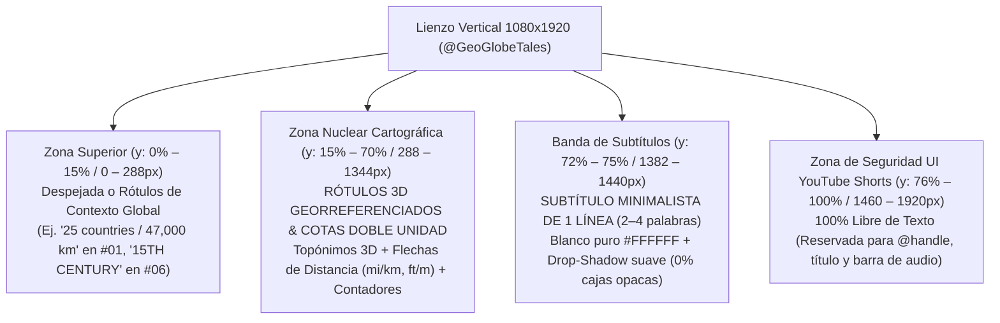

# Agente 4 — Texto en Pantalla, Rótulos Cartográficos y Subtítulos (`@GeoGlobeTales`)

> **Alcance del análisis:** Auditoría tipográfica, espacial y semiótica de los **20/20 YouTube Shorts** de `@GeoGlobeTales` (`#01` a `#20`). Desglosa la separación estricta entre la **Capa de Subtítulos Minimalistas (`y ≈ 72%–75%`)** —diseñada para dejar libre el **`95%` del lienzo cartográfico**— y el **Sistema de Rótulos Cartográficos Georreferenciados (*3D Map Callouts*)**, incluyendo la regla de oro de la **doble unidad métrica/imperial (`mi + km` / `ft + m`)**, los contadores demográficos/ambientales en 3D y las etiquetas con pastilla de color (*pill badges*), junto con su implementación completa en **CSS/SVG/Remotion** para nuestro motor.

---

## 1. Filosofía Tipográfica: «El Mapa Habla, el Subtítulo Susurra»

A diferencia de los canales de *talking head* o de historia narrativa que colocan subtítulos gigantes amarillos con bordes gruesos en el centro de la pantalla (estilo *Hormozi*), `@GeoGlobeTales` comprende una ley fundamental de los vídeos cartográficos: **si el subtítulo invade el centro o usa cajas opacas, tapa las fronteras, rutas y cotas que el espectador está intentando mirar**.

Por ello, el canal divide el texto en pantalla en **dos sistemas jerárquicos con funciones opuestas**:

1. **Sistema Primario (Protagonista Visual): Rótulos Cartográficos y Cotas 3D (*Map Callouts*) — `y = 15% a 68%`**
   * Textos grandes, en negrita (`font-weight: 800–900`), adheridos físicamente al terreno 3D o flotando sobre pines/flechas de cota. Son los que transmiten el **dato duro** (`80%`, `14,800 ft (4,500 m)`, `900 M (2952 FT)`, `220,000,000`, `SPAIN`, `ENEMIES`).
2. **Sistema Secundario (Apoyo Auditivo Silencioso): Subtítulos Ultra-Limpios — `y ≈ 72% a 75%`**
   * Una única línea horizontal de **`2 a 4 palabras`**, en tipografía sans-serif blanca de grosor medio (`font-weight: 500–600`), **sin caja de fondo, sin resaltado palabra por palabra (*karaoke highlight*) y sin animaciones estridentes**, situada exactamente por encima de la interfaz inferior de YouTube Shorts (`y ≈ 1380px–1440px` sobre `1920px`), dejando el **`95%` del mapa completamente despejado**.



---

## 2. Especificación Exacta del Sistema de Subtítulos (`y ≈ 72%–75%`)

La inspección de los 240 fotogramas extraídos en los 20 `storyboard.jpg` confirma que `@GeoGlobeTales` mantiene una disciplina invariable en sus subtítulos a lo largo de los 20 vídeos:

| Parámetro Técnico | Especificación Exacta en `@GeoGlobeTales` | Justificación Cognitiva y Visual |
| :--- | :--- | :--- |
| **Posición Vertical (`Y`)** | **`72% – 75%`** de la altura (`1382px – 1440px` en lienzo de `1920px`). | Queda justo debajo del foco de acción del mapa (`35%–60%`) y justo por encima del bloque de título/usuario de la UI de YouTube Shorts (`>76%`). |
| **Posición Horizontal (`X`)** | Centrado absoluto (`50%` / `540px`), con margen lateral mínimo de `120px` a cada lado. | Permite que el ojo lea el subtítulo con visión periférica sin apartar la fóvea del movimiento del mapa en el centro. |
| **Familia Tipográfica** | Sans-serif geométrica/humanista limpia: **`Inter`**, **`Roboto`** o **`Montserrat`** en peso **Medium / SemiBold (`500`–`600`)**. | Alta legibilidad a tamaño moderado; al no ser `Black/900`, no compite visualmente con los topónimos en `ExtraBold` del mapa (`SPAIN`, `FRANCE`). |
| **Tamaño de Fuente** | **`40px – 44px`** (sobre `1080x1920`), equivalente a `~2,1%–2,3%` de la altura del frame. | Tamaño contenido que ocupa menos del 5% de la superficie de la pantalla. |
| **Longitud de Bloque** | **`2 a 4 palabras` por bloque** (`14 a 24 caracteres` máximo), **siempre en 1 sola línea**. | Ejemplos reales verificados en storyboards: `"in history"`, `"in 1998"`, `"major obstacle"`, `"and the military"`, `"for 18 days"`, `"the two continents"`, `"off course"` (`#01`); `"it looks like Spain"`, `"unusual oddities"`, `"Spanish territory"` (`#03`). |
| **Capitalización** | **Sentence case / minúsculas naturales** según el flujo gramatical de la frase (solo mayúsculas en nombres propios como `Spain`, `Everest`, `Europe`). | A diferencia del `ALL CAPS` agresivo de otros canales, las minúsculas reducen la fatiga visual y refuerzan el tono divulgativo y elegante. |
| **Color y Sombra** | Texto blanco puro (`#FFFFFF`) con **sombra paralela negra difusa** (`text-shadow: 0px 3px 10px rgba(0,0,0,0.85), 0px 1px 3px rgba(0,0,0,0.95)`). **Sin `background-color`**. | Garantiza contraste tanto sobre océanos oscuros como sobre desiertos claros (Sahara en `#03`, nieve del Himalaya en `#08`) sin tapar teselas satelitales. |
| **Transición de Entrada/Salida** | Corte limpio sincronizado con la sílaba inicial del locutor (*hard cut* de texto de `0ms` o micro-fade de `60ms`), sin rebote (*bounce*) ni escala. | Cero distracción cinética: el movimiento lo pone la cámara 3D del mapa, no el subtítulo. |

---

## 3. Taxonomía del Sistema de Rótulos Cartográficos (*Map Callouts*)

El verdadero motor de retención visual de `@GeoGlobeTales` reside en sus **4 familias de rótulos cartográficos integrados en el espacio 3D del mapa**:

### 3.1. Familia 1: Topónimos 3D Anclados al Terreno (*3D Perspective Country & Sea Labels*)
* **Comportamiento espacial:** Los nombres de países, océanos y accidentes geográficos están colocados como **capas 3D sobre el plano del mapa** (`transform: rotateX(pitch) rotateZ(bearing)`). Cuando la cámara gira o se inclina, el texto se deforma en perspectiva junto con el territorio:
  * **Países protagonistas (`ALL CAPS` o `Title Case` Gigante):** Tipografía `Montserrat ExtraBold / Black (800–900)` blanca con borde/sombra exterior oscura, adaptada al eje longitudinal del país. Ejemplos: `SPAIN` y `FRANCE` rotados sobre la Península Ibérica en `#03`; `China` y `Nepal` a ambos lados del Everest en `#12`; `Ecuador` inclinado `30°` siguiendo la costa andina en `#12`; `WEDEN` y `FINL` en `#09`.
  * **Regiones y cordilleras adaptadas al trazado (*Curved Path Text*):** En `#04`, el rótulo `Rocky Mountains` (blanco con trazo negro) se curva siguiendo la cresta dorada 3D de las Rocosas, mientras `Gulf of Mexico` se arquea en el mar cian. En `#06`, `Pacific Ocean` y `The Andes` (en amarillo brillante `#FFD600`) flanquean la estrecha franja roja de Chile.
  * **Tipografía Histórica con Serifa (*Historical Serif Callouts*):** Cuando el canal activa el **Sub-estilo B** (mapas en pergamino de los siglos XV–XIX), cambia deliberadamente la fuente sans-serif por una **serifa clásica estilo grabado romano (`Cinzel` / `Trajan Pro` / `Playfair Display`)**:
    * En **`#06` (Chile):** `15TH CENTURY` en blanco translúcido gigante cruzando el océano sobre el mapa sepia de Sudamérica, y luego `SPAIN`, `PORTUGAL` y `MAPUCHE` impresos en negro sobre los colores coloniales.
    * En **`#09` (Isla Märket):** `19TH CENTURY` arqueado dentro del fotograma de película de 35mm y el año `1809` con cifras de estilo antiguo (*old-style figures*) sobre el mar Báltico.

### 3.2. Familia 2: Cotas de Distancia, Altitud y Profundidad en **Doble Unidad (`Imperial + Métrico`)**
Una de las decisiones de diseño más inteligentes de `@GeoGlobeTales` para maximizar su viralidad global (tanto en EE. UU. como en Europa, Asia y Latinoamérica) es **mostrar casi todas las cotas físicas simultáneamente en unidades imperiales (`mi`, `ft`) y métricas (`km`, `m`)**:

1. **Cotas de Distancia Horizontal sobre el Mapa (Línea de cota con flechas o topes `|---|`):**
   * **`#05` (Islas Diómedes):** Flecha blanca de doble punta entre Little Diomede y Big Diomede con el rótulo apilado `2,4 mi` arriba y `(3,8 km)` abajo.
   * **`#03` (Gibraltar a Reino Unido):** Línea punteada blanca cruzando el mar con el texto rotado `706 km` / `(438 mi)`.
   * **`#06` (Chile sobre Europa):** Línea punteada amarilla desde `🇬🇧 London` hasta `🇮🇶 Baghdad` con el rótulo `800 mi` (amarillo) y `1,280 km` (blanco) en paralelo a la cota.
   * **`#15` (Estrecho de Gibraltar vs. Megaproyectos):**
     * Sobre el Estrecho de Gibraltar: cota verde agua `14 km` / `(8.7 mi)`.
     * Sobre el Canal de la Mancha: `Channel Tunnel` / `50.5 km` / `(31.38 mi)`.
     * Sobre China oriental: `Danyang-Kunshan Grand Bridge` / `164.8 km` / `(102.4 mi)`.
2. **Cotas de Altitud y Profundidad en Vuelos 3D y Cortes Transversales 2D:**
   * **`#08` (Vuelo 3D sobre el Tíbet y el Himalaya):**
     * Cota de altitud media de la meseta en pastilla azul cian a la izquierda: `14,800 ft` / `(4,500 m)` sobre una línea horizontal blanca con tope `---|`.
     * Pin vertical naranja sobre la cumbre: **`Everest`** / **`29,029 ft`** / **`(8,848 m)`** en color bronce/dorado sobre el cielo despejado.
     * Cota de crucero del avión comercial: pastilla cian `33,000 ft` / `(10,000 m)` arriba y cota de descenso de emergencia `10,000 ft` / `(3,000 m)` incrustada contra la roca de la montaña.
   * **`#07` (Tormenta del *Dust Bowl* en corte lateral 2D):** Línea vertical discontinua negra desde el suelo hasta la cima de la nube de polvo con cota marrón `2.5 mi` / `4 km` separada por una barra horizontal (`2.5 mi` sobre `4 km`).
   * **`#15` (Corte submarino 2D del Estrecho de Gibraltar):** Línea vertical punteada blanca hasta el lecho rocoso con rótulo blanco en dos renglones: **`900 M`** / **`(2952 FT)`**, y en la comparativa de pantalla dividida: **`945 M`** / **`(3100 FT)`**.

### 3.3. Familia 3: Contadores Numéricos Gigantes e Infográficos 3D (*Data Counters*)
Cuando el guion presenta una magnitud demográfica o ambiental asombrosa, el número se convierte en un **objeto arquitectónico dentro del mapa**:
* **`#04` (Demografía de EE. UU.):**
  * Porcentaje gigante **`80%`** en azul cian (`#29B6F6`) con borde blanco sobre una fila de 10 pictogramas blancos de siluetas humanas (8 encendidos, 2 apagados).
  * Al dividir el país por el meridiano 100°: **`20%`** en naranja (`#FFA726`) al oeste frente a **`80%`** en azul al este.
  * Al aislar la costa del Pacífico (California, Oregón, Washington): **`11%`** amarillo con píldora inferior redondeada `👤 36,000,000`, dejando el interior con **`9%`** naranja (`👤 30,000,000`) y el este con **`80%`** azul (`👤 250,000,000`), comparado con un pin de la Estatua de la Libertad en `New York` (`👤 20,000,000`).
* **`#07` (Great Plains Shelterbelt):**
  * Contador de afectados por la tormenta de polvo: **`≈141,919`** en gris claro inclinado en 3D sobre un grupo de siluetas humanas blancas cuyos pechos se tiñen de rojo (neumonía por polvo).
  * Contador de reforestación: el número **`220,000,000`** en color verde hierba semitransparente (`#7CB342`), acostado en perspectiva 3D directamente sobre la llanura junto a las hileras de árboles tridimensionales.

### 3.4. Familia 4: Etiquetas con Pastilla de Color (*Colored Pill Badges*)
Para destacar conceptos clave, récords o estados geopolíticos en el **Hook (0–3s)** o en el **Clímax**, `@GeoGlobeTales` encierra de 1 a 3 palabras dentro de un rectángulo de color sólido (a menudo ligeramente inclinado entre `-3°` y `+5°`):
* **Pastilla Roja de Alerta / Conflicto / Hazaña Extrema (`#E53935` / `#D32F2F`):**
  * `#01` (Hook): `[27 years]` en caja roja + `walking` debajo sobre Europa.
  * `#13` (Mitad del vídeo): `[Biological Boundary]` en banda roja translúcida sobre la Línea de Wallace.
  * `#16` (Hook): **`[ENEMIES]`** en letras blancas mayúsculas con resplandor rojo neón intenso entre Corea del Norte y Corea del Sur.
  * `#16` (Mapa 1945): Etiqueta `[USSR]` en caja roja en la esquina superior izquierda frente a `[USA]` en caja azul marino en la esquina inferior.
* **Pastilla Azul Real / Cian de Récord Global (`#1E88E5` / `#1565C0`):**
  * `#01` (Cierre en Globo 3D): Dos pastillas azules apiladas en la parte superior: **`[25 countries]`** y **`[47,000 km]`** (con los números `25` y `47,000` en amarillo `#FFD600` y las unidades en blanco).
  * `#12` (Hook): Rótulo `closest to` + **`[SPACE]`** en pastilla azul celeste inclinada sobre el borde orbital de la Tierra.

---

## 4. Matriz Completa 20/20 de Texto en Pantalla, Rótulos y Subtítulos

La siguiente tabla documenta todos los elementos textuales y tipográficos verificados en los **20 Shorts (`#01` a `#20`)**:

| # | ID | Rótulos en el Hook (0–3s) | Topónimos y Etiquetas 3D en el Mapa | Cotas Numéricas y Doble Unidad (`mi/km`, `ft/m`) | Muestra de Bloques de Subtítulos (`y ≈ 73%`) |
| :-: | :--- | :--- | :--- | :--- | :--- |
| **#01** | `mtXDt-TJht4` | Pastilla roja `[27 years] walking` | `Bering Strait` | `2 years`, `18 days` (celda), `80 km` (deriva), `32 days` (Caspio), `[25 countries]` / `[47,000 km]` | `"in history"` / `"in 1998"` / `"major obstacle"` / `"off course"` / `"across Europe"` |
| **#02** | `ulmKClgP85g` | `The Darien Gap` + `X` roja | `North America`, `South America`, `Panama`, `Colombia`, sello rojo `[FAILED]` | `160 km` (`100 mi`) de selva sin carretera | `"impossible to cross"` / `"by Road"` / `"the Daran Gap"` / `"kidnapping"` |
| **#03** | `f3DnZlduEoE` | `SPAIN` + signos `? ? ?` amarillos | `SPAIN`, `FRANCE`, `Llívia`, `Pheasant Island`, `Andorra`, `Mediterranean Sea`, `Ceuta`, `Melilla` | `706 km (438 mi)` (distancia UK–Gibraltar), `2 km` (Llívia), `85 m` (Peñón de Vélez) | `"it looks like Spain"` / `"unusual oddities"` / `"Spanish territory"` / `"the island belongs"` |
| **#04** | `p5DfhG_DKSk` | `80%` cian + 10 siluetas humanas | `Washington`, `New York`, `Cascade Range`, `Rocky Mountains`, `Gulf of Mexico` | `80%` (`250,000,000`) vs `20%` (`11%` = `36,000,000` + `9%` = `30,000,000`) | `"live east of this line"` / `"Even more"` / `"within this line"` / `"only 9% of Americans live"` |
| **#05** | `kBR3Wi-fmns` | Línea láser EE. UU.–Rusia | `USA`, `Russia`, `Bering Strait`, `Little Diomede`, `Big Diomede` | **`2,4 mi (3,8 km)`**, población `82`, relojes `Monday 09:00 pm` vs `Sunday 12:00 am` (`21h`) | `"much closer to each"` / `"just 2 m apart"` / `"in the future"` / `"time traveler"` |
| **#06** | `mB1U5W8nwTg` | `Chili` (con flecha a ají rojo) | `🇬🇧 London`, `🇮🇶 Baghdad`, `15TH CENTURY` (serif), `SPAIN`, `PORTUGAL`, `MAPUCHE`, `Pacific Ocean`, `The Andes` | **`800 mi` / `1,280 km`** (cota amarilla/blanca en Europa), `< 60 miles wide` | `"not this chili"` / `"to Baghdad"` / `"the 15th century"` / `"diplomacy happened"` / `"empty lands"` |
| **#07** | `v-LJaB8y438` | Franja roja con flecha blanca | `Great Plains Shelterbelt 1934` (en plano 3D sobre EE. UU.) | **`2.5 mi / 4 km`** (altura tormenta de polvo), **`≈141,919`** (afectados), **`220,000,000`** (árboles 3D) | `"all the way to Texas"` / `"themselves"` / `"unsuitable for agriculture"` / `"blocking out the sun"` |
| **#08** | `yCNSI_EUDow` | Polígono rojo Tíbet + avión | `flightradar24` (logo UI), `Google Earth` (atribución), **`Everest`** | **`14,800 ft (4,500 m)`**, **`29,029 ft (8,848 m)`**, **`33,000 ft (10,000 m)`**, **`10,000 ft (3,000 m)`** | `"avoid flying"` / `"the size of France"` / `"of about 14,800 feet"` / `"five airports in Tibet"` |
| **#09** | `o4-ZkUMD0eQ` | `SWEDEN` / `FINLAND` + `? ? ?` | `19TH CENTURY` (serif en película 35mm), `1809` (serif), `Märket` (con flecha curva) | Superficie de `3.3 ha` ("smaller than a Costco parking lot"), frontera redibujada en zigzag | `"on land"` / `"Why does the line"` / `"Early 19th century"` / `"Ships liked it"` / `"No one fought"` |
| **#10** | `tnpjwJ3hcfY` | Aviones en fila + `? ? ?` | `flightradar24`, `Jet Stream`, `North Atlantic Tracks`, `Radar Blackout Zone` | **`320 km/h (200 mi/h)`** (velocidad del viento), cronómetros **`7h`** (verde) vs **`8h`** (rojo) | `"choose this specific"` / `"invisible Highway"` / `"saves Fuel"` / `"which makes flying so safe"` |
| **#11** | `t1DECN9zS_8` | 24 franjas horarias multicolor | `0 UTC (Coordinated Universal Time)`, `Los Angeles (-8)`, bocadillo `"Want to grab coffee at 6 pm?"`, `France`, `China` | Offsets `-10` a `+3`, `UTC-8` vs `UTC-7`, `12 time zones` (Francia), `5 time zones` → `+8` (China), `10:00 a.m.` | `"divided into 24 time zones"` / `"look so weird"` / `"zero UTC"` / `"dark at 10:00 a.m."` |
| **#12** | `XpYfmHoPEAs` | `closest to [SPACE]` | `Mount Everest` (en lupa), `China`, `Nepal`, `Geoid`, `Mt Chimborazo`, `Ecuador` | **`6,263 m`** (Chimborazo), comparación desde el centro: **`6,384 km`** vs **`6,382 km`** (**`+2 km`** en amarillo) | `"that's Everest"` / `"between two countries"` / `"is not actually round"` / `"farther from the center"` |
| **#13** | `O96MiXxXz6k` | Línea roja/rosa neón | `Bali`, `[Biological Boundary]` (pastilla roja), `PERMIAN` / `65 Ma` (recuadro paleogeográfico) | Fosa submarina profunda en corte 2D (`deep sea strait`) | `"that is not crossed by fish"` / `"This invisible barrier"` / `"elephants"` / `"a deep sea strait"` |
| **#14** | `TIP_4hrzLTk` | `UAE` iluminado en el Golfo | `UAE (United Arab Emirates)`, `Federal Supreme Council`, `Abu Dhabi`, `Dubai`, `Burj Khalifa`, `Vatican` | **`81,166 km²`** (`83,000 km²` en audio), numeración **`1` a `7`** sobre cada emirato, `85%` de superficie | `"between the UAE"` / `"seven federal territories"` / `"Abu Dhabi"` / `"palm-shaped islands"` |
| **#15** | `yMplWGXdA3Q` | Puente 3D en Gibraltar | `United Kingdom`, `Channel Tunnel`, `Danyang-Kunshan Grand Bridge`, `EUROPE`, `AFRICA` | **`14 km (8.7 mi)`**, **`50.5 km (31.38 mi)`**, **`164.8 km (102.4 mi)`**, **`900 M (2952 FT)`**, **`945 M (3100 FT)`**, ecuación `🌊+💨+📈 = $` | `"between Europe and Africa?"` / `"is only 14 kilometers"` / `"and strong underwater currents"` / `"extremely expensive"` |
| **#16** | `b-2lOYwi9q8` | `North Korea` / **`[ENEMIES]`** / `South Korea` | `Empire of Japan`, `[USSR]`, `[USA]`, `Democratic People's Republic of Korea (North Korea)`, `Republic of Korea (South Korea)` | `100 years ago`, `1910`, `38th parallel`, `2 million` voluntarios | `"no diplomatic relations"` / `"just 100 years ago"` / `"the Korean Peninsula"` / `"was never concluded"` |
| **#17** | `9bu4pyTeNxM` | `OKLAHOMA` + flecha al Panhandle | `Texas`, `USA`, `Missouri Compromise`, `No Man's Land`, `Colorado`, `Kansas`, `New Mexico`, `Oklahoma Territory` | Año `1845`, paralelo **`36.5'`** (`36°30' N`), sello vintage **`5 YEARS`** / `160 acres` | `"Panhandle"` / `"not part of Texas"` / `"in 1845"` / `"no man's land"` / `"state of Oklahoma"` |
| **#18** | `c1q6jnTsxn8` | Láser azul `49th parallel` | `Angle Inlet`, `🇨🇦 Winnipeg`, `Point Roberts`, `Stanstead` | Población `54`, ruta **`126 mi (203 km)`**, población `1,191` (`258`), doble aduana | `"separates the United States"` / `"surrounded by Canada"` / `"Angle Inlet"` / `"illegal border crossing"` |
| **#19** | `6yqQ2N7Yy1Q` | Recta amarilla en el Pacífico | `Pacific Ocean`, `Pakistan`, `Arabian Sea`, `Madagascar`, `Cape Agulhas`, `Drake Passage`, `Polynesian islands` | Falsa ruta: **`11,246 mi / 18,100 km`**; Ruta real en Globo 3D: **`20,000 mi` (`32,000 km`)** | `"longest distance"` / `"without touching land"` / `"starts in Pakistan"` / `"about 20,000 MI"` |
| **#20** | `yIZtQa92Bj4` | `Netherlands ≠ Holland` + `Dutch ???` | `Netherlands`, `Below Sea Level`, `North Holland`, `South Holland`, `Amsterdam`, `Rotterdam`, `The Hague`, `Holy Roman Empire`, `Deutsch` → `Dutch` | `60%` inundable sin diques, `12 provinces` vs `2 provinces` | `"Holland and the Netherlands?"` / `"same country"` / `"below sea level"` / `"specifically with the Netherlands"` |

---

## 5. Código CSS / SVG / Remotion de Referencia para Nuestro Motor de Renderizado

A continuación se presenta la implementación lista para producción en **Remotion (`1080x1920 @ 60fps`)** de los tres componentes tipográficos clave de `@GeoGlobeTales`:
1. **`<GeoSubtitleOverlay />`**: El subtítulo minimalista en `y = 73.5%` de 2 a 4 palabras sin caja de fondo.
2. **`<DualUnitDistanceCallout />`**: La cota vectorial SVG con flechas/topes y doble unidad (`mi + km` o `ft + m`).
3. **`<MapPillBadge3D />`**: La etiqueta con pastilla de color (`[27 years] walking` / `[25 countries]`) y soporte de rotación 3D.

```tsx
// src/components/GeoTypographySystem.tsx
import React from 'react';
import { useCurrentFrame, useVideoConfig, interpolate, spring } from 'remotion';

/* ==========================================================================
   1. SUBTÍTULO MINIMALISTA @GeoGlobeTales (y = 73.5%, 2-4 palabras, 0% cajas)
   ========================================================================== */
export interface SubtitleChunk {
  text: string;      // Máximo 2 a 4 palabras (14–24 caracteres)
  startFrame: number;
  endFrame: number;
}

export const GeoSubtitleOverlay: React.FC<{ chunks: SubtitleChunk[] }> = ({ chunks }) => {
  const frame = useCurrentFrame();
  const activeChunk = chunks.find((c) => frame >= c.startFrame && frame < c.endFrame);

  if (!activeChunk) return null;

  // Micro-fade de 3 frames (50ms a 60fps) para evitar parpadeo brusco sin distraer del mapa
  const opacity = interpolate(
    frame,
    [activeChunk.startFrame, activeChunk.startFrame + 3, activeChunk.endFrame - 2, activeChunk.endFrame],
    [0, 1, 1, 0],
    { extrapolateLeft: 'clamp', extrapolateRight: 'clamp' }
  );

  return (
    <div
      style={{
        position: 'absolute',
        top: '73.5%', // Exactamente entre el 72% y 75% (1411px sobre 1920px)
        left: '50%',
        transform: 'translate(-50%, -50%)',
        width: '84%',
        textAlign: 'center',
        pointerEvents: 'none',
        zIndex: 35,
        opacity,
      }}
    >
      <span
        style={{
          fontFamily: "'Inter', 'Montserrat', 'Roboto', sans-serif",
          fontWeight: 600,
          fontSize: '42px',
          lineHeight: 1.15,
          letterSpacing: '-0.01em',
          color: '#FFFFFF',
          whiteSpace: 'nowrap',
          // Sombra negra suave multicapa para legibilidad sobre océano, desierto o nieve sin usar fondo opaco
          textShadow: `
            0px 2px 4px rgba(0, 0, 0, 0.95),
            0px 4px 12px rgba(0, 0, 0, 0.85),
            0px 0px 22px rgba(0, 0, 0, 0.65)
          `,
        }}
      >
        {activeChunk.text}
      </span>
    </div>
  );
};

/* ==========================================================================
   2. COTA CARTOGRÁFICA EN DOBLE UNIDAD (Imperial + Métrico: mi/km, ft/m)
   ========================================================================== */
export interface DualUnitCalloutProps {
  x1: number;
  y1: number;
  x2: number;
  y2: number;
  primaryUnit: string;   // Ej: "2,4 mi" o "14,800 ft" o "900 M"
  secondaryUnit: string; // Ej: "(3,8 km)" o "(4,500 m)" o "(2952 FT)"
  accentColor?: string;  // Ej: "#00E5FF" (cian), "#FFD600" (amarillo) o "#FFFFFF"
  dashed?: boolean;
  startFrame: number;
}

export const DualUnitDistanceCallout: React.FC<DualUnitCalloutProps> = ({
  x1,
  y1,
  x2,
  y2,
  primaryUnit,
  secondaryUnit,
  accentColor = '#FFFFFF',
  dashed = false,
  startFrame,
}) => {
  const frame = useCurrentFrame();
  const { fps } = useVideoConfig();

  const progress = spring({
    frame: frame - startFrame,
    fps,
    config: { damping: 18, stiffness: 120, mass: 0.8 },
  });

  if (frame < startFrame) return null;

  const dx = x2 - x1;
  const dy = y2 - y1;
  const length = Math.hypot(dx, dy);
  const midX = x1 + (dx * progress) / 2;
  const midY = y1 + (dy * progress) / 2;
  const angleDeg = (Math.atan2(dy, dx) * 180) / Math.PI;
  // Evitar que el texto quede cabeza abajo si el ángulo está entre 90° y -90°
  const readableAngle = angleDeg > 90 || angleDeg < -90 ? angleDeg + 180 : angleDeg;

  return (
    <svg
      width={1080}
      height={1920}
      style={{ position: 'absolute', top: 0, left: 0, pointerEvents: 'none', zIndex: 25 }}
    >
      <defs>
        <filter id="callout-shadow" x="-30%" y="-30%" width="160%" height="160%">
          <feDropShadow dx="0" dy="3" stdDeviation="5" floodColor="#000000" floodOpacity="0.9" />
        </filter>
      </defs>

      {/* Línea de cota animada con Trim Path */}
      <line
        x1={x1}
        y1={y1}
        x2={x1 + dx * progress}
        y2={y1 + dy * progress}
        stroke={accentColor}
        strokeWidth={4.5}
        strokeDasharray={dashed ? '10 8' : length}
        strokeDashoffset={dashed ? 0 : length * (1 - progress)}
        filter="url(#callout-shadow)"
      />

      {/* Rótulo central en Doble Unidad alineado con el ángulo de la cota */}
      <g
        transform={`translate(${midX}, ${midY}) rotate(${readableAngle}) scale(${progress})`}
        filter="url(#callout-shadow)"
      >
        <text
          y={-18}
          textAnchor="middle"
          style={{
            fontFamily: "'Montserrat', 'Inter', sans-serif",
            fontWeight: 800,
            fontSize: '34px',
            fill: accentColor,
          }}
        >
          {primaryUnit}
        </text>
        <text
          y={22}
          textAnchor="middle"
          style={{
            fontFamily: "'Montserrat', 'Inter', sans-serif",
            fontWeight: 700,
            fontSize: '26px',
            fill: '#FFFFFF',
          }}
        >
          {secondaryUnit}
        </text>
      </g>
    </svg>
  );
};

/* ==========================================================================
   3. PASTILLA DE ÉNFASIS Y TOPÓNIMOS 3D ([27 years] walking / [25 countries])
   ========================================================================== */
export const MapPillBadge3D: React.FC<{
  x: number;
  y: number;
  highlightNumber?: string; // Ej: "25" o "47,000" en amarillo
  pillText: string;         // Ej: "27 years" o "countries"
  subText?: string;         // Ej: "walking"
  pillColor?: string;       // "#E53935" (rojo alerta) o "#1565C0" (azul récord)
  tiltDeg?: number;         // -4° a +4° estilo @GeoGlobeTales
}> = ({
  x,
  y,
  highlightNumber,
  pillText,
  subText,
  pillColor = '#E53935',
  tiltDeg = -3,
}) => {
  return (
    <div
      style={{
        position: 'absolute',
        left: x,
        top: y,
        transform: `translate(-50%, -50%) rotate(${tiltDeg}deg)`,
        display: 'flex',
        flexDirection: 'column',
        alignItems: 'center',
        zIndex: 28,
        pointerEvents: 'none',
      }}
    >
      <div
        style={{
          backgroundColor: pillColor,
          padding: '6px 20px',
          borderRadius: '8px',
          boxShadow: '0px 6px 18px rgba(0, 0, 0, 0.65)',
          fontFamily: "'Montserrat', sans-serif",
          fontWeight: 800,
          fontSize: '38px',
          color: '#FFFFFF',
          whiteSpace: 'nowrap',
        }}
      >
        {highlightNumber && (
          <span style={{ color: '#FFD600', marginRight: '8px' }}>{highlightNumber}</span>
        )}
        {pillText}
      </div>
      {subText && (
        <span
          style={{
            marginTop: '4px',
            fontFamily: "'Montserrat', sans-serif",
            fontWeight: 800,
            fontSize: '36px',
            color: '#FFFFFF',
            textShadow: '0px 3px 10px rgba(0, 0, 0, 0.9)',
          }}
        >
          {subText}
        </span>
      )}
    </div>
  );
};
```

---

## 6. Reglas de Diseño para Superar a `@GeoGlobeTales` en Nuestro Sistema

1. **Prevención de Colisiones `Callout vs. Subtítulo`:** En un par de fotogramas de `#03` (cuadro 3: `"Spanish territory"` pisando la bandera de España) y `#16` (cuadro 6: `"Korean government"` pisando el círculo de la bandera surcoreana), el rótulo del mapa baja hasta `y = 73%` y colisiona con el subtítulo. En nuestro motor programático, aplicaremos una **restricción de *Bounding-Box Repulsion***: ningún *Map Callout* podrá renderizarse dentro de la banda `y ∈ [69%, 78%]` mientras haya un subtítulo activo.
2. **Formateo Automático de Doble Unidad (`Intl.NumberFormat`):** Toda cifra física en el JSON del guion (`distance_km`, `elevation_m`) generará automáticamente su par imperial/métrico exacto (`14 km (8.7 mi)`, `4,500 m (14,800 ft)`) sin errores de redondeo ni inconsistencias de separador decimal (en `#05` usan coma europea `2,4 mi (3,8 km)` mientras en `#15` usan punto anglosajón `50.5 km (31.38 mi)`).
3. **Jerarquía de Fuentes Dual Automática (`Sans-Serif Científica` vs `Serif Histórica`):** Nuestro componente cambiará automáticamente de `Montserrat ExtraBold` a `Cinzel Bold` cuando la escena tenga `era < 1900`, replicando con total consistencia el salto estético de `#06` (`15TH CENTURY`) y `#09` (`1809`).
