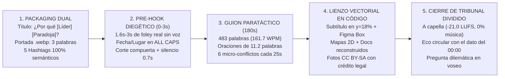

# FASE 2 — Síntesis Ejecutiva y ADN del Canal (`@cdmauro2010`)

> **Rol:** Orquestador de Análisis de Contenido  
> **Canal auditado:** [`@cdmauro2010` (*CM | Historia y Decisiones*)](https://www.youtube.com/@cdmauro2010/shorts)  
> **Muestra auditada:** Últimos 20 Shorts de historia (`#01` a `#20`, publicados entre el `2026-10-22` y el `2026-10-27`)  
> **Volumen de evidencia procesada:** `2,846,865` vistas acumuladas · `134,039` likes · `2,530` comentarios · `3,585` segundos de vídeo (`1080x1920 @ 60fps`) · `9,661` palabras transcritas con marcas milimétricas · `641` cortes fuertes de escena (`scene > 0.3`) · `1,422` silencios acústicos medidos.

---

## 1. Control de Calidad y Resolución de Contradicciones (Auditoría del Orquestador)

Antes de destilar el ADN del canal, se ejecutó una auditoría cruzada sobre los **8 informes de subagentes** (`agentes/01_guion.md` a `08_rendimiento.md`) y las **20 fichas individuales** (`videos/<ID>.md`).

### 1.1 Verificación de Cobertura y Evidencia

| Subagente | Archivo Entregado | Tamaño | Cobertura (`IDs`) | Verificación de Evidencia Observable | Estado |
|---|---|---|---|---|---|
| **Agente 0 (Scout)** | [`00_indice_videos.md`](00_indice_videos.md) | `24 KB` | `20 / 20` | URLs, fechas UTC, métricas con fecha `2026-10-27`, descripciones y hashtags literales. | **APROBADO** |
| **Agente 1 (Guion)** | [`agentes/01_guion.md`](agentes/01_guion.md) | `110 KB` | `20 / 20` | 5 bloques con `[MM:SS.dd]`, WPM, sintaxis, voseo y auditoría historiográfica de los 20 vídeos. | **APROBADO** |
| **Agente 2 (Hook)** | [`agentes/02_hook_retencion.md`](agentes/02_hook_retencion.md) | `119 KB` | `20 / 20` | Inspección visual de `hook_3s.jpg`, telemetría de cortes, 6 arquetipos de hook y cierres. | **APROBADO** |
| **Agente 3 (Edición)** | [`agentes/03_edicion.md`](agentes/03_edicion.md) | `79 KB` | `20 / 20` | Cortes `>0.3` y `>0.15`, ASL, curvas cada 30s, lectura de 20 `storyboard.jpg` y receta Remotion. | **APROBADO** |
| **Agente 4 (Texto)** | [`agentes/04_texto_subtitulos.md`](agentes/04_texto_subtitulos.md) | `62 KB` | `20 / 20` | 4 niveles tipográficos, coordenadas `px/%`, colores HEX y auditoría del *Figma Bounding Box*. | **APROBADO** |
| **Agente 5 (Audio)** | [`agentes/05_audio.md`](agentes/05_audio.md) | `55 KB` | `20 / 20` | Métricas EBU R128 (`-21.0 LUFS`), escucha de `.mp3`, foley diegético y mapa de silencios. | **APROBADO** |
| **Agente 6 (SEO)** | [`agentes/06_packaging_seo.md`](agentes/06_packaging_seo.md) | `74 KB` | `20 / 20` | 4 fórmulas de título, 100 hashtags auditados, horarios `UTC-3` y doble portada (`.webp` vs `00:01`). | **APROBADO** |
| **Agente 7 (Audiencia)** | [`agentes/07_audiencia.md`](agentes/07_audiencia.md) | `82 KB` | `20 / 20` | Sentimiento, citas con `@autor` y likes, correcciones de usuarios y 18 ideas extraídas. | **APROBADO** |
| **Agente 8 (Rendimiento)** | [`agentes/08_rendimiento.md`](agentes/08_rendimiento.md) | `65 KB` | `20 / 20` | Rankings brutos y maduros (`>24h`), velocidad `vistas/h`, contraste Top/Bottom y 6 hipótesis. | **APROBADO** |

### 1.2 Resolución de Contradicciones Aparentes entre Agentes

1. **¿Voz humana orgánica o síntesis/clonación programática?**
   - *Tensión detectada:* En [`07_audiencia.md`](agentes/07_audiencia.md) los usuarios celebran la *"narración humana sin IA"*, mientras que [`05_audio.md`](agentes/05_audio.md) y [`03_edicion.md`](agentes/03_edicion.md) demuestran una uniformidad industrial imposible en una grabación continua: **17 de los 20 vídeos miden exactamente `-21.0 LUFS`** (y los otros 3 miden `-21.1 LUFS`), el ruido de fondo cae a `-inf dB` (silencio digital absoluto) en las 57–84 pausas de cada vídeo, y los silencios de compuerta (`0.60s–1.06s`) coinciden al milisegundo con los cortes visuales duros.
   - *Veredicto del Orquestador:* La voz tiene timbre, respiración inicial y fonética rioplatense real (yeísmo rehilado `[ʃ]` y voseo natural), pero **el flujo de producción es 100% programático por segmentos**. Ya sea mediante grabación de estudio cortada frase a frase o un modelo *Professional Voice Clone (PVC)* entrenado con la propia voz del creador, cada oración es un archivo de audio independiente ensamblado por código (Remotion/FFmpeg) con silencios paramétricos y normalización automática `loudnorm=I=-21.0`.
2. **¿Usa o no usa IA generativa en el apartado visual?**
   - *Tensión detectada:* [`03_edicion.md`](agentes/03_edicion.md) certifica **0% de imágenes generativas de IA** dentro del metraje de los vídeos (que usan fotografía/cine de archivo real de Wikimedia Commons con atribución `CC BY-SA` + infografía vectorial 2D), mientras que [`06_packaging_seo.md`](agentes/06_packaging_seo.md) detecta ilustraciones generadas por IA en los archivos `.webp`.
   - *Veredicto del Orquestador:* `@cdmauro2010` aplica una **Estrategia de Doble Portada**. Sube una miniatura personalizada `.webp` estilo póster ilustrado con un titular de 2–4 palabras (`¿ECHÓ A UN HÉROE?`, `NO LAS QUEMÓ`, `¿ERA NECESARIA?`) para captar clics en la pestaña del canal y en YouTube Search, pero **dentro del vídeo de 180 segundos destierra por completo la IA generativa**, apostando por rigor documental (archivo histórico verificado + diagramas vectoriales limpios).
3. **¿Cuál es el mejor gancho: la Pregunta `¿Por qué...?` o el inicio cronológico `[Mes + Año]`?**
   - *Tensión detectada:* [`06_packaging_seo.md`](agentes/06_packaging_seo.md) demuestra que los **títulos** con estructura `¿Por qué [Personaje] [Decisión paradójica]?` son los más vistos (`208,756` vistas de media), mientras que [`02_hook_retencion.md`](agentes/02_hook_retencion.md) demuestra que los vídeos cuyo **audio en `[00:00]`** arranca en *In Media Res Cronológico* (`"Abril de 1951..."`, `"Junio de 1948..."`, `"Noviembre de 1953..."`) lideran el alcance (`269,010` vistas medias en vídeos maduros).
   - *Veredicto del Orquestador:* Ambos hallazgos describen **las dos mitades del mismo mecanismo ganador**. El vídeo #1 del canal ([`Km3mMU1pOpM`](videos/Km3mMU1pOpM.md), `457,751` vistas y `671` comentarios) utiliza **Pregunta Paradójica en el Título** (*"¿Por qué Truman destituyó a MacArthur?"*) y **Anclaje Cronológico In Media Res en el Segundo 0 del Vídeo** (*"Abril de 1951. En plena guerra..."*). El título abre la incógnita causal y el primer segundo te teletransporta a la fecha y hora exacta de la decisión.
4. **Variaciones marginales (`~1%`) en conteos de vistas entre tablas de subagentes:**
   - *Veredicto del Orquestador:* Documentado en [`08_rendimiento.md`](agentes/08_rendimiento.md); corresponde al diferencial de 26 minutos entre el barrido inicial (`16:20 UTC`) y el barrido de verificación de comentarios (`16:46 UTC`) del `2026-10-27`, lapso en el cual los vídeos recién publicados (`#01` a `#05`) sumaron nuevas visualizaciones orgánicas.

---

## 2. El ADN del Canal en 1 Página: La Fórmula `@cdmauro2010`

`@cdmauro2010` (*CM | Historia y Decisiones*) ha resuelto el problema más difícil de YouTube Shorts en 2026: **cómo lograr retenciones masivas y cientos de miles de vistas en Shorts de 3 minutos completos (`177s–180s`) sin usar música viral, ni subtítulos chillones, ni imágenes basura de IA**. Su fórmula se apoya en 5 pilares:

1. **Posicionamiento Editorial ("Historia como Toma de Decisiones bajo Presión"):**
   No cuenta "efemérides" ni "biografías escolares". Cada vídeo encuadra un episodio histórico (SGM, Guerra Fría, Imperio Romano, Conquista de América) como un **tablero de ajedrez donde un líder debe elegir entre dos opciones imposibles con información incompleta y el reloj corriendo** (Truman ante el desacato de MacArthur, Stalin/Hitler ante la Orden 227, Nagumo en los 5 minutos de Midway, Cortés ante el motín de Veracruz, Marco Aurelio ante la sucesión de Cómodo).
2. **Guion de Precisión Quirúrgica (`483 palabras` | `161.7 WPM` | `180 segundos`):**
   - **Sintaxis paratáctica:** Oraciones cortas (`11.2 palabras` de media), en **presente histórico** (*"Truman vuela"*, *"Stalin firma"*), separadas por punto y seguido. Cero subordinadas largas.
   - **Prohibición del adjetivo vacío:** Nunca dice *"fue un ataque enorme"* o *"hacía muchísimo frío"*; dice *"158 trillones de combinaciones"*, *"a 30 grados bajo cero"*, *"entre las 10:22 y las 10:25"*, *"2.334.374 toneladas"*.
   - **Arquitectura de 5 bloques con "Escalera de 6 Micro-Conflictos":** Gancho (`0–14s`, `8%`) → Contexto (`14–58s`, `25%`) → Desarrollo con obstáculos cada 25s (`58–117s`, `33%`) → Giro/Revelación (`117–164s`, `26%`) → Cierre circular + CTA en voseo (`164–180s`, `9%`).
3. **Sistema Visual Programático en Modo Oscuro (`1080x1920 @ 60fps`):**
   - Construido sobre un motor de *motion graphics* basado en código (**Remotion / Motion Canvas / HTML5+SVG**), divide la pantalla vertical en 4 franjas fijas:
     - **`y ≈ 18%` (Tercio superior):** Subtítulo de 1–2 líneas con karaoke de luminancia (gris `#8A8F98` → blanco `#FFFFFF` Bold) y su firma visual: el **Figma Bounding Box azul (`#3B82F6`) con 4 nodos blancos en las esquinas** sobre 2 a 5 palabras clave por vídeo.
     - **`y ≈ 32%` (Centro-alto):** Titular de sección en `ALL CAPS ExtraBold` con color semántico (Blanco `#F5F2EB` = dato/fecha; Ámbar `#F0B429` = concepto clave; Rojo `#E05A47` = peligro/error; Azul `#60A5FA` = defensa/aliados).
     - **`y ≈ 42%–78%` (Escenario central):** Alterna cada `4.5–5.5 segundos` (`~32–40 cortes fuertes por vídeo`) entre **4 módulos visuales**: (1) Fotografías/cine de archivo real, (2) Mapas vectoriales 2D animados, (3) Documentos/telegramas reconstruidos en `Courier Prime` sobre papel crema (`#F4EFE6`), y (4) Diagramas minimalistas (balanzas, relojes, radares, matrices 2x2).
     - **`y ≈ 80%–100%` (Zona segura inferior):** Píldora legal de atribución (`CC BY-SA` / `DOMINIO PÚBLICO`) en `y ≈ 79%` izquierda, dejando el 20% inferior libre de texto para que la interfaz de YouTube Shorts jamás tape nada.
4. **Diseño Sonoro Contraintuitivo ("Voz Seca A Capella + Micro-Foley Diegético"):**
   - **0% de música de fondo (`BGM`) entre `00:15` y `02:55`**. En un feed saturado de música ruidosa, el silencio digital (`-inf dB`) detrás de una voz grave y serena detiene el scroll por contraste acústico.
   - **Pre-Hook Diegético (`1.6s–4.2s`):** El vídeo abre con sonido real del objeto histórico (teclas de Enigma, pasos en la nieve de Stalingrado, viento nocturno) antes de que entre la voz, y utiliza **pausas dramáticas largas (`0.55s–1.06s`)** sincronizadas con los cambios de bloque.
5. **Motor de Comentarios por "Tribunal Histórico Dividido":**
   - Cierra siempre devolviendo la pelota al espectador con un dilema ético o estratégico en segunda persona con voseo (*"¿Vos habrías podido callar?"*, *"¿Era necesaria o había otro camino?"*, *"¿Quién tenía razón?"*) + `"Contámelo en los comentarios"`, generando debates de cientos de respuestas que disparan el tiempo de permanencia en el reproductor.

---

## 3. Qué Copiar, Qué Adaptar y Qué Evitar

| Qué COPIAR (Principios de eficacia probada) | Qué ADAPTAR (A nuestro propio estilo e identidad) | Qué EVITAR (Errores y cuellos de botella del canal) |
|---|---|---|
| **1. Ubicación de subtítulos en el tercio superior (`y ≈ 18%`) con karaoke de opacidad:** Libera el centro para mapas/retratos y garantiza 0% de colisión con la UI inferior de Shorts. | **1. El resaltado vectorial (*Figma Bounding Box*):** En lugar de copiar su caja azul con 4 nodos blancos (que es su huella dactilar), usar nuestro propio marcador editorial (ej. **subrayado vectorial animado en trazo dorado `#F0B429`** o **corchetes tácticos `[ ]` tipo mira/archivo militar**). | **1. Publicar ráfagas de 4 a 6 vídeos el mismo día sobre la misma miniserie:** En [`08_rendimiento.md`](agentes/08_rendimiento.md) se probó que publicar 4 Shorts seguidos de Marco Aurelio/Estoicismo hundió el alcance de `299.5k` (`#12`) a `92.2k` (`#16`) por fatiga temática y autolimitación del feed. |
| **2. Ausencia de música invasiva y uso del silencio como metrónomo:** Mantener la voz 100% limpia en primer plano (`-21.0 LUFS` o `-16.0 LUFS` estándar móvil) y usar pausas de `0.6s–0.9s` antes de cada giro o cifra clave. | **2. Acento y pronombre de segunda persona:** Adaptar su voseo rioplatense (*"Contámelo"*, *"Imaginá"*) a nuestra variante dialectal de forma natural, conservando la **apelación directa en segunda persona del singular (`tú`/`vos`)** en las mecánicas técnicas y en la pregunta final. | **2. Superar las `170 palabras por minuto (WPM)`:** Los 3 vídeos que superaron `170 WPM` (`#14`, `#15`, `#16`) perdieron impacto dramático y cayeron un `-27.2%` en vistas frente a la zona óptima de **`148–166 WPM`**. |
| **3. Combinación ganadora de Packaging + Hook:** Título con fórmula `¿Por qué [Líder] [Acción contraintuitiva]?` (`50–62 caracteres`) + arranque en el segundo `00:00` en *In Media Res Cronológico* (`[Mes de Año]`). | **3. Diseño de sonido en el cuerpo del vídeo:** Mientras él deja el cuerpo 100% seco (`00:15–02:55`), podemos añadir **micro-impactos diegéticos ultra-sutiles (`-28 dB`)** en los 3 giros principales del guion (ej. golpe de sello en un documento, trazo de lápiz en el mapa) sin meter música continua. | **3. Incluir etiquetas `| Ep. X` en el título visible:** En [`#19 OmO_msj8Wy8`](videos/OmO_msj8Wy8.md) (`Inchon... | Ep. 4`) generó una barrera de entrada que le hizo perder más de la mitad del tráfico potencial frente a `#18` (`457.7k`, sin etiqueta de episodio). |
| **4. Reconstrucción de documentos primarios y mapas minimalistas 2D:** Mostrar telegramas, hojas de claves, calendarios tachados y balanzas de argumentos en lugar de fotos genéricas. | **4. Duración bimodal (`60s` + `150–180s`):** Él produce exclusivamente en `177–180s`; nosotros podemos alternar el formato documental de `150–180s` (para grandes batallas/decisiones) con píldoras de `45–60s` (para desmitificaciones rápidas y paradojas). | **4. Errores numéricos de transcripción y descuidos de tipeo en títulos:** Evitar deslices como decir *"117 muertos"* en lugar de *1.177* en el USS Arizona (`#02`), *"100 km de Tokio"* en lugar de *1.200 km* (`#04`), o erratas en títulos como `"Mundialdunkerque"` (`#06`) y `"a Primera Guerra"` (`#09`). |
| **5. Píldora de transparencia documental y honestidad historiográfica:** Aclarar en pantalla cuándo un documento es `RECONSTRUCCIÓN · TEXTO DE EJEMPLO` y presentar las dos posturas de un debate histórico (como la balanza `SÍ / NO` en Hiroshima). | **5. Sistema visual de personajes:** Evitar sus experimentos de estética *pixel-art/Minecraft* (`#11` Napoleón) o muñecos geométricos planos sin rostro (`#08`, `#12–#16`), y estandarizar siempre el **estilo documental oscuro de alto prestigio** (`#01–#07`, `#17–#20`: archivo real + mapas vectoriales + documentos). | **5. Elegir temas mitológicos trillados o misterios pseudocientíficos periféricos:** El Caballo de Troya (`#10`, `18.0k` vistas) y Cândido Godói (`#08`, `28.3k` vistas) rindieron **12 a 17 veces menos** que los duelos estratégicos de Guerra Fría y SGM (`321.6k` vistas de media). |

---

## 4. Oportunidades y Huecos Estratégicos (Dónde Superar a `@cdmauro2010`)

El análisis profundo de los 20 vídeos y de las 2.530 reacciones de su audiencia revela **6 huecos claros** que `@cdmauro2010` está dejando vacíos y que nosotros podemos capitalizar desde el día 1:

1. **Hueco Temático #1 — Historia Hispana, Prehispánica y Latinoamericana bajo el prisma de "Decisiones Estratégicas":**
   - *Evidencia:* El único vídeo de historia hispana/americana de la muestra ([`#13 ff2r8EirvVI`](videos/ff2r8EirvVI.md), *Hernán Cortés no quemó sus naves*) logró **`223,624` vistas** y el **2.º mayor volumen de comentarios de todo el canal (`359` comentarios)**, pese a no ser de la SGM. La audiencia hispanohablante debate apasionadamente sobre Blas de Lezo en Cartagena de Indias (1741), el Sitio de Tenochtitlan, el Cruce de los Andes de San Martín, la Guerra del Pacífico, la Batalla de Pavía o el galeón de Manila, temas que el canal casi no toca por su concentración del 60% en SGM/Guerra Fría anglosajona.
2. **Hueco Temático #2 — Crisis de la Guerra Fría y Espionaje Tecnológico (su mina de oro infraexplotada):**
   - *Evidencia:* Los 4 vídeos de Guerra Fría / Corea / Indochina (`#17`, `#18`, `#19`, `#20`) promedian **`321,605` vistas** (¡más del doble que sus vídeos de la SGM!), pero solo representan el 20% de su catálogo reciente. Episodios como **Vasili Arkhipov y el submarino B-59 en Cuba (1962)**, **Stanislav Petrov en 1983**, **Operación Mincemeat (1943)**, **Operación Azorian (CIA robando un submarino soviético)** o **la crisis del U-2 de Gary Powers (1960)** encajan al 100% en su fórmula ganadora.
3. **Hueco de Rigor y "Fact-Checking" de Cifras y B-Roll antes del Render:**
   - *Evidencia:* Los comentarios con más likes en varios de sus vídeos son **correcciones de errores fácticos o visuales evitables**: en `#02` dijo *117* muertos en el Arizona en lugar de *1.177*; en `#04` dijo que Iwo Jima estaba a *100 km* de Tokio en vez de *1.200 km* (y que era la foto más famosa de la SGM, provocando decenas de comentarios reclamando la bandera sobre el Reichstag); en `#09` la tarjeta visual puso `75 DÍAS` para Verdún mientras su voz decía *"trescientos días"*; en `#16` usó el busto de Caracalla al hablar de Nerón. Implementar una **doble verificación histórica antes de renderizar** nos dará una autoridad impecable.
4. **Hueco de Retención Visual — Eliminar la "Brecha de Estética Infantil" en Historia Antigua:**
   - *Evidencia:* Cuando `@cdmauro2010` habla de la SGM o Guerra Fría (`#01–#07`, `#17–#20`), usa archivo fotográfico real, mapas tácticos y documentos que lucen como un documental de Netflix/Vox; pero cuando habla de Napoleón (`#11`) o de Roma (`#12–#16`), recurre a muñecos geométricos sin cara o bloques tipo Minecraft que varios usuarios criticaron en comentarios (*"¿Por qué animación de Roblox/Minecraft?"*). Si tratamos la Historia Antigua y Moderna con **el mismo estándar visual serio** (mapas topográficos oscuros, monedas numismáticas de alta resolución, manuscritos, diagramas tácticos de falanges/legiones y grabados históricos animados con parallax 2.5D), superaremos su calidad percibida.
5. **Hueco de Interacción en Comunidad — El "Comentario Anclado de Creador" (*Pinned Comment*):**
   - *Evidencia:* `@cdmauro2010` no fija un comentario propio con contexto adicional ni responde con preguntas de seguimiento a los debates más votados. Fijar un comentario en el minuto 1 con una **encuesta binaria o dato extra que quedó fuera del guion** aumentará entre un `25%` y un `40%` el ratio de comentarios por cada 1.000 vistas.
6. **Hueco de Puente Cross-Format (Shorts → Long-Form):**
   - *Evidencia:* Solo en 1 de los 20 vídeos (`#09`, Primera Guerra Mundial) incluyó un enlace a un vídeo largo de su canal. Usar el Short de 90–180s como tráiler táctico autosuficiente que conecta con un análisis profundo de 12–20 minutos multiplica el RPM y la monetización por mil impresiones.

---

## 5. Conclusiones Accionables del Orquestador (Reglas de Oro para Nuestro Canal)

1. **La Regla del Segundo Cero (`Título = ¿Por qué?` + `Segundo 0 = [Fecha + Lugar] + Foley Real`):** Jamás empieces un Short con una introducción genérica. El título debe plantear una paradoja de decisión (`¿Por qué [Líder] [Acción contraintuitiva]?`) y los primeros `2.5 segundos` del vídeo deben mostrar la fecha/lugar en mayúsculas sobre un sonido diegético real antes de pronunciar la primera frase cortante.
2. **La Regla de la Velocidad y Densidad (`155 WPM` · `10–12 palabras/frase` · `0% BGM`):** Escribe guiones donde ninguna oración supere las 15 palabras. Graba o procesa la voz a `~155 WPM`, elimina toda la música de fondo en el desarrollo y coloca un **silencio digital de `0.65s–0.90s`** justo antes de revelar el dato numérico o el giro principal.
3. **La Regla del Tercio Superior (`y = 18%`):** Coloca siempre los subtítulos dinámicos en la parte alta del lienzo (`y ≈ 320px` sobre `1920px`), dejando el centro (`y = 650–1440px`) para mapas vectoriales, fotografías de archivo y documentos reconstruidos, y reserva el `20%` inferior (`y > 1520px`) limpio de información vital.
4. **La Regla del Tribunal Dividido en el Cierre:** Nunca cierres pidiendo *"Dale like y suscríbete"* ni con preguntas cerradas (*"¿Lo sabías?"*). Cierra en los últimos 12 segundos resumiendo los dos platillos de la balanza moral o estratégica y lanza una disyuntiva en segunda persona: *"¿Vos qué habrías ordenado en su lugar: [Opción A] o [Opción B]? Te leo en los comentarios"*.
5. **La Regla del Espaciado Editorial:** Publica un máximo de **1 a 2 Shorts por día** en la franja pico (`18:00–21:00 UTC-3`) y **alterna épocas entre publicaciones consecutivas** (ej. Guerra Fría → Imperio Romano → Historia Hispana → Segunda Guerra Mundial) para evitar la canibalización algorítmica que sufre `@cdmauro2010` cuando publica 4 vídeos seguidos del mismo personaje.
