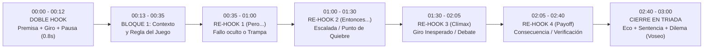

# 02. Análisis de Hook, Arquitectura de Retención y Cierres (`@cdmauro2010`)

> **Agente Responsable:** Agente 2 — Hook y Retención  
> **Muestra Analizada:** 20 YouTube Shorts (`177s`–`180s`, formato vertical `1080x1920 @ 60fps`)  
> **Fuentes Procesadas:** Transcripciones con marcas de tiempo al centésimo de segundo, telemetría de cortes por detección de umbral óptico (`scene > 0.3` para cortes duros y `scene > 0.15` incluyendo transiciones/animaciones internas), análisis acústico EBU R128 y mapeo de silencios (`<= -32 dB`), e inspección visual fotograma a fotograma de `hook_3s.jpg` (`00:01`–`00:03`) y `storyboard.jpg` (`00:00`–`02:55`).

---

## Resumen Ejecutivo del Mecanismo de Retención

El canal **CM | Historia y Decisiones (`@cdmauro2010`)** desafía la regla convencional de los Shorts de formato largo (`180s`): logra retener a cientos de miles de espectadores durante tres minutos completos **sin recurrir a la edición hiperquinética de TikTok** (su duración media de plano duro o *ASL* oscila entre `3.46s` y `10.53s`, con una media global de `5.42s`, y una cadencia vocal pausada de `148` a `180 WPM`).

Su retención descansa sobre tres pilares de ingeniería narrativa y audiovisual:
1. **Doble Hook escalonado (`00:00`–`00:03` y `00:03`–`00:12`):** Los primeros 3 segundos combinan una **premisa contraintuitiva o anclaje temporal *in media res*** con una **metáfora visual inmediata** (un contador numérico acelerando, un sello rojo de `HALT!` o `BLOQUEO`, una marea vaciándose en 2 segundos, o un recuadro azul de selección vectorial sobre la palabra clave del subtítulo). Entre `00:04` y `00:12`, el hook no empieza aún a narrar cronológicamente: **eleva la apuesta (*stakes*)**, destruye el mito común (*"Todos dicen que las quemó. No es cierto"*) y cierra con una **pausa dramática de silencio (`0.55s`–`1.06s`)** que actúa como compuerta hacia el relato.
2. **Escalera de micro-conflictos cada `20`–`25` segundos:** En lugar de cambiar de plano cada segundo, el guion inyecta conectores adversativos y de giro (*"Pero..."*, *"Entonces..."*, *"Del otro lado..."*, *"El problema era..."*) sincronizados con **micro-pausas acústicas (`>= 0.50s` a `<= -32 dB`)** y cambios de capa visual (paso de archivo histórico a mapa táctico o diagrama vectorial).
3. **Cierre en Triada («Eco Circular + Sentencia Filosófica + Dilema en Voseo»):** Entre `02:42` y `02:58`, todos los vídeos (salvo `#09`, que actúa como puente a un documental largo) regresan visual y verbalmente al elemento del segundo `00:01`, destilan una máxima universal sobre la toma de decisiones y lanzan una pregunta dicotómica en segunda persona rioplatense (*"¿Vos qué habrías hecho?"*), dejando entre `1.00s` y `4.76s` de cola acústica final para forzar la respuesta en comentarios o el bucle automático.

---

## 1. Fichas Individuales de los 20 Vídeos (`#01` al `#20`)

---

### #01 | `UsMkfLhccJM` — Enigma: Alan Turing y el equipo que descifró el código nazi
- **Métricas (`2026-10-27`):** Vistas: `2,540` | Likes: `223` | Comentarios: `1` | **Engagement:** `8.82%` (`0.39` com/1k vistas)
- **Clasificación del Hook:** **Pregunta Paradójica de Escala Numérica Imposible** (*How-to* frente a una magnitud inabarcable + restricción de tiempo).

#### A. Disección Quirúrgica del Hook (`[00:00]`–`[00:13.00]`)
- **Inspección visual (`[00:00]`–`[00:03]`, `hook_3s.jpg`):**
  - **Fondo:** Vídeo real de archivo/recreación en primer plano cenital-oblicuo de una máquina Enigma auténtica (`VIDEO · UNA ENIGMA REAL · Z22 · CC BY-SA 4.0`). En `00:01`, los dedos de un operador presionan una tecla metálica; en `00:02` y `00:03` se ven las teclas (`T`, `Z`, `G`, `H`) en foco y el panel de lámparas superior donde se iluminan letras (`F`, `C`).
  - **Texto en pantalla:**
    - *Subtítulo superior dinámico (blanco con palabra activa resaltada en brillo):* `00:01`: «¿Cómo se **rompe**» → `00:02`: «¿Cómo se rompe un código **con**» → `00:03`: «**158**».
    - *Titular central fijo:* **`ENIGMA`** en tipografía sans-serif mayúscula gruesa color crema, centrado sobre el panel de lámparas.
    - *Elemento gráfico reactivo (`00:03`):* Aparece sobre las teclas un contador numérico amarillo con borde negro (`017.407.874.577.000`) corriendo a alta velocidad para tangibilizar los trillones de combinaciones.
    - *Crédito inferior izquierdo:* Pastilla negra translúcida con texto blanco diminuto identificando la licencia CC.
- **Lo que se oye palabra por palabra y diseño sonoro (`[00:00]`–`[00:13.00]`):**
  - *Locución (`00:00`–`00:04.91`):* «¿Cómo se rompe un código con 158 trillones de combinaciones que además cambia cada medianoche?»
  - *Extensión del Hook (`00:04.92`–`00:13.00`):* «Los nazis creían que su máquina, Enigma, era imposible de romper. Un matemático de 27 años pensó lo contrario. Se llamaba Alan Turing.»
  - *Acústica y cortes del Hook:* Hay una ráfaga de micro-eventos ópticos en `scene > 0.15` entre `1.13s` y `4.93s` (`19` detecciones suaves provocadas por el contador numérico en rápido movimiento y el encendido de lámparas), seguidos de cortes duros en `4.93s`, `6.65s`, `10.90s` y `16.40s` (donde aparece el retrato de archivo de Alan Turing en Princeton con el rótulo amarillo `27 AÑOS`). Justo tras pronunciar «Se llamaba Alan Turing», el narrador ejecuta la **pausa dramática más larga de todo el vídeo (`0.90s` de silencio entre `15.53s` y `16.42s`)** antes de explicar cómo funciona la máquina.
- **Brecha de curiosidad (*Curiosity Gap*):** Enfrenta una cifra matemáticamente inabarcable (`158 trillones`) + un reinicio diario (`cada medianoche`) contra un individuo joven sin recursos aparentes (`un matemático de 27 años`). La promesa implícita es revelar el **truco lógico** exacto que derrotó a la fuerza bruta.

#### B. Puntos de Re-enganche (*Re-hooks*) y Ritmo (`180s`)
- **Métricas de corte (`digest_technical_cuts_audio.md`):** `41` cortes fuertes (`ASL 0.3 = 4.29s`, `2.28` cortes/10s) y `62` cortes totales incluyendo animaciones suaves (`ASL 0.15 = 2.86s`). Curva de cortes fuertes cada 30s muy estable: `0-30s: 7` | `30-60s: 8` | `60-90s: 6` | `90-120s: 8` | `120-150s: 7` | `150-180s: 5`.
- **Escalera de *Re-hooks* narrativos y visuales:**
  1. `[00:28.64]` **Re-hook de imposibilidad operativa:** «La clave cambia todos los días a medianoche. Lo que sirvió ayer, hoy no sirve.» (Acompañado de corte en `27.80s` a una hoja reconstruida de claves alemanas *GEHEIM! CLAVES DEL MES* con un reloj animado y pausa de `0.58s`).
  2. `[00:33.16]` **Re-hook de giro histórico (desmitificación):** «Los primeros en romperla fueron polacos.» (Corte en `32.65s` tras pausa de `0.61s`; rompe el cliché de que Turing empezó de cero).
  3. `[00:59.28]` **Re-hook de revelación del fallo técnico (*El Punto Débil*):** «Turing encuentra el punto débil de Enigma. Una letra nunca se cifra como sí misma...» (Corte en `57.85s` tras pausa de `0.61s` a un diagrama circular negro y dorado con la letra `A` en el centro y `[débil]` en recuadro azul).
  4. `[01:24.12]` **Re-hook de escalada de amenaza:** «Pero la marina alemana es más difícil y en el Atlántico sus submarinos cazan en manada...» (Corte en `83.77s` tras pausa de `0.65s` a mapa del Atlántico Norte con ruta `HALIFAX`–`LIVERPOOL` y siluetas rojas de U-Boots).
  5. `[01:54.44]` **Re-hook de crisis/oscuridad (*All is lost*):** «Pero en 1942 los submarinos agregan un cuarto rotor. Bletchley queda ciega 10 meses.» (Corte en `112.53s` tras pausa de `0.62s`).
  6. `[02:06.32]` **Re-hook de dilema moral/estratégico:** «Pero cada mensaje leído obliga a una decisión difícil: usarlo sin que los alemanes sospechen.» (Corte en `125.28s` a tarjeta *MENSAJE DESCIFRADO* con sello rojo `ULTRA ALTO SECRETO`).
  7. `[02:32.16]` **Re-hook trágico biográfico:** «Turing no llegó a verlo. En 1952 lo condenaron...» (Corte en `152.17s` a retrato de Turing en 1951 con etiqueta `1952`).

#### C. Análisis del Final (`[02:42]`–`[02:58]`)
- **Estructura de cierre:**
  - *Eco circular (`[02:42.48]`):* «158 trillones de combinaciones y las venció una letra que nunca podía ser ella misma y miles de personas que supieron callar.» Regresa exactamente al número del segundo `00:03` (`158 trillones`) y en pantalla (`172.05s`) vuelve al vídeo real de los rotores de la máquina Enigma del inicio.
  - *Pregunta de debate en voseo + CTA (`[02:52.04]`):* «¿Vos habrías podido callar tanto tiempo? Contámelo en los comentarios.» En pantalla aparece el rótulo gigante inferior **`¿VOS HABRÍAS PODIDO CALLAR?`** en blanco y amarillo. Tras el CTA quedan `1.80s` de cola final.

---

### #02 | `t89RDX8qolU` — Pearl Harbor 1941: la alerta del radar que fue ignorada
- **Métricas (`2026-10-27`):** Vistas: `6,092` | Likes: `629` | Comentarios: `12` | **Engagement:** `10.52%` (`1.97` com/1k vistas — *mayor % de engagement global de la muestra*)
- **Clasificación del Hook:** ***In Media Res* Cronológico + Paradoja de negligencia humana** (Lugar + Fecha exacta + advertencia ignorada).

#### A. Disección Quirúrgica del Hook (`[00:00]`–`[00:14.36]`)
- **Inspección visual (`[00:00]`–`[00:03]`, `hook_3s.jpg`):**
  - **Fondo:** Fotografía de archivo coloreada/iluminada (`FOTO DE ARCHIVO · ARCHIVO DE EE. UU. · DOMINIO PÚBLICO`) mostrando la colosal bola de fuego naranja y humo negro de la explosión de un acorazado en Pearl Harbor con un ligero *zoom-in* continuo.
  - **Texto en pantalla:**
    - *Subtítulo superior:* `00:01`: «Pearl **Harbor,**» → `00:02`: «Pearl Harbor, 7 **de**» → `00:03`: «de **1941.**».
    - *Etiqueta mecanografiada animada (`00:02`–`00:03`):* En el tercio superior izquierdo se despliega una cinta color crema con borde izquierdo rojo e inscripción en fuente *typewriter* negra que se escribe letra a letra: `7 DE DICIEMBRE DE 1` → `7 DE DICIEMBRE DE 1941`.
    - *Titular central-inferior:* **`PEARL HARBOR`** en mayúsculas monumentales color blanco hueso sobre el fuego.
- **Lo que se oye palabra por palabra y diseño sonoro (`[00:00]`–`[00:14.36]`):**
  - *Locución (`00:00`–`00:06.43`):* «Pearl Harbor, 7 de diciembre de 1941. Un radar ve llegar más de 100 aviones casi una hora antes del ataque.»
  - *Extensión del Hook (`00:06.44`–`00:14.36`):* «Avisan y les contestan, "No se preocupen." Esta es la historia de la alerta que nadie escuchó.»
  - *Acústica y cortes del Hook:* Cortes duros muy rápidos en el arranque (`0.03s`, `4.25s`, `8.50s`, `11.85s`, `13.37s`, `15.45s` — `12` cortes fuertes en los primeros `30s`, el arranque visualmente más rápido del canal). Incluye dos pausas dramáticas clave: `0.61s` (`11.34s`–`11.95s`) justo después de `"No se preocupen"`, y `0.70s` (`14.75s`–`15.45s`) tras «la alerta que nadie escuchó».
- **Brecha de curiosidad (*Curiosity Gap*):** Todo el mundo sabe que Pearl Harbor fue un ataque sorpresa, pero el hook revela que **no fue sorpresa técnica**: el radar los vio una hora antes. La brecha obliga a quedarse para responder: *¿Por qué un oficial diría "No se preocupen" ante más de 100 aviones japoneses?*

#### B. Puntos de Re-enganche (*Re-hooks*) y Ritmo (`180s`)
- **Métricas de corte (`digest_technical_cuts_audio.md`):** `46` cortes fuertes (`ASL 0.3 = 3.83s`, `2.56` cortes/10s) y `74` cortes totales (`ASL 0.15 = 2.40s`). Curva de cortes fuertes cada 30s bimodal (picos en el hook y en el clímax del ataque): `0-30s: 12` | `30-60s: 5` | `60-90s: 7` | `90-120s: 12` | `120-150s: 5` | `150-180s: 5`.
- **Escalera de *Re-hooks* narrativos y visuales:**
  1. `[00:26.48]` **Re-hook de plan maestro:** «El almirante Yamamoto propone un golpe por sorpresa...» (Corte en `26.33s` tras pausa de `0.51s`).
  2. `[00:44.28]` **Re-hook de ironía dramática:** «Washington sabía que algo venía. Desde hacía meses leía los mensajes cifrados de Japón.» (Corte en `44.25s` tras pausa de `0.64s`).
  3. `[00:57.40]` **Re-hook de decisión fatal contraproducente:** «Por eso los aviones se estacionan juntos ala con ala, para vigilarlos mejor.» (Corte en `58.70s`; prepara la tragedia posterior).
  4. `[01:10.96]` **Re-hook de primera alerta ignorada (6:45 AM):** «A las 6:45 el destructor Ward hunde un submarino japonés en la entrada del puerto... El aviso le llega tarde al almirante.» (Cortes en `67.87s` y `70.68s`).
  5. `[01:23.24]` **Re-hook central (7:02 AM, resolución del Hook):** «A las 7:02 en la punta norte de Oahu, dos soldados ven en su radar la mancha más grande que vieron nunca... Esa mañana llegan 12 bombarderos B-17 desde California. Les dice: "No se preocupen".» (Cortes en `81.48s`, `87.78s`, `95.38s` y pausa de `0.68s` en `100.62s` antes del grito *Tora, tora, tora*).
  6. `[01:54.04]` **Re-hook de impacto visceral (8:10 AM):** «A las 8:10, una bomba atraviesa la cubierta del Arizona... En segundos mueren 1.177 hombres.» (Pico de `12` cortes fuertes entre `90s` y `120s`).
  7. `[02:25.28]` **Re-hook de giro estratégico a largo plazo:** «Pero Japón falla en algo. Los portaaviones estadounidenses no estaban en el puerto.» (Corte en `144.65s`).

#### C. Análisis del Final (`[02:46]`–`[02:58]`)
- **Estructura de cierre:**
  - *Eco circular + Sentencia (`[02:46.68]`):* «La alerta sonó, el radar funcionó. Lo que faltó fue alguien que la creyera.» Sintetiza la tesis de que el fracaso de inteligencia rara vez es tecnológico, sino de sesgo de confirmación humano.
  - *Pregunta en voseo + CTA (`[02:51.88]`):* «¿Vos le hubieras creído al radar? Contámelo en los comentarios.» Seguido de una **cola silenciosa de `4.76s` (`175.05s`–`179.82s`)** donde la imagen permanece en pantalla mientras el espectador lee o abre la caja de comentarios.

---

### #03 | `Dn8s4cqsNCQ` — Hiroshima 1945: ¿era necesaria la bomba atómica? | Segunda Guerra Mundial
- **Métricas (`2026-10-27`):** Vistas: `58,214` | Likes: `3,628` | Comentarios: `311` | **Engagement:** `6.77%` (**`5.34` com/1k vistas — Récord absoluto de ratio de comentarios del canal**)
- **Clasificación del Hook:** ***In Media Res* Cronológico + Pregunta de Dilema Moral Abierto**.

#### A. Disección Quirúrgica del Hook (`[00:00]`–`[00:15.80]`)
- **Inspección visual (`[00:00]`–`[00:03]`, `hook_3s.jpg`):**
  - **Fondo:** Película de archivo en blanco y negro (`PELÍCULA DE ARCHIVO · «TALE OF TWO CITIES», EJÉRCITO DE EE. UU., 1946 · DOMINIO PÚBLICO`) encuadrada en formato horizontal central sobre fondo negro difuminado, mostrando al bombardero B-29 *Enola Gay* (cola `05`) volando de derecha a izquierda sobre un mar de nubes.
  - **Texto en pantalla:**
    - *Subtítulo superior:* `00:01`: «**Hiroshima,**» → `00:02`: «Hiroshima, 6 de **agosto**» → `00:03`: «**1945.**».
    - *Etiqueta mecanografiada (`00:02`–`00:03`):* Cinta crema con borde izquierdo rojo: `6 DE AGOSTO DE 1945`.
    - *Titular central:* **`HIROSHIMA`** en mayúsculas grandes color crema justo encima del fuselaje del B-29.
- **Lo que se oye palabra por palabra y diseño sonoro (`[00:00]`–`[00:15.80]`):**
  - *Locución (`00:00`–`00:06.95`):* «Hiroshima, 6 de agosto de 1945. Una sola bomba borra una ciudad entera.»
  - *Extensión del Hook (`00:06.96`–`00:15.80`):* «80 años después seguimos discutiendo lo mismo. ¿Era necesaria? Para responder hay que ponerse en el lugar de quien decidía, con lo que se sabía en julio de 1945.»
  - *Acústica y cortes del Hook:* En `4.50s`–`6.82s` corta del avión al hongo atómico; tras preguntar «¿Era necesaria?», deja una pausa dramática de `0.55s` (`10.74s`–`11.29s`) sincronizada con el corte duro en `11.28s`.
- **Brecha de curiosidad (*Curiosity Gap*):** En lugar de dar una respuesta dogmática, plantea un **ejercicio de empatía estratégica con información incompleta** («con lo que se sabía en julio de 1945»). Promete darle al espectador las cartas de ambos bandos para que él mismo sea el juez.

#### B. Puntos de Re-enganche (*Re-hooks*) y Ritmo (`180s`)
- **Métricas de corte (`digest_technical_cuts_audio.md`):** `39` cortes fuertes (`ASL 0.3 = 4.50s`, `2.17` cortes/10s) y `45` cortes totales (`ASL 0.15 = 3.91s`). Curva cada 30s (`scene > 0.3`): `0-30s: 10` | `30-60s: 6` | `60-90s: 8` | `90-120s: 5` | `120-150s: 5` | `150-180s: 5`.
- **Escalera de *Re-hooks* narrativos y visuales:**
  1. `[00:29.88]` **Re-hook del escenario alternativo (*Operación Downfall*):** «El paso siguiente era invadir Japón... Los cálculos de bajas iban de decenas de miles a más de un millón... y en Kyushu había el doble de soldados de lo previsto.» (Corte en `29.68s`).
  2. `[00:53.20]` **Re-hook del factor atómico + error de traducción (*Mokusatsu*):** «El 16 de julio en el desierto de Nuevo México explota la primera bomba atómica... Tokio contesta con una palabra ambigua, *Mokusatsu*, que puede leerse "Lo ignoramos".» (Cortes en `53.20s`, `58.08s`, `64.38s` y pausa de `0.58s` en `69.48s`).
  3. `[01:28.24]` **Re-hook del factor soviético:** «El 8 de agosto la Unión Soviética le declara la guerra a Japón y al otro día invade Manchuria.» (Corte en `88.25s` tras pausa de `0.54s`).
  4. `[01:43.00]` **Gran Re-hook estructural (Mitad exacta del vídeo — El Juicio Histórico):** «¿Entonces, la bomba terminó la guerra? Acá empieza la discusión. Los que dicen que sí...» (Pausa de `0.56s` en `102.97s` + corte en `103.53s` + segunda pausa de `0.60s` en `105.46s`).
  5. `[01:58.64]` **Re-hook de contrapeso (*Los que dicen que no*):** «Los que dicen que no: Japón ya estaba derrotado... Hay historiadores que creen que lo que más asustó a Tokio no fue la bomba, sino la entrada de la Unión Soviética.» (Corte en `118.73s` tras pausa de `0.55s`).
  6. `[02:28.28]` **Re-hook geopolítico oculto:** «Otros ven otra razón: mostrarle a Stalin el arma nueva que tenía Estados Unidos.» (Corte en `146.50s` tras pausa de `0.60s`).

#### C. Análisis del Final (`[02:41]`–`[02:58]`)
- **Estructura de cierre:**
  - *Sentencia de humildad epistemológica + Imagen icónica (`[02:36.88]`–`[02:48.04]`):* «Fue una decisión con información incompleta mientras la guerra seguía matando cada día... En Hiroshima quedó en pie una cúpula, el recuerdo de lo que cuesta una decisión así.» Pausa dramática de `0.76s` (`169.58s`–`170.34s`).
  - *Eco circular de la pregunta del Hook + CTA (`[02:50.68]`):* «¿Vos qué pensás? ¿Era necesaria o había otro camino? Contámelo en los comentarios.» Cierra con `4.75s` de silencio final (`175.06s`–`179.82s`). Al haber dado argumentos de peso a ambas posturas sin tomar partido, dispara `311` comentarios con debates largos entre usuarios.

---

### #04 | `4VT2qvIRUkg` — Iwo Jima 1945: la historia detrás de la foto y la segunda bandera
- **Métricas (`2026-10-27`):** Vistas: `17,171` | Likes: `1,503` | Comentarios: `11` | **Engagement:** `8.82%` (`0.64` com/1k vistas)
- **Clasificación del Hook:** **Desmitificación Visual Directa (Icono Cultural + Triada de Mentiras/Errores)**.

#### A. Disección Quirúrgica del Hook (`[00:00]`–`[00:14.00]`)
- **Inspección visual (`[00:00]`–`[00:03]`, `hook_3s.jpg`):**
  - **Fondo:** Película de archivo original **en color** (`PELÍCULA DE ARCHIVO · BILL GENAUST, USMC, 23-2-1945 · DOMINIO PÚBLICO`) mostrando el mástil de la bandera estadounidense levantándose contra el cielo azul de Iwo Jima. Usar el metraje en movimiento en color en vez de la foto fija en blanco y negro ya genera un choque perceptivo inmediato.
  - **Texto en pantalla:**
    - *Subtítulo superior con caja de selección azul:* `00:01`: «Esta **es**» → `00:02`: «Esta es la `[foto]` más **famosa**» (la palabra `foto` aparece enmarcada dentro de un **rectángulo azul de nodos de edición vectorial**) → `00:03`: «de la Segunda **Guerra**».
    - *Titular central-inferior (`00:02`–`00:03`):* **`23 DE FEBRERO DE 1945`** en tipografía blanca limpia.
- **Lo que se oye palabra por palabra y diseño sonoro (`[00:00]`–`[00:14.00]`):**
  - *Locución (`00:00`–`00:05.00`):* «Esta es la foto más famosa de la Segunda Guerra Mundial y cuenta solo la mitad de la verdad.»
  - *Extensión del Hook (`00:05.00`–`00:14.00`):* «No es la primera bandera, la batalla no estaba ganada y durante 70 años nos equivocamos de nombres. Iwo Jima, febrero de 1945.»
  - *Acústica y cortes del Hook:* Cada una de las tres afirmaciones rompedoras va acompañada de su propio corte duro (`3.45s`, `5.85s`, `7.38s`, `9.62s`, `13.05s`) y cierra el bloque de hook con una **pausa dramática de `1.05s` (`12.01s`–`13.07s`)** antes de pronunciar «Iwo Jima, febrero de 1945».
- **Brecha de curiosidad (*Curiosity Gap*):** Planta una **lista numerada implícita de 3 misterios** sobre una imagen que todo espectador cree conocer: 1) ¿Por qué hubo otra bandera antes?, 2) ¿Qué pasó con los soldados después de la foto?, 3) ¿Cómo pudieron equivocarse de nombres durante 70 años?

#### B. Puntos de Re-enganche (*Re-hooks*) y Ritmo (`180s`)
- **Métricas de corte (`digest_technical_cuts_audio.md`):** `36` cortes fuertes (`ASL 0.3 = 4.86s`, `2.00` cortes/10s) y `47` cortes totales (`ASL 0.15 = 3.75s`). Curva cada 30s (`scene > 0.3`): `0-30s: 5` | `30-60s: 6` | `60-90s: 8` | `90-120s: 7` | `120-150s: 6` | `150-180s: 4`.
- **Escalera de *Re-hooks* narrativos y visuales:**
  1. `[00:27.32]` **Re-hook de expectativa rota:** «Los generales calculan que la van a tomar en una semana, pero el general japonés Kuribayashi preparó algo distinto: 21.000 soldados escondidos bajo tierra...» (Corte en `30.17s`).
  2. `[00:48.48]` **Re-hook de trampa táctica:** «Al principio silencio, y cuando la playa se llena, los cañones escondidos abren fuego.» (Cortes en `48.13s` y `51.45s`).
  3. `[01:15.48]` **Re-hook de revelación anecdótica:** «Pero esa bandera es chica... Y el secretario de la Marina, que está en la playa, la quiere de recuerdo, así que un coronel manda subir otra más grande.» (Cortes en `74.68s`, `77.65s`, `81.30s`).
  4. `[01:45.50]` **Re-hook estructural #1 (*Primera media verdad*):** «Primera media verdad: no es la primera bandera, es el reemplazo... La película en color lo desmiente.» (Pausa de `0.99s` en `105.29s`–`106.27s` + corte en `106.25s`).
  5. `[02:01.80]` **Re-hook estructural #2 (*Segunda media verdad*):** «Segunda media verdad: la foto parece una victoria, pero la batalla recién empezaba... De los seis hombres de la foto, tres murieron en la isla.» (Pausa de `1.03s` en `120.74s`–`121.77s` + corte en `121.77s`).
  6. `[02:19.40]` **Re-hook estructural #3 (*Tercera media verdad*):** «Tercera media verdad: los nombres. Durante décadas se honró a hombres que no estaban en la foto. En 2016 y en 2019 los marines lo corrigieron.» (Pausa de `1.09s` en `138.30s`–`139.39s` + corte en `139.37s`).

#### C. Análisis del Final (`[02:44]`–`[02:59]`)
- **Estructura de cierre:**
  - *Sentencia de síntesis (`[02:44.50]`):* «La foto no mintió, mostró un instante real. Lo que mintió a medias fue la historia que le pusimos alrededor.» (Pausa de `0.69s` en `170.86s` + corte en `171.53s`).
  - *Pregunta reflexiva en voseo + CTA (`[02:50.32]`):* «¿Vos qué crees? ¿Una sola foto puede contar la verdad de una guerra? Contámelo en los comentarios.» Seguido de `3.15s` de silencio final (`176.67s`–`179.82s`).

---

### #05 | `lYVMDblBX3Y` — Midway 1942: los minutos que cambiaron la guerra del Pacífico
- **Métricas (`2026-10-27`):** Vistas: `170,248` | Likes: `7,867` | Comentarios: `82` | **Engagement:** `4.67%` (`0.48` com/1k vistas)
- **Clasificación del Hook:** **Pregunta de Compresión Temporal Extrema + Detalle Causal Inesperado («El mensaje del agua»)**.

#### A. Disección Quirúrgica del Hook (`[00:00]`–`[00:11.00]`)
- **Inspección visual (`[00:00]`–`[00:03]`, `hook_3s.jpg`):**
  - **Fondo:** Película de archivo en color de John Ford (`PELÍCULA DE ARCHIVO · «THE BATTLE OF MIDWAY», JOHN FORD, 1942 · DOMINIO PÚBLICO`). En `00:01` y `00:02` un bombardero estadounidense despega/vuela a ras del mar; en `00:03` (corte duro en `1.85s`/`3.30s`) estalla una densa columna de humo negro.
  - **Texto en pantalla:**
    - *Subtítulo superior con caja azul:* `00:01`: «¿Cómo se **pierde**» → `00:02`: «**solo**» → `00:03`: «solo cinco `[minutos?]`» (con recuadro azul de selección sobre `minutos?`).
    - *Elemento gráfico central-inferior:* Un **reloj digital/mecánico en caja negra con borde y dígitos rojos** que marca `10:22` en `00:01`–`00:02` y salta a `10:25` en `00:03`, visualizando el lapso fatal de 5 minutos.
- **Lo que se oye palabra por palabra y diseño sonoro (`[00:00]`–`[00:11.00]`):**
  - *Locución (`00:00`–`00:05.11`):* «¿Cómo se pierde una guerra en solo 5 minutos?» (Pausa dramática de `0.58s` entre `2.82s` y `3.40s` justo después de «5 minutos»).
  - *Extensión del Hook (`00:05.12`–`00:11.00`):* «En Midway, Japón perdió tres portaaviones casi al mismo tiempo y todo empezó con un mensaje falso sobre el agua.» (Cierra el hook con una **pausa dramática de `0.86s` en `10.21s`–`11.07s`** antes de decir «Junio de 1942»).
- **Brecha de curiosidad (*Curiosity Gap*):** Combina un **macro-efecto desproporcionado** (perder una guerra y tres portaaviones en 5 minutos) con una **micro-causa cotidiana aparentemente absurda** («un mensaje falso sobre el agua»). El espectador necesita entender qué tiene que ver el agua potable con hundir tres portaaviones.

#### B. Puntos de Re-enganche (*Re-hooks*) y Ritmo (`180s`)
- **Métricas de corte (`digest_technical_cuts_audio.md`):** `25` cortes fuertes (`ASL 0.3 = 6.92s`, `1.39` cortes/10s) y `38` cortes totales (`ASL 0.15 = 4.62s`). Curva cada 30s (`scene > 0.3`): `0-30s: 6` | `30-60s: 2` | `60-90s: 5` | `90-120s: 5` | `120-150s: 5` | `150-180s: 2`.
- **Escalera de *Re-hooks* narrativos y visuales:**
  1. `[00:29.50]` **Re-hook de misterio criptográfico (*El objetivo AF*):** «Saben que viene un gran ataque contra un objetivo llamado AF, pero no saben qué es AF.» (Corte en `28.65s` tras pausa de `0.51s`).
  2. `[00:40.00]` **Re-hook de resolución del primer bucle (La trampa del agua):** «Entonces, el comandante Rochefort inventa un truco: hacen que Midway mande un mensaje sin cifrar: "Se rompió la planta de agua". Poco después, los japoneses informan: "AF tiene poca agua".» (Corte en `43.93s` y pausa de `0.57s` en `48.21s`).
  3. `[01:11.84]` **Re-hook de indecisión fatal (El dilema de Nagumo):** «El almirante Nagumo decide atacarla otra vez y manda a cambiar los torpedos de sus aviones por bombas. Y justo entonces le avisan: hay barcos enemigos cerca. Nagumo cambia de idea: otra vez torpedos.» (Cortes en `70.50s` y `71.33s`).
  4. `[01:38.56]` **Re-hook de sacrificio con giro inesperado:** «De un escuadrón entero de 15 aviones, sobrevive un solo piloto. Parece un desastre, pero ese sacrificio tiene un efecto inesperado: los cazas japoneses bajan al nivel del mar y el cielo de arriba queda vacío.» (Corte en `99.45s`).
  5. `[01:48.96]` **Re-hook de clímax (10:20 AM — Los 5 minutos):** «A las 10:20 llegan los bombarderos en picada... En cinco minutos, tres de los cuatro portaaviones japoneses están en llamas.» (Pausa de `0.59s` en `108.38s` + corte en `108.97s`).

#### C. Análisis del Final (`[02:37]`–`[02:58]`)
- **Estructura de cierre:**
  - *Sentencia estratégica (`[02:42.50]`):* «Nagumo perdió por dudar en el peor momento. Cambiar de idea dos veces le costó todo.» (Pausa de `0.58s` en `169.03s` + corte en `169.62s`).
  - *Pregunta de dilema táctico en voseo + CTA (`[02:48.50]`):* «¿Vos qué hubieras hecho en su lugar? ¿Atacar ya con lo que tenías o esperar a estar listo? Contámelo en los comentarios.» Cierra con `4.09s` de cola silenciosa (`175.53s`–`179.64s`).

---

### #06 | `KCrSmZt-A0w` — Dunkerque 1940: ¿por qué Hitler frenó los tanques? | Segunda Guerra Mundial
- **Métricas (`2026-10-27`):** Vistas: `64,786` | Likes: `3,165` | Comentarios: `75` | **Engagement:** `5.00%` (`1.16` com/1k vistas)
- **Clasificación del Hook:** **Pregunta de Error Estratégico Inexplicable (*Por qué el vencedor se detuvo a centímetros del triunfo*)**.

#### A. Disección Quirúrgica del Hook (`[00:00]`–`[00:16.56]`)
- **Inspección visual (`[00:00]`–`[00:03]`, `hook_3s.jpg`):**
  - **Fondo en Pantalla Dividida Horizontal (*Split-Screen*):**
    - *Mitad superior:* Película de archivo oscura de un tanque alemán disparando una llamarada (`LOS TANQUES` en `00:01`). En `00:02` y `00:03`, el vídeo superior se tiñe de azul oscuro y **se estampa un sello militar rojo inclinado con textura desgastada: `HALT! ¡ALTO!`**.
    - *Mitad inferior:* Fotografía de archivo en sepia/blanco y negro de la playa y paseo marítimo de Dunkerque llenos de cañones antiaéreos destruidos, escombros y cadáveres.
  - **Texto en pantalla:**
    - *Subtítulo superior:* `00:01`: «¿Por qué **Hitler**» → `00:02`: «**tanques,**» → `00:03`: «tanques, cuando tenía **al**».
- **Lo que se oye palabra por palabra y diseño sonoro (`[00:00]`–`[00:16.56]`):**
  - *Locución (`00:00`–`00:03.55`):* «¿Por qué Hitler frenó a sus tanques cuando tenía al ejército británico atrapado contra el mar?» (Pausa dramática de `0.57s` en `4.67s`–`5.24s` + corte duro en `5.13s`).
  - *Extensión del Hook (`00:05.76`–`00:16.56`):* «Esos días de pausa salvaron a más de 300.000 soldados y probablemente cambiaron el destino de la guerra. Esto es Dunkerque, mayo de 1940.» (Pausa de `0.56s` en `11.79s` y pausa de `0.63s` en `16.01s`–`16.64s` + corte en `16.65s`).
- **Brecha de curiosidad (*Curiosity Gap*):** Presenta la decisión más contraintuitiva de la Segunda Guerra Mundial: tener al enemigo acorralado contra el agua y ordenar parar. Promete desglosar la anatomía exacta de ese error.

#### B. Puntos de Re-enganche (*Re-hooks*) y Ritmo (`178s`)
- **Métricas de corte (`digest_technical_cuts_audio.md`):** `37` cortes fuertes (`ASL 0.3 = 4.68s`, `2.08` cortes/10s) y `44` cortes totales (`ASL 0.15 = 3.96s`). Curva cada 30s (`scene > 0.3`): `0-30s: 5` | `30-60s: 7` | `60-90s: 6` | `90-120s: 8` | `120-150s: 5` | `150-180s: 6`.
- **Escalera de *Re-hooks* narrativos y visuales:**
  1. `[00:21.50]` **Re-hook de engaño táctico (*El corte de hoz*):** «Pero era una trampa. El golpe principal venía por otro lado, por el bosque de las Ardenas. Ese bosque parecía imposible para tanques. Pasaron más de 1.000.» (Corte en `27.70s` tras pausa de `0.56s`).
  2. `[00:48.76]` **Re-hook de clímax de la pregunta (La orden del 24 de mayo):** «El 24 de mayo, los tanques de Guderian están a unos 20 km y entonces llega la orden: ¡Alto! ... ¿Por qué? Hay cuatro razones y ninguna alcanza sola.» (Cortes en `47.48s`, `53.82s`, `57.58s` con tres pausas de `~0.56s–0.60s`).
  3. `[01:00.00]`–`[01:31.40]` **Matriz enumerada de 4 razones (Retención por completitud):** «Primera: los tanques estaban gastados... Segunda: Göring le prometió a Hitler... Tercera: el miedo... Y cuarta: Hitler quería mostrar quién mandaba.» (Un corte duro por cada razón: `61.58s`, `68.45s`, `73.05s`, `78.58s`, `85.62s`).
  4. `[01:48.08]` **Re-hook épico civil (*Los pequeños barcos*):** «Los barcos grandes no pueden acercarse a la arena. Gran Bretaña le pide ayuda a su gente: pescadores, barcos de paseo, botes de remo.» (Cortes en `105.33s`, `110.50s`, `114.05s`).
  5. `[02:11.64]` **Re-hook de ventana cerrada:** «El 26 de mayo, Hitler levanta la orden, pero ya es tarde.» (Corte en `138.00s` tras pausa de `0.54s`).

#### C. Análisis del Final (`[02:46]`–`[02:58]`)
- **Estructura de cierre:**
  - *Eco circular de las causas (`[02:46.32]`):* «Hitler frenó por cansancio, por confianza y por orgullo. Y una pausa de dos días cambió la guerra.»
  - *Pregunta de ponderación en voseo + CTA (`[02:52.00]`):* «¿Vos qué crees que pesó más en su decisión? Contámelo en los comentarios.» (Facilita muchísimo comentar porque el espectador solo tiene que elegir una de las 4 razones recién explicadas; logra `75` comentarios).

---

### #07 | `yeMKOTtYlWU` — Stalingrado en 3 minutos: «Ni un paso atrás» | Segunda Guerra Mundial
- **Métricas (`2026-10-27`):** Vistas: `71,565` | Likes: `3,885` | Comentarios: `87` | **Engagement:** `5.55%` (`1.22` com/1k vistas)
- **Clasificación del Hook:** **Contraste Simétrico / Espejo Táctico (*La misma orden dada por dos enemigos con resultados opuestos*)**.

#### A. Disección Quirúrgica del Hook (`[00:00]`–`[00:15.60]`)
- **Inspección visual (`[00:00]`–`[00:03]`, `hook_3s.jpg`):**
  - **Fondo:** Mapa táctico vectorial propio sobre fondo verde oliva/caqui reticulado, mostrando el río Volga, el Mar Negro y el Mar Caspio. Un nodo circular brillante naranja late junto a la etiqueta oscura **`STALINGRADO`** mientras dos gruesas flechas marrón oscuro con núcleo luminoso avanzan hacia la ciudad al mismo tiempo que la cámara hace *zoom-in* continuo (`00:01` a `00:03`).
  - **Texto en pantalla:**
    - *Subtítulo superior:* `00:01`: «Stalin» → `00:02`: «Stalin dio una **orden:**» → `00:03`: «**paso**».
- **Lo que se oye palabra por palabra y diseño sonoro (`[00:00]`–`[00:15.60]`):**
  - *Locución (`00:00`–`00:06.03`):* «Stalin dio una orden: ni un paso atrás. Meses después, Hitler dio exactamente la misma.» (Cortes duros en `3.53s` y `6.73s`).
  - *Extensión del Hook (`00:06.04`–`00:15.60`):* «Una salvó a su ejército, la otra lo enterró en la nieve. Esto es Stalingrado, la batalla que dio vuelta a la Segunda Guerra Mundial.» (Cierra el hook con una **pausa dramática de `1.03s` entre `14.66s` y `15.69s`** + corte duro en `15.68s` antes de «Verano de 1942»).
- **Brecha de curiosidad (*Curiosity Gap*):** Construye una simetría perfecta: **1 orden idéntica («Ni un paso atrás») = 2 destinos opuestos (salvación vs aniquilación)**. La audiencia se queda para descubrir por qué funcionó para Stalin y destruyó a Hitler.

#### B. Puntos de Re-enganche (*Re-hooks*) y Ritmo (`180s`)
- **Métricas de corte (`digest_technical_cuts_audio.md`):** **`51` cortes fuertes (`ASL 0.3 = 3.46s`, `2.83` cortes/10s — el ritmo de cortes duros más alto de los 20 vídeos)** y `122` eventos totales en `scene > 0.15` (`ASL 0.15 = 1.46s`, impulsado por las animaciones de pinzas en el mapa durante la Operación Urano entre `90s` y `125s`). Curva cada 30s (`scene > 0.3`): `0-30s: 5` | `30-60s: 7` | `60-90s: 12` | `90-120s: 6` | `120-150s: 14` | `150-180s: 7`.
- **Escalera de *Re-hooks* narrativos y visuales:**
  1. `[00:44.00]` **Re-hook de cambio de naturaleza del combate:** «Ya no se defiende un mapa, se defiende una ciudad con gente adentro.» (Corte en `43.30s`).
  2. `[00:59.76]` **Re-hook de táctica contraintuitiva (*Abrazar al enemigo*):** «Chuikov tiene un problema: los aviones alemanes dominan el cielo. Su respuesta: abrazar al enemigo, pelear tan cerca que los aviones no puedan bombardear sin pegarle a los suyos.» (Corte en `59.00s` tras pausa de `0.53s`).
  3. `[01:29.88]` **Re-hook del gran giro (*Operación Urano*):** «En noviembre, los alemanes tienen casi toda la ciudad. Casi, porque mientras todos miran las ruinas, el general Zhukov prepara otra cosa.» (Pausa de `0.54s` en `92.66s` + corte a mapa animado en `98.40s` con ráfaga de frames de las pinzas soviéticas cerrándose).
  4. `[01:53.50]` **Re-hook de espejo (La segunda orden):** «Paulus pide permiso para romper el cerco. Hitler responde: "Ni un paso atrás".» (Corte en `113.53s` tras pausa de `0.53s`).
  5. `[02:15.60]` **Re-hook de ironía psicológica final:** «El 30 de enero, Hitler nombra a Paulus mariscal. Ningún mariscal alemán se había rendido jamás. Al día siguiente, Paulus se rinde.» (Cortes rápidos entre `134.57s` y `143.37s`).

#### C. Análisis del Final (`[02:33]`–`[02:59]`)
- **Estructura de cierre:**
  - *Eco circular + Sentencia estratégica (`[02:33.80]`–`[02:50.96]`):* «La misma orden, dos resultados. Unos resistieron con un plan; los otros, sin salida, por orden de alguien que estaba muy lejos... Resistir no siempre es valentía. A veces, lo más difícil es saber cuándo retroceder.»
  - *Pregunta de dilema en voseo + CTA (`[02:51.50]`):* «¿Vos qué hubieras hecho en el lugar de Paulus? ¿Obedecer o romper el cerco? Contámelo en los comentarios.» (Pausa previa de `0.51s` en `171.66s` + corte en `172.18s` y cola silenciosa de `2.13s`).

---

### #08 | `VKEIpXxGMVk` — Cândido Godói: el pueblo de los gemelos y la teoría sobre Mengele
- **Métricas (`2026-10-27`):** Vistas: `28,297` | Likes: `2,035` | Comentarios: `10` | **Engagement:** `7.23%` (`0.35` com/1k vistas)
- **Clasificación del Hook:** **Hipótesis Inmersiva en 2ª Persona (`Imaginá...`) + Anomalía Estadística + Villano Histórico (Mengele)**.

#### A. Disección Quirúrgica del Hook (`[00:00]`–`[00:13.12]`)
- **Inspección visual (`[00:00]`–`[00:03]`, `hook_3s.jpg`):**
  - **Fondo:** Ilustración vectorial 2D minimalista de estilo *flat design*. Un camino de tierra atraviesa colinas verdes flanqueadas por casas de entramado alemán y una iglesia de torre blanca. Sobre el camino aparecen **pares de muñecos gemelos idénticos** (rubios y castaños, vestidos de a dos en rojo, amarillo, verde y violeta) que se multiplican geométricamente de `00:01` (1 par) a `00:02` (4 pares) y `00:03` (multitud de gemelos avanzando hacia cámara).
  - **Texto en pantalla:**
    - *Subtítulo superior:* `00:01`: «Imaginá **vivir**» → `00:02`: «**donde,**» → `00:03`: «donde, en algunas **calles,**». (Sin rótulo central en los primeros 3s para dejar limpia la multiplicación visual de gemelos; en `13.20s` entra el mapa de Rio Grande do Sul con el titular `CÂNDIDO GODÓI`).
- **Lo que se oye palabra por palabra y diseño sonoro (`[00:00]`–`[00:13.12]`):**
  - *Locución (`00:00`–`00:04.91`):* «Imaginá vivir en un pueblo donde, en algunas calles, uno de cada 10 bebés nace con un gemelo.» (Corte en `3.62s` y `6.12s`).
  - *Extensión del Hook (`00:04.92`–`00:13.12`):* «Durante años el mundo culpó a un solo hombre: Josef Mengele, el médico nazi de Auschwitz.» (Corte en `8.15s` a silueta oscura con sombrero e iluminación siniestra, cerrando el hook con una **pausa dramática de `0.87s` entre `12.35s` y `13.22s`** + corte en `13.20s`).
- **Brecha de curiosidad (*Curiosity Gap*):** Conecta un fenómeno biológico real y verificable (`1 de cada 10 partos son gemelos`, frente a `1 de cada 80` en el mundo) con el fugitivo nazi más infame de Sudamérica. El verbo en pasado («Durante años el mundo culpó...») ya insinúa que hay un giro científico detrás del mito.

#### B. Puntos de Re-enganche (*Re-hooks*) y Ritmo (`178s`)
- **Métricas de corte (`digest_technical_cuts_audio.md`):** `26` cortes fuertes (`ASL 0.3 = 6.59s`, `1.46` cortes/10s) y `29` cortes totales (`ASL 0.15 = 5.93s`). Curva cada 30s (`scene > 0.3`): `0-30s: 6` | `30-60s: 5` | `60-90s: 5` | `90-120s: 4` | `120-150s: 3` | `150-180s: 3`.
- **Escalera de *Re-hooks* narrativos y visuales:**
  1. `[00:32.36]` **Re-hook de *flashback* al origen del terror:** «Para entender por qué, hay que volver a 1943.» (Pausa de `0.70s` en `31.74s` + corte en `32.40s` a vagones de tren nocturnos y luego fotografía de archivo soviética de niños gemelos en Auschwitz con rótulo `CIENTOS DE PARES`).
  2. `[01:01.64]` **Re-hook de fuga en Sudamérica:** «En 1949 cruzó a la Argentina con un pasaporte falso a nombre de Helmut Gregor... Recién en 1985 abrieron su tumba y en 1992 el ADN lo confirmó.» (Pausa de `0.69s` en `61.02s` + cortes a foto real del pasaporte italiano con recuadro azul en `[Gregor.]` y recorte de prensa `1985: ABREN LA TUMBA`).
  3. `[01:34.50]` **Re-hook de la teoría conspirativa (2009):** «Pero en 2009 un periodista argentino, Jorge Camarasa, hizo famosa una teoría que dio la vuelta al mundo... Encajaba demasiado bien.» (Corte en `102.00s` tras pausa de `0.58s` a ilustración de Mengele de espaldas entrando al pueblo con frascos de `[remedios]` y rótulo amarillo `LA TEORÍA`).
  4. `[01:57.50]` **Re-hook de refutación empírica (El giro detectivesco):** «Pero los científicos fueron a mirar los papeles. Una genetista brasileña, Úrsula Matte, revisó miles de actas de bautismo... y encontró gemelos desde mucho antes, por lo menos desde los años 30.» (Pausa de `0.59s` en `118.66s` + corte en `119.20s` a gráfico de barras por décadas `'30` a `'90`).
  5. `[02:20.40]` **Re-hook de resolución científica (*Efecto fundador*):** «Entonces, ¿de dónde salen tantos gemelos? ... Encontró una variante de un gen... Se llama efecto fundador.» (Pausa de `0.63s` en `142.06s` + corte en `142.55s` a doble hélice de ADN animada con un eslabón dorado brillante y rótulo `UNA VARIANTE DE UN GEN`).

#### C. Análisis del Final (`[02:41]`–`[02:58]`)
- **Estructura de cierre:**
  - *Eco circular + Sentencia de desmitificación (`[02:41.50]`):* «Mengele existió y lo que les hizo a los gemelos de Auschwitz fue real. Pero el misterio de este pueblo no lo fabricó un nazi, lo trajeron sus abuelos, en la sangre.» En `171.45s` regresa a la ilustración del pueblo del segundo `00:01`, ahora de noche con dos bebés gemelos en una cuna en primer plano.
  - *Pregunta de comprobación de creencia + CTA (`[02:53.50]`):* «¿Vos conocías esta historia? Contalo en los comentarios.» (Observación crítica: al hacer una pregunta cerrada de tipo *Sí/No* —«¿Conocías esta historia?»— en lugar de un dilema moral o táctico, el ratio de comentarios cae a `10` comentarios en `28.2k` vistas, demostrando empíricamente que las preguntas de dilema multiplican por 4x–10x la participación frente a las de trivialidad).

---

### #09 | `UjI03Si4VA8` — La Primera Guerra Mundial en 3 minutos: de Sarajevo al armisticio
- **Métricas (`2026-10-27`):** Vistas: `205,332` | Likes: `9,241` | Comentarios: `105` | **Engagement:** `4.55%` (`0.51` com/1k vistas)
- **Clasificación del Hook:** **Pregunta de Desproporción Causa-Efecto (*Efecto Mariposa Histórico: 2 balas → 15 millones de muertos y 4 imperios caídos*)**.

#### A. Disección Quirúrgica del Hook (`[00:00]`–`[00:10.35]`)
- **Inspección visual (`[00:00]`–`[00:03]`, `hook_3s.jpg`):**
  - **Fondo:** Mapa histórico animado de Europa en tonos pergamino/sepia sobre mares azul noche. En `00:01` enfoca los Balcanes; en `00:02` estalla un **destello blanco-amarillo con anillos de onda expansiva concéntricos sobre `SARAJEVO`**; en `00:03` (corte en `3.13s`) la cámara se aleja mostrando a Alemania y Austria-Hungría teñidas de rojo coral y a Serbia en azul, mientras múltiples flechas naranjas curvas se disparan desde Sarajevo hacia toda Europa.
  - **Texto en pantalla:**
    - *Subtítulo superior con caja azul:* `00:01`: «¿Cómo **pudieron**» → `00:02`: «¿Cómo pudieron dos `[balas,]`» (con recuadro azul de selección vectorial sobre `balas,`) → `00:03`: «disparadas en **Sarajevo,**».
- **Lo que se oye palabra por palabra y diseño sonoro (`[00:00]`–`[00:10.35]`):**
  - *Locución (`00:00`–`00:06.91`):* «¿Cómo pudieron dos balas, disparadas en Sarajevo, desatar una guerra que mató a más de 15 millones de personas?» (Cortes en `0.77s`, `1.00s`, `3.13s`, `6.63s`).
  - *Extensión del Hook (`00:06.92`–`00:10.35`):* «En cuatro años cayeron cuatro imperios.» Cierra el hook con la **pausa dramática más larga de todo el vídeo (`1.01s` de silencio entre `9.47s` y `10.49s`)** + corte duro en `10.38s` antes de «En 1914, Europa está atada por alianzas».
- **Brecha de curiosidad (*Curiosity Gap*):** Contrasta la pequeñez física del detonante (`2 balas`) con la escala apocalíptica del resultado (`15 millones de muertos`, `4 imperios`). Promete explicar el mecanismo de relojería (las alianzas y los trenes calculados al minuto) que hizo inevitable la reacción en cadena.

#### B. Puntos de Re-enganche (*Re-hooks*) y Ritmo (`180s`)
- **Métricas de corte (`digest_technical_cuts_audio.md`):** `47` cortes fuertes (`ASL 0.3 = 3.75s`, `2.61` cortes/10s) y `114` cortes totales (`ASL 0.15 = 1.57s`, con un pico de `69` eventos suaves entre `60s` y `90s` por el mapa de propagación de declaraciones de guerra y metraje de archivo de trincheras). Curva cada 30s (`scene > 0.3`): `0-30s: 8` | `30-60s: 9` | `60-90s: 10` | `90-120s: 6` | `120-150s: 7` | `150-180s: 7`.
- **Escalera de *Re-hooks* narrativos y visuales:**
  1. `[00:29.56]` **Re-hook de casualidad fatal (El giro equivocado en Sarajevo):** «El 28 de junio, en Sarajevo, el auto del archiduque Francisco Fernando dobla por la calle equivocada. Frena justo frente a Gavrilo Princip...» (Pausa previa de `0.92s` en `28.77s` + corte en `29.58s`).
  2. `[00:47.28]` **Re-hook de efecto dominó (37 días):** «Alemania le da a Austria-Hungría un cheque en blanco... En 37 días, Europa entera está en guerra.» (Cortes encadenados en `47.35s`, `52.95s`, `59.75s`).
  3. `[01:09.88]` **Re-hook de ilusión rota (700 km de trincheras):** «Creen que para Navidad van a estar en casa. Pero el plan alemán se frena en el Marne... Y los dos ejércitos cavan: 700 km de trincheras, del mar a Suiza.» (Cortes en `70.35s`, `76.38s`, `82.63s`).
  4. `[01:31.72]` **Re-hook de humanidad inesperada (*Tregua de Navidad*):** «Aún así, en la Navidad de 1914, algunos británicos y alemanes salen de las trincheras y se dan la mano.» (Corte en `91.62s`).
  5. `[01:46.50]` **Re-hook de carnicería industrial (Verdún y Somme):** «En 1916, la batalla de Verdún dura 300 días. Más de 700.000 bajas y el frente queda casi igual.» (Pausa previa de `0.93s` en `98.43s` + cortes en `106.55s` y `115.43s`).
  6. `[02:18.00]` **Re-hook del enemigo invisible (La Gripe de 1918):** «Y llega otro enemigo: la gripe de 1918, que mata a millones en todo el planeta.» (Pausa de `0.77s` en `121.07s` + corte en `121.75s`).

#### C. Análisis del Final (`[02:44]`–`[03:00]`)
- **Estructura de cierre:**
  - *Gancho hacia adelante + Eco circular (`[02:39.89]`–`[02:52.09]`):* «En Versalles, 5 años después de Sarajevo, se firma una paz que va a sembrar la próxima guerra. 20 años después, empezaba la Segunda Guerra Mundial. No fueron dos balas, fueron la chispa. El polvorín se había llenado durante años.» (Pausa dramática de `0.88s` en `174.35s`–`175.23s`).
  - *CTA de conversión a formato largo (`[02:55.21]`):* «Si quieres ver el vídeo completo, suscríbete a mi canal de YouTube. Hay muchos más.» (Único vídeo del lote diseñado como *teaser* de su documental largo de 21 minutos; aun sin pregunta de comentarios en el audio, su descripción pregunta *«¿Se podía evitar la guerra en 1914?»* y cosecha `105` comentarios y `205k` vistas).

---

### #10 | `g_M7r8EMoFg` — El caballo de Troya: el engaño que abrió las puertas de una ciudad
- **Métricas (`2026-10-27`):** Vistas: `18,048` | Likes: `1,152` | Comentarios: `11` | **Engagement:** `6.44%` (`0.61` com/1k vistas)
- **Clasificación del Hook:** **Pregunta de Ironía Táctica + Auto-sabotaje (*El enemigo que abriste con tus propias manos*)**.

#### A. Disección Quirúrgica del Hook (`[00:00]`–`[00:11.60]`)
- **Inspección visual (`[00:00]`–`[00:03]`, `hook_3s.jpg`):**
  - **Fondo:** Pintura clásica al óleo (`G. D. TIEPOLO, c. 1760 · NATIONAL GALLERY`, *La procesión del caballo de Troya*). En `00:01` y `00:02` se ve a los troyanos tirando de las cuerdas del gigantesco caballo de madera junto a las murallas; en `00:03` (corte duro en `2.75s`), la pintura se tiñe de **rojo incandescente con llamas vectoriales amarillas/naranjas en el borde inferior y chispas ascendentes**.
  - **Texto en pantalla:**
    - *Subtítulo superior con caja azul:* `00:01`: «¿Cómo pudo» → `00:02`: «¿Cómo pudo un `[regalo]` de **madera**» (con recuadro azul de selección sobre `regalo`) → `00:03`: «destruir la **ciudad**».
    - *Titular central-inferior (`00:02`–`00:03`):* **`UN REGALO`** en mayúsculas grandes color amarillo dorado.
- **Lo que se oye palabra por palabra y diseño sonoro (`[00:00]`–`[00:11.60]`):**
  - *Locución (`00:00`–`00:05.71`):* «¿Cómo pudo un regalo de madera destruir la ciudad que 10 años de guerra no habían podido conquistar?» (Pausa dramática de `0.67s` en `5.10s`–`5.77s` + corte en `5.67s`).
  - *Extensión del Hook (`00:05.72`–`00:11.60`):* «Lo más increíble: los troyanos lo metieron ellos mismos, con sus propias manos.» Cierra el hook con la **pausa dramática más larga del vídeo (`1.06s` entre `10.60s` y `11.66s`)** + corte duro en `11.58s`.
- **Brecha de curiosidad (*Curiosity Gap*):** No se pregunta qué era el caballo, sino **cómo se convence psicológicamente a una ciudad sitiada durante 10 años para que derribe su propia muralla** y meta adentro una estructura enemiga.

#### B. Puntos de Re-enganche (*Re-hooks*) y Ritmo (`180s`)
- **Métricas de corte (`digest_technical_cuts_audio.md`):** `32` cortes fuertes (`ASL 0.3 = 5.45s`, `1.78` cortes/10s) y `39` cortes totales (`ASL 0.15 = 4.50s`). Curva cada 30s (`scene > 0.3`): `0-30s: 6` | `30-60s: 8` | `60-90s: 5` | `90-120s: 4` | `120-150s: 5` | `150-180s: 4`.
- **Escalera de *Re-hooks* narrativos y visuales:**
  1. `[00:23.56]` **Re-hook de cambio de paradigma (Odiseo):** «Entonces Odiseo, el más astuto de los griegos, cambia la pregunta: no hay que derribar las murallas, hay que lograr que los troyanos las abran.» (Pausa de `0.63s` en `22.99s` + corte en `23.50s`).
  2. `[00:47.40]` **Re-hook del falso retiro:** «En realidad las naves no se van, se esconden detrás de la isla de Ténedos.» (Pausa de `0.64s` en `46.82s` + corte en `47.38s`).
  3. `[00:56.80]` **Re-hook del infiltrado (La mentira de Sinón):** «Un griego se deja atrapar a propósito. Se llama Sinón y cuenta una mentira perfecta...» (Cortes en `57.42s` y `63.30s`).
  4. `[01:08.50]` **Re-hook de las dos advertencias ignoradas (Laocoonte y Casandra):** «Pero un sacerdote, Laocoonte, desconfía: "Temo a los griegos aún cuando traen regalos"... La princesa Casandra también avisa, pero su maldición era esa: decir la verdad y que nadie le creyera.» (Cortes en `69.35s`, `77.90s`, `87.35s`).
  5. `[02:09.52]` **Gran Re-hook de verificación arqueológica (Minuto 2:10):** «Pero, ¿pasó de verdad? La Troya real existió... Del caballo, en cambio, no hay ninguna prueba.» (Pausa de `0.70s` en `128.90s` + corte en `129.50s` + pausa de `0.84s` en `130.98s` + corte en `131.97s`; transforma un relato mitológico en una investigación histórica sobre máquinas de asedio y terremotos).

#### C. Análisis del Final (`[02:46]`–`[02:59]`)
- **Estructura de cierre:**
  - *Eco circular + Puente al presente (`[02:46.00]`):* «3.000 años después, seguimos llamando caballo de Troya a todo lo que entra como un regalo y destruye desde adentro.»
  - *Pregunta directa en voseo + CTA (`[02:52.56]`):* «¿Y vos, lo habrías dejado entrar? Te leo en los comentarios.» Seguido de pausa de `0.60s` (`175.40s`) y cola silenciosa de `2.63s` (`177.06s`–`179.69s`).

---

### #11 | `V3ase69Rap8` — Napoleón: cuándo actuar y cuándo esperar | De Austerlitz a Waterloo
- **Métricas (`2026-10-27`):** Vistas: `65,181` | Likes: `5,670` | Comentarios: `20` | **Engagement:** `8.73%` (`0.31` com/1k vistas)
- **Clasificación del Hook:** **Pregunta de Oxímoron Biográfico («Vísteme despacio, que estoy apurado»)**.

#### A. Disección Quirúrgica del Hook (`[00:00]`–`[00:22.16]`)
- **Inspección visual (`[00:00]`–`[00:03]`, `hook_3s.jpg`):**
  - **Fondo:** Animación 2.5D de estética *voxel/pixel-art* (estilo personajes cúbicos tipo Minecraft sobre habitación cálida con empapelado a rayas verticales, zócalo de madera y un reloj de pared redondo arriba a la derecha cuyas agujas giran velozmente). Napoleón (casaca azul con botones dorados y bicornio negro) intenta vestirse mientras su ayudante marrón corre a su lado; en `00:01`–`00:03` saltan partículas cuadradas amarillas simulando los botones que se traban o saltan por el apuro.
  - **Texto en pantalla:**
    - *Subtítulo superior:* `00:01`: «¿Por qué el **hombre**» → `00:02`: (transición) → `00:03`: «de Europa pedía **que**».
    - *Titular central (`00:02`–`00:03`):* **`APURADO`** en enormes letras mayúsculas color rojo salmón con contorno negro grueso, posicionado justo debajo del reloj de pared.
- **Lo que se oye palabra por palabra y diseño sonoro (`[00:00]`–`[00:22.16]`):**
  - *Locución (`00:00`–`00:06.67`):* «¿Por qué el hombre más apurado de Europa pedía que lo vistieran despacio? "Vísteme despacio, que estoy apurado."» (Pausa de `0.58s` en `3.64s` + corte en `4.13s`, y pausa de `0.62s` en `6.12s`).
  - *Extensión del Hook (`00:06.68`–`00:22.16`):* «La frase se le atribuye a Napoleón. Cuentan que una mañana, antes de una batalla, su ayudante lo vestía a toda velocidad. Los dedos se trababan, los botones quedaban torcidos y había que empezar otra vez. Entonces Napoleón lo frenó: "Más despacio. Un error cuesta más que hacerlo bien".» (Cortes en `8.88s`, `13.67s`, `18.15s`, `21.20s` y pausa de `0.66s` en `23.27s`).
- **Brecha de curiosidad (*Curiosity Gap*):** Presenta una paradoja cognitiva deliciosa: el general más veloz de la historia militar exigiendo lentitud en el momento de mayor urgencia. Promete revelar la regla táctica que separa la velocidad estratégica del apuro torpe.

#### B. Puntos de Re-enganche (*Re-hooks*) y Ritmo (`179s`)
- **Métricas de corte (`digest_technical_cuts_audio.md`):** **`16` cortes fuertes (`ASL 0.3 = 10.53s`, `0.89` cortes/10s — el ASL más largo del corpus)** y `19` cortes totales (`ASL 0.15 = 8.95s`). Curva cada 30s (`scene > 0.3`): `0-30s: 6` | `30-60s: 2` | `60-90s: 3` | `90-120s: 0` | `120-150s: 2` | `150-180s: 3`. *(Nota técnica: entre `80.47s` y `140.00s` hay un plano secuencia continuo de `59.5s` donde la retención se sostiene mediante animación continua del mapa táctico de Austerlitz —las colinas de Pratzen, la niebla y el ataque al centro— sin cortes bruscos de cámara).*
- **Escalera de *Re-hooks* narrativos y visuales:**
  1. `[00:23.88]` **Re-hook de genealogía clásica (*Festina lente*):** «Nadie sabe si la dijo él... El emperador romano Augusto repetía: "Apresúrate despacio".» (Pausa de `0.66s` en `23.27s` + corte en `27.50s`).
  2. `[00:39.88]` **Re-hook de contraste biográfico:** «Lo curioso es que Napoleón era famoso por su velocidad. En 1805 llevó a su ejército desde la costa del Canal de la Mancha hasta el Danubio en pocas semanas...» (Pausa de `0.66s` en `39.27s` + corte en `39.93s`).
  3. `[01:03.90]` **Re-hook de caso de éxito (La trampa de Austerlitz):** «Pero el que más corría sabía cuándo frenar... En Austerlitz tenía enfrente a dos emperadores... Tenía menos soldados. Y en vez de esconderlo, fingió estar todavía más débil.» (Pausa de `0.64s` en `64.65s` + corte en `65.28s`).
  4. `[01:47.52]` **Re-hook de precisión cronométrica (Los 15 minutos de Soult):** «Napoleón le preguntó al mariscal Soult cuánto tardaría en subir a las colinas. "20 minutos", le dijo. "Entonces esperemos un cuarto de hora más", respondió Napoleón.» (Pausa de `0.56s` en `97.64s` y `0.58s` en `115.98s`).
  5. `[02:19.92]` **Re-hook de reverso trágico (Waterloo):** «Pero ojo: despacio no es lo mismo que tarde. 10 años después, en Waterloo, Napoleón demoró el ataque toda la mañana, esperando que se secara el barro... y perdió para siempre.» (Pausa de `0.63s` en `139.42s` + corte duro en `140.00s` que rompe el plano secuencia de Austerlitz).

#### C. Análisis del Final (`[02:38]`–`[02:59]`)
- **Estructura de cierre:**
  - *Sentencia de aplicación moderna (`[02:43.50]`):* «Hoy los soldados de élite lo dicen así: "Lento es suave y suave es rápido". Cuando tenés poco tiempo, es cuando menos te podés permitir equivocarte.» (Cortes en `164.78s` y `170.63s`).
  - *Pregunta de introspección cotidiana en voseo (SIN frase "Contámelo en los comentarios", `[02:53.50]`):* «¿Qué estás haciendo apurado hoy que te convendría hacer despacio?» Seguido de `1.15s` de silencio final (`178.05s`–`179.20s`). Su altísimo ratio de Likes (`8.73%`) demuestra que este cierre funciona como una **píldora de sabiduría guardable (*save-bait*)**.

---

### #12 | `GZNpPvHITiM` — ¿Por qué Marco Aurelio dormía en el suelo a los 12 años?
- **Métricas (`2026-10-27`):** Vistas: `301,299` | Likes: `19,838` | Comentarios: `206` | **Engagement:** `6.65%` (`0.68` com/1k vistas — **Top #1 en Likes absolutos (`19.8k`) y Top #3 en Vistas del canal**)
- **Clasificación del Hook:** **Pregunta Paradójica de Estatus vs. Austeridad Extrema**.

#### A. Disección Quirúrgica del Hook (`[00:00]`–`[00:13.11]`)
- **Inspección visual (`[00:00]`–`[00:03]`, `hook_3s.jpg`):**
  - **Fondo:** Ilustración vectorial 2D con perspectiva simétrica renacentista. Una majestuosa galería imperial de columnas de mármol gris/plata con capiteles dorados y suelo embaldosado conduce hacia una luz dorada al fondo. En medio del pasillo hay una **cama imperial púrpura y oro con almohada blanca brillante**. Entre `00:01` y `00:03`, la cámara hace un *travelling in* constante acercándose a la cama vacía mientras en `00:02` aparece a la izquierda la pastilla oscura con texto amarillo **`El palacio`**.
  - **Texto en pantalla:**
    - *Subtítulo superior:* `00:01`: «¿Por qué el **hombre**» → `00:02`: «a **gobernar**» → `00:03`: «a gobernar medio mundo».
- **Lo que se oye palabra por palabra y diseño sonoro (`[00:00]`–`[00:13.11]`):**
  - *Locución (`00:00`–`00:04.19`):* «¿Por qué el hombre que iba a gobernar medio mundo dormía en el suelo?» (Pausa dramática de `0.66s` entre `3.59s` y `4.25s` + corte en `4.10s`).
  - *Extensión del Hook (`00:04.20`–`00:13.11`):* «Marco Aurelio podía tenerlo todo y a los 12 años eligió la tierra dura y un manto áspero. Roma, año 133.» (Corte en `6.40s`, pausa de `0.62s` en `9.87s` + corte en `10.57s`, y pausa de `0.64s` en `12.53s`–`13.17s` tras «Roma, año 133»).
- **Brecha de curiosidad (*Curiosity Gap*):** Contrapone el máximo privilegio concebible en la antigüedad («gobernar medio mundo», «podía tenerlo todo») con una privación física voluntaria en la niñez («a los 12 años eligió la tierra dura»). Despierta curiosidad psicológica y filosófica inmediata: *¿por qué un niño rico se haría eso a sí mismo y para qué le sirvió después?*

#### B. Puntos de Re-enganche (*Re-hooks*) y Ritmo (`179s`)
- **Métricas de corte (`digest_technical_cuts_audio.md`):** `19` cortes fuertes (`ASL 0.3 = 8.95s`, `1.06` cortes/10s) y `26` cortes totales (`ASL 0.15 = 6.63s`). Curva cada 30s (`scene > 0.3`): `0-30s: 5` | `30-60s: 3` | `60-90s: 3` | `90-120s: 3` | `120-150s: 2` | `150-180s: 3`.
- **Escalera de *Re-hooks* narrativos y visuales:**
  1. `[00:25.44]` **Re-hook de revelación de identidad + fuente histórica:** «Lo cuenta su biografía antigua, la *Historia Augusta*, y ese chico iba a ser emperador.» (Corte en `25.13s` a busto escultórico real de Marco Aurelio joven en los Museos Capitolinos con etiqueta `Iba a ser emperador`, seguido de pausa de `0.74s` en `30.01s`).
  2. `[00:46.16]` **Re-hook de clave filosófica (La explicación de Séneca):** «Séneca lo había explicado: practica la pobreza unos días... Si ya sabés vivir con poco, nadie te puede amenazar con quitártelo. No es castigarse, es quitarle poder al miedo.» (Pausa de `0.70s` en `45.54s` + corte en `46.25s` a una gigantesca mano negra amenazante —la sombra del miedo— cerniéndose sobre el joven Marco Aurelio, y pausa de `0.77s` en `60.38s`).
  3. `[01:08.00]` **Re-hook del peligro del poder (*No te vuelvas un César*):** «Rodeado de oro y de gente que le decía que sí a todo, se escribió una advertencia: "Cuidado con volverte un César, con teñirte de púrpura".» (Corte en `61.13s` al cuaderno abierto con etiqueta `Meditaciones 6.30` y pausa de `0.74s` en `75.35s`).
  4. `[01:21.52]` **Re-hook de la gran prueba real (Peste + Invasión + Tesoro vacío):** «Y llega la prueba: una peste mata a miles... Las tribus germanas cruzan el Danubio y el tesoro está vacío.» (Cortes en `76.08s` y `82.08s`).
  5. `[01:36.00]` **Re-hook de resolución del entrenamiento infantil (La subasta imperial):** «Cualquier emperador habría subido los impuestos. Él hizo otra cosa: sacó del palacio sus copas de oro y de cristal, las joyas, las estatuas... y los remató en público, en el Foro de Trajano.» (Cortes en `96.48s` y `100.97s` mostrando los tesoros y vestidos de su esposa).
  6. `[02:13.80]` **Re-hook de intimidad humana en el Danubio:** «Y de noche escribía, para nadie, un cuaderno que hoy conocemos como *Meditaciones*... Ahí confiesa algo muy humano: que a la mañana le costaba levantarse.» (Cortes en `120.65s` y `144.17s` tras pausa de `0.67s`).

#### C. Análisis del Final (`[02:32]`–`[03:00]`)
- **Estructura de cierre (`storyboard.jpg`):**
  - *Eco circular visual y verbal (`[02:32.00]`–`[02:45.00]`):* «Dormir en el suelo nunca fue para sufrir, fue un entrenamiento para que nada de lo que tenía pudiera tenerlo a él. El hombre que tuvo todo vendió sus tesoros sin dudar, porque hacía años que había aprendido a no necesitarlos.» En `159.68s`, la pantalla **regresa exactamente a la galería de columnas y la cama púrpura del segundo `00:01`**, pero ahora de noche y con Marco Aurelio durmiendo en una estera sobre el suelo junto a la cama vacía (`No era para sufrir`).
  - *Contraste de inmortalidad + Pregunta espejo en voseo (`[02:50.00]`):* «Su cuaderno sobrevivió, las copas de oro no. ¿Qué cosa tenés vos que en realidad ya te tiene a vos?» (En `174.73s` tras pausa de `0.64s`, aparece el libro violeta `MARCO AURELIO MEDITACIONES` iluminado frente a una copa de oro apagada). Cierra con `1.17s` de silencio (`177.95s`–`179.12s`). Es posiblemente la mejor línea de cierre de todo el canal: un quiasmo filosófico (`tenés vos / te tiene a vos`) que generó `19,838` likes y `206` comentarios.

---

### #13 | `ff2r8EirvVI` — Hernán Cortés no quemó sus naves: la historia detrás del mito
- **Métricas (`2026-10-27`):** Vistas: `223,683` | Likes: `9,803` | Comentarios: `359` | **Engagement:** `4.54%` (**`1.60` com/1k vistas — Top #2 en Comentarios absolutos del canal**)
- **Clasificación del Hook:** **Pregunta de Desmitificación Directa + Giro Psicológico («Lo que hizo fue mucho más frío»)**.

#### A. Disección Quirúrgica del Hook (`[00:00]`–`[00:11.75]`)
- **Inspección visual (`[00:00]`–`[00:03]`, `hook_3s.jpg`):**
  - **Fondo:** Ilustración vectorial 2D minimalista. En primer plano, una fila simétrica de 6 conquistadores españoles con cascos morrión negros, barbas, lanzas verticales y túnicas rojas y grises; detrás de ellos, un muro de llamas naranjas/amarillas animadas y las siluetas oscuras de los mástiles de los barcos ardiendo.
  - **Texto en pantalla:**
    - *Subtítulo superior con caja azul:* `00:01`: «¿Por qué **Hernán**» → `00:02`: «**destruyó**» → `00:03`: «destruyó sus propias `[naves,]`» (con recuadro azul de nodos vectoriales sobre `naves,`).
- **Lo que se oye palabra por palabra y diseño sonoro (`[00:00]`–`[00:11.75]`):**
  - *Locución (`00:00`–`00:06.83`):* «¿Por qué Hernán Cortés destruyó sus propias naves? Con 500 hombres frente a un imperio de millones.»
  - *Extensión del Hook (`00:06.84`–`00:11.75`):* «Todos dicen que las quemó. No es cierto. Lo que hizo fue mucho más frío.» Cierra el hook con la **pausa dramática más larga de la pieza (`1.04s` entre `10.82s` y `11.87s`)** sincronizada exactamente con el **primer corte duro del vídeo en `11.85s`** (sostiene el plano de las llamas durante los `11.85s` enteros del hook antes de cortar a Cuba en febrero de 1519).
- **Brecha de curiosidad (*Curiosity Gap*):** Ejecuta un doble gancho magistral: primero desmiente una frase proverbial de la lengua española («quemar las naves» → «No es cierto»), y segundo abre una intriga maquiavélica («Lo que hizo fue mucho más frío»). El espectador necesita saber: *1) Si no las quemó, ¿cómo las destruyó?, y 2) ¿por qué fue "más frío"?*

#### B. Puntos de Re-enganche (*Re-hooks*) y Ritmo (`179s`)
- **Métricas de corte (`digest_technical_cuts_audio.md`):** `24` cortes fuertes (`ASL 0.3 = 7.16s`, `1.34` cortes/10s) y `27` cortes totales (`ASL 0.15 = 6.39s`). Curva cada 30s (`scene > 0.3`): `0-30s: 3` | `30-60s: 5` | `60-90s: 4` | `90-120s: 4` | `120-150s: 5` | `150-180s: 3`.
- **Escalera de *Re-hooks* narrativos y visuales:**
  1. `[00:20.88]` **Re-hook de ilegalidad de origen:** «Cortés zarpó igual... Desde ese momento era un rebelde.» (Pausa de `0.62s` en `20.39s` + corte en `20.97s` y pausa de `0.75s` en `29.75s` + corte en `30.48s`).
  2. `[00:43.24]` **Re-hook de error de cálculo psicológico (El oro de Moctezuma):** «Los enviados de Moctezuma llegaron con regalos: un disco de oro del tamaño de una rueda de carreta. Moctezuma quería que se fueran. Para Cortés, ese oro fue una invitación. Consiguió lo contrario.» (Corte en `42.80s` tras pausa de `0.65s`, cerrando con pausa de `0.79s` en `54.43s` + corte en `55.20s`).
  3. `[01:09.96]` **Re-hook de motín y ejecución:** «Un grupo planeó robar un barco y escapar. Cortés los descubrió y mandó ahorcar a dos de los cabecillas. Y entonces tomó la decisión.» (Corte en `75.20s`).
  4. `[01:17.76]` **Re-hook de revelación del Hook (La mentira de la broma y el desguace):** «Arregló con los pilotos que dijeran que los barcos estaban comidos por la broma, un gusano de mar. Uno a uno, los barcos fueron llevados contra la playa, perforados y desarmados. No los quemó. Guardó las anclas, las velas, las cuerdas y cada pieza de hierro.» (Cortes en `77.53s`, `85.28s`, `90.48s` y pausa de `0.73s` en `98.08s` + corte en `98.80s`).
  5. `[02:18.92]` **Gran Re-hook de *Payoff* de Guion (*La pistola de Chéjov* — Los 13 bergantines):** «En 1521, para sitiar una ciudad rodeada de agua, Cortés necesitó barcos. Mandó construir 13 bergantines y los armó con el hierro, las velas y las anclas de las naves que había destruido. Las naves que hundió para no volver fueron las que le dieron la victoria.» (Pausa de `0.68s` en `129.36s` + cortes en `130.00s`, `135.50s`, `138.88s`). ¡Este giro explica por qué haber guardado el hierro en 1519 fue tan frío y calculador!

#### C. Análisis del Final (`[02:44]`–`[02:59]`)
- **Estructura de cierre:**
  - *Eco circular + Sentencia psicológica (`[02:44.36]`–`[02:53.92]`):* «Y nació una frase que todavía usamos: quemar las naves, aunque nunca ardieron. Cerrar la puerta de atrás no te da coraje, te deja sin otra opción que tenerlo.»
  - *Pregunta de aplicación personal en voseo (`[02:55.04]`):* «¿Qué naves tendrías que hundir vos para no volver atrás?» (Corte suave en `175.05s` y silencio final de `1.16s`). Combina el debate historiográfico en comentarios (leyenda negra vs leyenda rosa, papel de los tlaxcaltecas y la viruela) con respuestas personales, alcanzando `359` comentarios.

---

### #14 | `VFppMLRXRqk` — ¿Por qué Marco Aurelio dejó Roma en manos de Cómodo?
- **Métricas (`2026-10-27`):** Vistas: `161,559` | Likes: `6,134` | Comentarios: `28` | **Engagement:** `3.81%` (`0.17` com/1k vistas)
- **Clasificación del Hook:** **Pregunta de Paradoja Política + Desmitificación de Cultura Pop (*Gladiador* de Hollywood vs. Realidad peor)**.

#### A. Disección Quirúrgica del Hook (`[00:00]`–`[00:11.28]`)
- **Inspección visual (`[00:00]`–`[00:03]`, `hook_3s.jpg`):**
  - **Fondo:** Ilustración vectorial 2D minimalista sobre fondo negro/marrón con viñeteado cálido. En `00:01` y `00:02`, una mano con manga imperial púrpura sostiene una **corona de laurel dorada resplandeciente**; en `00:03`, la mano púrpura suelta la corona y la entrega hacia la derecha a una segunda mano con manga roja (Cómodo).
  - **Texto en pantalla:**
    - *Subtítulo superior:* `00:01`: «¿Por qué el **emperador**» → `00:02`: «sabio» → `00:03`: (transición limpia para dar protagonismo al traspaso de la corona).
- **Lo que se oye palabra por palabra y diseño sonoro (`[00:00]`–`[00:11.28]`):**
  - *Locución (`00:00`–`00:04.35`):* «¿Por qué el emperador más sabio de Roma le dejó el imperio a Cómodo?» (Corte suave en `3.98s`).
  - *Extensión del Hook (`00:04.36`–`00:11.28`):* «Si viste *Gladiador*, conocés la versión de Hollywood: el hijo mata al padre. La historia real es otra y, en algún sentido, es peor.» (Corte suave en `8.55s` y cierre del hook con **pausa dramática de `0.63s` entre `11.82s` y `12.45s`** + primer corte duro en `12.48s`).
- **Brecha de curiosidad (*Curiosity Gap*):** Apela a un referente cultural masivo (*Gladiador* de Ridley Scott) para desmontarlo inmediatamente y prometer que la verdad histórica supera a la ficción («en algún sentido, es peor»).

#### B. Puntos de Re-enganche (*Re-hooks*) y Ritmo (`179s`)
- **Métricas de corte (`digest_technical_cuts_audio.md`):** `28` cortes fuertes (`ASL 0.3 = 6.17s`, `1.56` cortes/10s) y `35` cortes totales (`ASL 0.15 = 4.97s`). Curva cada 30s (`scene > 0.3`): `0-30s: 6` | `30-60s: 3` | `60-90s: 3` | `90-120s: 6` | `120-150s: 5` | `150-180s: 5`.
- **Escalera de *Re-hooks* narrativos y visuales:**
  1. `[00:23.24]` **Re-hook de la anomalía biológica dinástica:** «Así llegaron Trajano, Adriano, Antonino y el propio Marco Aurelio. Ninguno tenía un hijo varón que llegara a adulto. Marco, sí.» (Cortes rápidos en `20.08s`, `21.40s`, `23.35s`, `24.48s`, `28.73s`).
  2. `[00:46.50]` **Re-hook de la trampa sin salida (Por qué no eligió a otro):** «¿Podía elegir a otro? Muchos historiadores creen que no. Un hijo vivo dejado de lado era una guerra civil esperando.» (Pausa de `0.63s` en `52.80s`).
  3. `[01:17.68]` **Re-hook de contraste Cine vs Realidad:** «En la película, ese momento es un asesinato. En la realidad, Marco murió enfermo, rodeado de sus amigos. Lo primero que hizo [Cómodo] fue firmar la paz con los germanos y volverse a Roma.» (Pausa de `0.72s` en `72.74s` + corte en `73.45s` y pausa de `0.67s` en `77.08s` + corte en `77.77s`).
  4. `[01:38.60]` **Re-hook de degradación del poder (El emperador gladiador):** «Y él se dedicó a otra cosa: bajar a la arena del Coliseo a pelear como gladiador. Para un romano, era como si un presidente se subiera a pelear a un ring.» (Corte en `98.33s` y `103.68s` tras pausa de `0.61s`).
  5. `[02:05.24]` **Re-hook de escena grotesca inolvidable (La cabeza de avestruz):** «Una vez, en el Coliseo, levantó delante de los senadores la cabeza de una avestruz que acababa de matar, como diciendo: "Ustedes son los próximos". Dión confiesa que se puso a masticar las hojas de laurel de su corona para que no lo vieran reírse.» (Cortes en `125.28s` y `133.85s`).
  6. `[02:33.50]` **Re-hook de sentencia epocal (Casio Dión):** «Dión lo resumió así: "Pasamos de un reino de oro a uno de hierro y óxido".» (Pausa de `0.69s` en `138.59s` + corte en `139.28s`).

#### C. Análisis del Final (`[02:40]`–`[02:59]`)
- **Estructura de cierre:**
  - *Sentencia estoica aplicada a la paternidad (`[02:40.72]`):* «Marco había escrito que solo depende de nosotros lo que hacemos nosotros. Pudo gobernar su propio carácter; el de su hijo no dependía de él. Pero lo que escribió de noche, junto al Danubio, sobrevivió a todo eso.» (Cortes en `161.77s` y `170.33s`).
  - *Pregunta filosófica abierta (`[02:54.44]`):* «¿Hasta dónde somos responsables de lo que hacen los que vienen después de nosotros?» (Corte en `174.57s` y silencio final de `1.17s`).

---

### #15 | `fGYdtXyKbtQ` — Marco Aurelio y sus Meditaciones: el diario del emperador estoico
- **Métricas (`2026-10-27`):** Vistas: `93,093` | Likes: `4,981` | Comentarios: `18` | **Engagement:** `5.37%` (`0.19` com/1k vistas)
- **Clasificación del Hook:** **Pregunta de Intimidad del Poder Absoluto (*El diario secreto del hombre más poderoso del mundo*)**.

#### A. Disección Quirúrgica del Hook (`[00:00]`–`[00:13.88]`)
- **Inspección visual (`[00:00]`–`[00:03]`, `hook_3s.jpg`):**
  - **Fondo:** Ilustración vectorial 2D minimalista con un **corte duro de contraste visual extremo en `2.23s`**:
    - En `00:01` y `00:02` (el poder público): Dos filas simétricas de legionarios romanos con escudos rojos y estandartes `SPQR` flanqueando un imponente estandarte imperial púrpura y oro sobre fondo oscuro.
    - En `00:03` (la soledad privada, tras el corte en `2.23s`): Plano cenital de un **cuaderno abierto en blanco iluminado por una pequeña vela encendida** abajo a la derecha, mientras la mano de Marco Aurelio (manga púrpura) traza líneas en la página izquierda.
  - **Texto en pantalla:**
    - *Subtítulo superior:* `00:01`: «¿Qué **escribe**» → `00:02`: «**poderoso**» → `00:03`: «poderoso del mundo **cuando**».
- **Lo que se oye palabra por palabra y diseño sonoro (`[00:00]`–`[00:13.88]`):**
  - *Locución (`00:00`–`00:05.15`):* «¿Qué escribe el hombre más poderoso del mundo cuando sabe que nadie lo va a leer?» (Corte duro en `2.23s`, pausa dramática de `0.69s` entre `4.27s` y `4.96s` + corte en `5.12s`).
  - *Extensión del Hook (`00:05.16`–`00:13.88`):* «Marco Aurelio, emperador de Roma, llenó un cuaderno de noche, en una tienda de campaña junto al Danubio. Nunca pensó que lo íbamos a leer.» (Corte en `11.43s` y cierre del hook con **pausa dramática de `0.85s` entre `13.07s` y `13.93s`** + corte en `13.93s`).
- **Brecha de curiosidad (*Curiosity Gap*):** Explota el **voyeurismo intelectual legítimo**: leer los pensamientos sin filtro de un emperador que no escribía para la posteridad ni para la propaganda, sino «Para sí mismo» (*Ta eis heauton*).

#### B. Puntos de Re-enganche (*Re-hooks*) y Ritmo (`177s`)
- **Métricas de corte (`digest_technical_cuts_audio.md`):** `29` cortes fuertes (`ASL 0.3 = 5.90s`, `1.64` cortes/10s) y `32` cortes totales (`ASL 0.15 = 5.36s`). Curva cada 30s (`scene > 0.3`): `0-30s: 6` | `30-60s: 4` | `60-90s: 5` | `90-120s: 6` | `120-150s: 3` | `150-180s: 5`.
- **Escalera de *Re-hooks* narrativos y visuales:**
  1. `[00:19.60]` **Re-hook de triple catástrofe:** «Primero, la peste... Después, la guerra... Y el tesoro estaba vacío.» (Cortes acompasados en `21.45s`, `27.28s`, `32.57s`, `34.78s` con pausas de `0.65s`–`0.70s`).
  2. `[00:53.50]` **Re-hook del título original:** «Ahí, de noche, escribía. No para publicar, para él. Lo escribió en griego, y el título que llegó hasta nosotros lo dice todo: *Para sí mismo*.» (Cortes en `57.85s` y `63.40s`, pausa de `0.72s` en `65.64s`).
  3. `[01:13.00]` **Re-hook de citas directas accionables (El corazón del vídeo):** «Y lo que escribe no son órdenes de guerra, son recordatorios. Al amanecer, decite: "Hoy me voy a cruzar con gente entrometida, desagradecida, arrogante, mentirosa..."» (Corte en `71.48s` y `75.45s`, pausa de `0.76s` en `87.49s` + corte en `88.25s`).
  4. `[01:45.96]` **Re-hook del aforismo cumbre:** «Y deja la frase que más se cita hoy: "Lo que se interpone en el camino se convierte en el camino".» (Pausa de `0.90s` en `110.30s`–`111.20s` + corte en `111.20s`).
  5. `[02:02.88]` **Re-hook de coherencia ética real (La traición de Avidio Casio):** «En el 175, su mejor general, Avidio Casio, se proclamó emperador... Marco no quiso ver la prueba y mandó quemar las cartas de los cómplices sin leerlas para no tener que odiar a nadie.» (Cortes en `122.65s` y `129.68s`, pausa de `0.73s` en `140.53s`).

#### C. Análisis del Final (`[02:40]`–`[02:58]`)
- **Estructura de cierre:**
  - *Sentencia + Cliffhanger serializado hacia el siguiente episodio (`[02:40.04]`–`[02:49.68]`):* «Su consejo más corto: "No pierdas más tiempo discutiendo cómo tiene que ser un hombre bueno. Sé uno". Pero la prueba más dura todavía no había llegado. Se llamaba Cómodo y era su hijo.» (¡Inserta un *cliffhanger* directo que conecta con el vídeo `#14` publicado al día siguiente!).
  - *Eco circular en voseo (`[02:51.50]`):* «¿Qué te escribirías a vos mismo esta noche si supieras que nadie lo va a leer?» (Corte en `172.40s` y silencio final de `1.16s`).

---

### #16 | `3tSKNGKJOrc` — Epicteto: el esclavo que inspiró a Marco Aurelio | Estoicismo
- **Métricas (`2026-10-27`):** Vistas: `92,214` | Likes: `5,372` | Comentarios: `16` | **Engagement:** `5.84%` (`0.17` com/1k vistas)
- **Clasificación del Hook:** **Pregunta de Inversión Extrema de Estatus (*Esclavo rengo ágrafo → Maestro de un Emperador*)**.

#### A. Disección Quirúrgica del Hook (`[00:00]`–`[00:12.99]`)
- **Inspección visual (`[00:00]`–`[00:03]`, `hook_3s.jpg`):**
  - **Fondo:** Ilustración vectorial 2D con un **corte duro de contraposición social en `1.98s`**:
    - En `00:01` y `00:02` (el esclavo): Primer plano vertical de una pierna descalza morena con un **grillete de hierro cerrado en el tobillo y una cadena metálica tensa** subiendo en diagonal hacia la derecha sobre fondo oscuro.
    - En `00:03` (el emperador, tras el corte en `1.98s`): Marco Aurelio con corona de laurel dorada y toga blanca y púrpura sentado en un trono áureo entre columnas de mármol leyendo un rollo de papiro desplegado.
  - **Texto en pantalla:**
    - *Subtítulo superior con caja azul:* `00:01`: «¿Cómo un `[esclavo]`» (con recuadro azul de selección sobre `esclavo`) → `00:02`: «**pierna**» → `00:03`: «pierna rota **terminó**».
- **Lo que se oye palabra por palabra y diseño sonoro (`[00:00]`–`[00:12.99]`):**
  - *Locución (`00:00`–`00:07.39`):* «¿Cómo un esclavo con una pierna rota terminó enseñándole a un emperador sin escribir una sola línea?» (Corte suave en `1.98s`, corte duro en `4.08s`, pausa de `0.53s` en `5.94s` + corte suave en `6.47s`).
  - *Extensión del Hook (`00:07.40`–`00:12.99`):* «Su nombre ni siquiera era un nombre: Epicteto quiere decir "el comprado".» (Pausa de `0.51s` en `11.15s` + corte duro en `11.65s`).
- **Brecha de curiosidad (*Curiosity Gap*):** Acumula **tres desventajas absolutas** (esclavo comprado, lisiado de una pierna, no escribió ni una sola línea) frente a un logro casi imposible (ser el maestro intelectual del emperador de Roma).

#### B. Puntos de Re-enganche (*Re-hooks*) y Ritmo (`178s`)
- **Métricas de corte (`digest_technical_cuts_audio.md`):** `28` cortes fuertes (`ASL 0.3 = 6.14s`, `1.57` cortes/10s) y `35` cortes totales (`ASL 0.15 = 4.94s`). Curva cada 30s (`scene > 0.3`): `0-30s: 5` | `30-60s: 4` | `60-90s: 5` | `90-120s: 2` | `120-150s: 7` | `150-180s: 5`.
- **Escalera de *Re-hooks* narrativos y visuales:**
  1. `[00:28.50]` **Re-hook de escena dramática visceral (La pierna rota):** «Según un relato antiguo, un día su amo le retorcía la pierna para divertirse. Epicteto, sonriendo, le avisó: "Me la vas a romper". La pierna se rompió y él solo dijo: "¿No te lo avisé?".» (Cortes en `28.17s`, `36.73s` tras pausa de `0.58s`, y `40.65s` tras pausa de `0.65s`).
  2. `[01:14.32]` **Re-hook de desapego material (La lámpara robada):** «Una noche le roban la lámpara [de hierro] y él dice: "Mañana compro una de barro. Uno solo pierde lo que tiene".» (Corte en `70.13s` y `81.00s` tras pausa de `0.52s`).
  3. `[01:34.08]` **Re-hook de resolución del misterio del Hook (Arriano):** «Gracias a esos apuntes [de su alumno Arriano] tenemos sus palabras, porque Epicteto nunca escribió nada. Y el manual que salió de ellos empieza así: "Hay cosas que dependen de nosotros y cosas que no".» (Pausa de `0.56s` en `93.19s` + cortes en `93.77s` y `98.65s`).
  4. `[02:25.77]` **Re-hook de ironía póstuma + Conexión con Marco Aurelio y Vietnam:** «Después, un admirador pagó 3.000 dracmas por su lámpara de barro. Unos años más tarde, un maestro le presta a un joven romano los apuntes de Epicteto... Y casi 2.000 años después, un piloto prisionero en Hanói [James Stockdale] se aferraría a esas mismas líneas.» (Ráfaga de `7` cortes fuertes entre `120s` y `150s` + cortes en `157.37s`, `161.53s` y `167.20s`).

#### C. Análisis del Final (`[02:45]`–`[02:58]`)
- **Estructura de cierre:**
  - *Eco circular de los tres símbolos del vídeo (`[02:45.90]`):* «Le podían quitar la libertad, la pierna, la lámpara; nunca lo que él decidía pensar.» (Pausa de `0.55s` en `172.60s` + corte en `173.20s`).
  - *Pregunta terapéutica en voseo (`[02:52.00]`):* «¿Qué te está quitando el sueño que en realidad no depende de vos?» Seguido de `1.18s` de silencio (`176.35s`–`177.53s`).

---

### #17 | `kOpUJPR9BOM` — Dien Bien Phu: la trampa que derrotó a Francia en Vietnam
- **Métricas (`2026-10-27`):** Vistas: `291,387` | Likes: `11,074` | Comentarios: `241` | **Engagement:** `3.88%` (`0.83` com/1k vistas — **Top #4 en Vistas y Top #4 en Comentarios**)
- **Clasificación del Hook:** ***In Media Res* Cronológico + Inversión de Trampa («El cazador cazado»)**.

#### A. Disección Quirúrgica del Hook (`[00:00]`–`[00:12.91]`)
- **Inspección visual (`[00:00]`–`[00:03]`, `hook_3s.jpg`):**
  - **Fondo:** Ilustración vectorial 2D minimalista sobre cielo degradado azul acero. La silueta oscura de la cola de un avión de transporte militar cruza el borde superior mientras **decenas de paracaídas blancos redondos con siluetas de soldados** se abren y descienden en racimo de `00:01` a `00:03`.
  - **Texto en pantalla:**
    - *Subtítulo superior:* `00:01`: «**Noviembre**» → `00:02`: «Noviembre de **1953.**» → `00:03`: «Noviembre de **1953.**».
    - *Titular central-superior fijo:* **`NOVIEMBRE 1953`** en mayúsculas blancas rotundas con ligera sombra paralela.
- **Lo que se oye palabra por palabra y diseño sonoro (`[00:00]`–`[00:12.91]`):**
  - *Locución (`00:00`–`00:07.31`):* «Noviembre de 1953. Francia tira miles de paracaidistas al fondo de un valle rodeado de montañas en Vietnam.» (Corte duro en `2.78s` y cortes suaves de descenso en `5.45s` y `8.30s`).
  - *Extensión del Hook (`00:07.32`–`00:12.91`):* «Era una trampa para el enemigo. Terminó siendo la trampa de Francia.» Cierra el hook con la **pausa dramática más larga del vídeo (`0.89s` entre `12.09s` y `12.98s`)** sincronizada con el corte duro en `12.97s`.
- **Brecha de curiosidad (*Curiosity Gap*):** Plantea un absurdo táctico visualizable al instante («tirar paracaidistas al fondo de un valle rodeado de montañas») y una inversión perfecta («Era una trampa para el enemigo. Terminó siendo la trampa de Francia»). El espectador quiere saber cómo el general francés creyó que eso era buena idea y cómo Giap le dio vuelta el tablero.

#### B. Puntos de Re-enganche (*Re-hooks*) y Ritmo (`179s`)
- **Métricas de corte (`digest_technical_cuts_audio.md`):** `29` cortes fuertes (`ASL 0.3 = 5.97s`, `1.62` cortes/10s) y `32` cortes totales (`ASL 0.15 = 5.42s`). Curva cada 30s (`scene > 0.3`): `0-30s: 4` | `30-60s: 5` | `60-90s: 4` | `90-120s: 6` | `120-150s: 6` | `150-180s: 4`.
- **Escalera de *Re-hooks* narrativos y visuales:**
  1. `[00:44.92]` **Re-hook del supuesto erróneo (La soberbia de Navarre):** «Navarre está seguro de que el enemigo no puede subir artillería pesada a esas montañas.» (Pausa previa de `0.83s` en `44.16s` + corte en `44.97s` y pausa de `0.64s` en `49.44s` + corte en `50.08s`).
  2. `[00:50.00]` **Re-hook de hazaña logística (Giap y las bicicletas):** «Del otro lado, el general Vo Nguyen Giap hace lo que nadie esperaba: desarma los cañones y los sube por la selva, pieza por pieza, a mano y con sogas. Decenas de miles de cargadores llevan munición y arroz en bicicletas reforzadas.» (Cortes en `54.68s`, `60.48s`, `65.17s` y pausa de `0.81s` en `74.08s`).
  3. `[01:14.84]` **Re-hook de colapso de la pista (El estrangulamiento aéreo):** «El 13 de marzo de 1954 las colinas se encienden... Los cañones destrozan la pista. Desde ahora todo tiene que llegar en paracaídas.» (Cortes en `83.28s` y `88.48s`).
  4. `[01:43.32]` **Re-hook nuclear desconocido (*Operación Buitre*):** «Francia le pide ayuda a Estados Unidos. En Washington se estudia la Operación Buitre: decenas de bombarderos B-29 y hasta tres bombas atómicas... Churchill dice que no y Estados Unidos no interviene.» (Cortes en `103.37s`, `106.00s`, `112.88s`, `117.93s` tras pausa de `0.62s`).
  5. `[02:37.96]` **Re-hook de ironía histórica (El presagio de EE. UU.):** «Francia se va de Indochina y el país que no quiso entrar en 1954 terminará entrando: 10 años después, Vietnam será su guerra.» (Corte en `160.00s` y `167.60s`).

#### C. Análisis del Final (`[02:46]`–`[02:59]`)
- **Estructura de cierre:**
  - *Sentencia simétrica de estrategia (`[02:46.80]`):* «Navarre eligió dónde pelear, Giap eligió cómo. Elegir el terreno no sirve de nada si subestimás al que tenés enfrente.»
  - *Pregunta de identificación personal en voseo (`[02:54.16]`):* «¿Alguna vez subestimaste a alguien que después te ganó?» (Corte en `175.20s` y silencio final de `1.15s`).

---

### #18 | `Km3mMU1pOpM` — ¿Por qué Truman destituyó a MacArthur? | Guerra de Corea
- **Métricas (`2026-10-27`):** Vistas: `457,924` | Likes: `19,219` | Comentarios: `671` | **Engagement:** `4.34%` (**`1.47` com/1k vistas — Top #1 absoluto en Vistas (`457.9k`) y Top #1 absoluto en Comentarios (`671`) del canal**)
- **Clasificación del Hook:** ***In Media Res* Nocturno + Choque de Poderes («El presidente echa al héroe a la 1 de la mañana»)**.

#### A. Disección Quirúrgica del Hook (`[00:00]`–`[00:12.19]`)
- **Inspección visual (`[00:00]`–`[00:03]`, `hook_3s.jpg`):**
  - **Fondo:** Ilustración vectorial 2D minimalista y atmosférica. Cielo nocturno negro sobre la silueta oscura de una cadena montañosa (Corea). En la línea del horizonte brillan **focos de fuego y explosiones naranjas difuminadas**, mientras en el cielo negro flotan y parpadean bengalas blancas de artillería.
  - **Texto en pantalla:**
    - *Subtítulo superior:* `00:01`: «Abril de» → `00:02`: «Abril de **1951.**» → `00:03`: «Abril de **1951.**».
    - *Titular central fijo:* **`ABRIL 1951`** en tipografía sans-serif blanca gruesa en el centro exacto de la pantalla.
- **Lo que se oye palabra por palabra y diseño sonoro (`[00:00]`–`[00:12.19]`):**
  - *Locución (`00:00`–`00:06.67`):* «Abril de 1951. En plena guerra, el presidente Truman echa al general más famoso de Estados Unidos.» (Corte suave en `2.70s` y corte duro en `4.58s`).
  - *Extensión del Hook (`00:06.68`–`00:12.19`):* «Lo anuncia a la 1 de la mañana y medio país se le pone en contra.» (Cortes duros en `7.50s` y `9.70s`, cerrando el hook con una **pausa dramática de `0.61s` entre `11.39s` y `12.00s`** + corte duro en `12.00s` a foto de archivo de MacArthur con el rótulo `HÉROE` y `[héroe:]` en recuadro azul).
- **Brecha de curiosidad (*Curiosity Gap*):** Presenta una decisión política aparentemente suicida: despedir en mitad de una guerra, de madrugada (`a la 1 de la mañana`), al general más venerado del país sabiendo que la opinión pública te va a crucificar. Abre una pregunta urgente: *¿Qué hizo MacArthur tan grave como para que Truman asumiera ese costo político?*

#### B. Puntos de Re-enganche (*Re-hooks*) y Ritmo (`180s`)
- **Métricas de corte (`digest_technical_cuts_audio.md`):** `36` cortes fuertes (`ASL 0.3 = 4.86s`, `2.00` cortes/10s) y `38` cortes totales (`ASL 0.15 = 4.62s`). Curva cada 30s (`scene > 0.3`): `0-30s: 7` | `30-60s: 6` | `60-90s: 6` | `90-120s: 7` | `120-150s: 6` | `150-180s: 4`.
- **Escalera de *Re-hooks* narrativos y visuales (`storyboard.jpg`):**
  1. `[00:22.56]` **Re-hook de micro-gesto de insubordinación + error de cálculo:** «En octubre de 1950, Truman vuela hasta la isla de Wake para verlo en persona. MacArthur no le hace el saludo militar, le da la mano. Le asegura que China casi no tiene chances de entrar... Para noviembre, unos 180.000 chinos ya habían cruzado el río Yalu.» (Cortes en `22.65s`, `26.25s`, pausa de `0.73s` en `31.03s` y corte en `36.45s`).
  2. `[00:42.52]` **Re-hook de escalada nuclear (Las 34 bombas atómicas):** «MacArthur quiere llevar la guerra a China... Pide permiso para usar armas atómicas y presenta una lista de blancos que requería 34 bombas. Truman dice que no.» (Pausa de `0.64s` en `41.93s` + cortes en `42.57s`, `47.08s`, `53.20s` y pausa de `0.72s` en `57.99s`).
  3. `[00:58.64]` **Re-hook de sabotaje diplomático directo:** «En marzo, el presidente prepara una propuesta de paz. MacArthur se le adelanta: publica su propio mensaje y desafía a China por su cuenta. La propuesta de Truman muere antes de salir.» (Cortes en `58.65s`, `61.77s`, `66.97s`, `69.77s` con ilustración de documento `PROPUESTA DE PAZ` y libro abierto con rótulo `AUTORIDAD` y `[autoridad]` en caja azul).
  4. `[01:24.00]` **Re-hook del dilema constitucional (La balanza):** «Truman tiene que elegir: si lo deja, un general decide la política del país; si lo echa, echa a un héroe.» (Pausa de `0.81s` en `83.28s`–`84.09s` —la más larga de la narración— + corte en `84.00s` a una balanza dorada pesando la gorra de general con 5 estrellas bajo el titular `ECHAR A UN HÉROE`).
  5. `[01:41.50]` **Re-hook de ejecución dramática (1:00 AM vs Almuerzo en Tokio):** «A la 1 de la mañana del 11 de abril, la Casa Blanca reparte el anuncio a los periodistas. En Tokio, MacArthur se entera por la radio, en medio de un almuerzo.» (Cortes en `101.65s`, `104.53s`, `109.68s` con el reloj marcando la `1:00` sobre los flashes de los periodistas).
  6. `[01:58.96]` **Re-hook del precio político (23% de aprobación) + La frase de Bradley:** «La aprobación de Truman cae al 23%... Pero en el Senado, el general Bradley explica por qué no había que seguirlo: agrandar la guerra era pelear la guerra equivocada, en el lugar equivocado, en el momento equivocado y contra el enemigo equivocado.» (Cortes en `122.68s`, `129.00s`, `133.20s`, `143.20s` donde se tachan en rojo las palabras `GUERRA`, `LUGAR`, `MOMENTO`, `ENEMIGO`).

#### C. Análisis del Final (`[02:42]`–`[03:00]`)
- **Estructura de cierre (`storyboard.jpg`):**
  - *Sentencia institucional (`[02:42.92]`):* «Años después, Truman lo dijo sin vueltas: "Lo eché porque no respetaba la autoridad del presidente". Ese día quedó claro quién manda en una democracia: no el general más famoso, sino el que eligieron los votantes.»
  - *Pregunta de dilema político-militar en voseo (`[02:55.72]`):* «¿Vos habrías echado a un héroe para defender esa regla?» En `175.85s` aparece la Casa Blanca sobre una urna electoral con votos cayendo y el titular **`¿QUIÉN MANDA?`**, seguido de `1.15s` de silencio (`178.38s`–`179.53s`). Al tocar la tensión universal entre **eficacia militar / carisma caudillista vs. subordinación civil democrática** (más el debate sobre si EE. UU. debió atacar a China en 1951), desata `671` comentarios.

---

### #19 | `OmO_msj8Wy8` — Inchon: la apuesta de MacArthur contra la marea | Ep. 4
- **Métricas (`2026-10-27`):** Vistas: `204,776` | Likes: `8,211` | Comentarios: `105` | **Engagement:** `4.06%` (`0.51` com/1k vistas)
- **Clasificación del Hook:** ***In Media Res* Cronológico + Obstáculo Físico Imposible Convertido en Ventaja («El puerto donde el mar desaparece»)**.

#### A. Disección Quirúrgica del Hook (`[00:00]`–`[00:13.12]`)
- **Inspección visual (`[00:00]`–`[00:03]`, `hook_3s.jpg`):**
  - **Fondo:** Ilustración vectorial 2D minimalista que demuestra visualmente el problema físico en 2 segundos: un buque de desembarco gris rotulado **`LST`** flota sobre una masa alta de agua azul en `00:01`; en `00:02` y `00:03`, **el nivel del mar cae abruptamente hasta el borde inferior**, dejando al barco `LST` encallado e inclinado sobre un lecho de barro marrón bajo un cielo anaranjado.
  - **Texto en pantalla:**
    - *Subtítulo superior:* `00:01`: «**Septiembre**» → `00:02`: «Septiembre de **1950.**» → `00:03`: «Septiembre de **1950.**».
    - *Titular central fijo:* **`SEPTIEMBRE 1950`** en mayúsculas blancas gruesas sobre el barco.
- **Lo que se oye palabra por palabra y diseño sonoro (`[00:00]`–`[00:13.12]`):**
  - *Locución (`00:00`–`00:06.47`):* «Septiembre de 1950. MacArthur apuesta la guerra de Corea a un puerto donde el mar desaparece dos veces por día.» (Cortes duros en `2.55s` y `5.45s`).
  - *Extensión del Hook (`00:06.48`–`00:13.12`):* «Sus almirantes dicen que es imposible. Para él, eso era justamente el plan.» (Corte suave en `7.75s`, corte duro en `10.13s` y cierre del hook con la **pausa dramática más larga del vídeo: `0.76s` entre `12.43s` y `13.18s`** + corte duro en `13.13s`).
- **Brecha de curiosidad (*Curiosity Gap*):** Presenta una paradoja geográfica («un puerto donde el mar desaparece dos veces por día») y una paradoja estratégica («Sus almirantes dicen que es imposible. Para él, eso era justamente el plan»). El espectador necesita entender cómo una desventaja hidrográfica letal se transforma en la clave de la victoria.

#### B. Puntos de Re-enganche (*Re-hooks*) y Ritmo (`180s`)
- **Métricas de corte (`digest_technical_cuts_audio.md`):** `40` cortes fuertes (`ASL 0.3 = 4.39s`, `2.22` cortes/10s) y `41` cortes totales (`ASL 0.15 = 4.29s`). Curva cada 30s (`scene > 0.3`) sumamente regular: `0-30s: 8` | `30-60s: 5` | `60-90s: 6` | `90-120s: 7` | `120-150s: 7` | `150-180s: 7`.
- **Escalera de *Re-hooks* narrativos y visuales:**
  1. `[00:21.60]` **Re-hook de urgencia desesperada (El perímetro de Busan):** «Estadounidenses y surcoreanos retroceden hasta quedar acorralados en un rincón del sureste, Busan... con el mar a la espalda.» (Pausa de `0.63s` en `21.01s` + corte en `21.60s`).
  2. `[00:49.48]` **Re-hook de catálogo de obstáculos imposibles (La marea de 9 metros):** «Pero Inchon tiene un problema: la marea. El mar sube y baja casi 9 metros, como un edificio de tres pisos... Para entrar, hay un solo canal, angosto. Un barco hundido lo tapa entero... Un oficial de la marina hizo la lista de todas las desventajas posibles: Inchon las tenía todas.» (Cortes en `49.48s`, `56.80s`, `62.20s`, `66.48s`, `71.33s`, `74.65s`, `78.40s` y pausa de `0.69s` en `83.92s`).
  3. `[01:36.20]` **Re-hook de persuasión retórica (Los 45 minutos en Tokio):** «MacArthur habla casi 45 minutos, sin papeles. Su argumento: si todos creen que ahí no se puede, el enemigo tampoco lo va a esperar. Lo aprueban. Y hay una sola fecha posible: el 15 de septiembre.» (Cortes en `96.25s`, `99.85s`, `105.20s`, `110.08s`).
  4. `[02:04.92]` **Re-hook de suspenso cronométrico (Las 12 horas aislados en el barro):** «Con la marea de la mañana, los marines toman Wolmido antes del mediodía. Después el mar se va y quedan solos en la isla, rodeados de barro casi 12 horas. Al atardecer vuelve el agua y la oleada principal trepa los muros con escaleras.» (Cortes en `125.10s`, `129.28s`, `133.53s`, `139.28s` tras pausa de `0.64s`).
  5. `[02:40.00]` **Re-hook de hubris (La semilla de la caída):** «Pero la victoria lo empuja más lejos. Cruza el paralelo y avanza hacia la frontera china. En octubre, China entra en la guerra.» (Cortes en `161.48s` y `166.65s`, conectando narrativamente con el vídeo `#18`).

#### C. Análisis del Final (`[02:48]`–`[03:00]`)
- **Estructura de cierre:**
  - *Sentencia de paradoja histórica (`[02:48.50]`):* «La apuesta que salvó a Corea del Sur abrió una guerra más grande, y Corea sigue partida hasta hoy.»
  - *Pregunta de audacia personal en voseo (`[02:53.52]`):* «¿Vos te animarías a apostarlo todo a lo que todos llaman imposible?» (Corte en `175.08s` y silencio final de `1.08s`).

---

### #20 | `RT6my9-VxFI` — Puente aéreo de Berlín: vencieron el bloqueo sin disparar
- **Métricas (`2026-10-27`):** Vistas: `332,747` | Likes: `11,546` | Comentarios: `162` | **Engagement:** `3.52%` (`0.49` com/1k vistas — **Top #2 absoluto en Vistas (`332.7k`) del canal**)
- **Clasificación del Hook:** ***In Media Res* Cronológico + Falso Dilema Binario Roto («Tenían dos opciones... Eligieron una tercera»)**.

#### A. Disección Quirúrgica del Hook (`[00:00]`–`[00:14.95]`)
- **Inspección visual (`[00:00]`–`[00:03]`, `hook_3s.jpg`):**
  - **Fondo:** Ilustración vectorial 2D minimalista sobre fondo gris plomo oscuro. Una autopista de asfalto en perspectiva central con líneas discontinuas blancas es cortada de golpe por una **barrera fronteriza a franjas rojas y blancas** que baja de `00:01` (inclinada) a `00:02`–`00:03` (horizontal cerrada), al tiempo que se estampa un **sello rectangular rojo inclinado: `BLOQUEO`** con una onda expansiva circular tenue.
  - **Texto en pantalla:**
    - *Subtítulo superior:* `00:01`: «Junio de» → `00:02`: «Junio de **1948.**» → `00:03`: «Junio de **1948.**».
    - *Titular central-superior fijo:* **`JUNIO 1948`** en mayúsculas blancas gruesas.
- **Lo que se oye palabra por palabra y diseño sonoro (`[00:00]`–`[00:14.95]`):**
  - *Locución (`00:00`–`00:07.51`):* «Junio de 1948. Stalin corta todos los caminos a Berlín Occidental. 2 millones de personas rodeadas.» (Corte duro en `2.55s`).
  - *Extensión del Hook (`00:07.52`–`00:14.95`):* «Los aliados tenían dos opciones: rendirse o ir a la guerra. Eligieron una tercera.» (Cortes duros en `8.87s` y `13.75s`, cerrando el hook con una **pausa dramática de `0.64s` entre `14.41s` y `15.05s`** + corte duro en `15.05s`).
- **Brecha de curiosidad (*Curiosity Gap*):** Utiliza la estructura clásica del **pensamiento lateral (*Third Option Hook*)**: encierra al protagonista en un dilema binario letal (`Opción A: rendirse` vs `Opción B: ir a la Tercera Guerra Mundial`) y anuncia que existía una `Opción C` invisible.

#### B. Puntos de Re-enganche (*Re-hooks*) y Ritmo (`180s`)
- **Métricas de corte (`digest_technical_cuts_audio.md`):** `32` cortes fuertes (`ASL 0.3 = 5.45s`, `1.78` cortes/10s) y `32` cortes totales (`ASL 0.15 = 5.45s` — todos los cortes del vídeo son cambios de escena netos `> 0.3`). Curva cada 30s (`scene > 0.3`) perfectamente metronómica: `0-30s: 6` | `30-60s: 6` | `60-90s: 5` | `90-120s: 5` | `120-150s: 5` | `150-180s: 5`.
- **Escalera de *Re-hooks* narrativos y visuales:**
  1. `[00:35.28]` **Re-hook de estrangulamiento total:** «El 24 de junio cierra trenes, rutas y canales por "dificultades técnicas". Corta también la electricidad... Hay reservas de comida para unas pocas semanas.» (Pausa de `0.62s` en `34.04s` + cortes en `34.65s`, `39.60s`, `45.45s`).
  2. `[01:00.52]` **Re-hook del vacío legal estratégico (Los tres corredores aéreos):** «Pero había un detalle: un acuerdo de 1945 garantizaba tres corredores aéreos de 32 km de ancho. Por tierra, Stalin podía cerrar el paso. Por aire, para frenar un avión tenía que derribarlo.» (Cortes en `61.48s` y `69.20s`, invirtiendo la carga de iniciar la guerra sobre Stalin).
  3. `[01:21.20]` **Re-hook de brecha matemática imposible (90 vs 5.000 toneladas):** «La ciudad necesita más de 5.000 toneladas por día... La primera semana llegan 90 toneladas por día. Nadie cree que se pueda.» (Pausa de `0.67s` en `80.62s` + corte en `81.28s` y `91.60s`).
  4. `[01:35.50]` **Re-hook de ingeniería logística (William Tunner y el «Viernes Negro»):** «Entonces llega el general William Tunner... Organiza todo como una cinta de montaje: cada avión con su altura, su horario y un solo intento de aterrizaje. Si no aterriza a la primera, vuelve a su base con la carga. Porque el 13 de agosto, con niebla, los aviones se amontonaron sobre Berlín: lo llamaron el Viernes Negro.» (Cortes en `96.48s`, `101.53s`, `111.85s` tras pausa de `0.63s`, y `118.88s` tras pausa de `0.67s`).
  5. `[02:04.50]` **Re-hook de calidez humana (*El bombardero de los dulces*):** «Un piloto, Gail Halvorsen, empieza a tirarles caramelos a los chicos con paracaídas hechos de pañuelos.» (Corte en `124.80s` y `127.77s`).
  6. `[02:11.24]` **Re-hook de clímax estadístico (1 avión por minuto):** «En abril de 1949, en 24 horas, aterrizan 1.383 aviones: casi uno por minuto. Stalin entiende que el bloqueo no funciona.» (Pausa de `0.62s` en `130.64s` + corte en `131.20s` y `142.48s`).

#### C. Análisis del Final (`[02:45]`–`[03:00]`)
- **Estructura de cierre:**
  - *Gancho histórico posterior + Eco circular (`[02:45.48]`–`[02:53.20]`):* «Berlín siguió partida y en 1961 la cortaron con un muro. La decisión fue no elegir entre rendirse y disparar: alimentar una ciudad desde el cielo.» (Cortes en `165.20s` y `169.97s`).
  - *Pregunta de *crowdsourcing* histórico en voseo (`[02:54.50]`):* «¿Se te ocurre otro conflicto que se haya ganado sin disparar un tiro?» (Corte en `175.68s` y silencio final de `1.14s` en `178.78s`–`179.92s`). Esta pregunta invita a los espectadores a proponer temas para futuros vídeos en los comentarios (`162` comentarios).

---

## 2. Patrones Transversales y Correlación con el Rendimiento

### 2.1. Taxonomía de Hooks vs. Rendimiento Cuantitativo

Agrupando los 20 vídeos según la arquitectura de su Hook (`[00:00]`–`[00:12]`), emerge una correlación sumamente clara entre el **mecanismo de entrada** y el **tipo de respuesta de la audiencia** (alcance masivo en el feed de Shorts vs. tasa de Likes vs. tasa de Comentarios):

| Arquetipo de Hook (`00:00`–`00:12`) | Vídeos en la Muestra (`n=20`) | Vistas Medias (Global) | Vistas Medias (Sin `<24h`*) | Engagement Medio `(L+C)/V` | Comentarios Medios / Vídeo | Ratio Medio `Com / 1k Vistas` | Función Principal en el Canal |
| :--- | :--- | :---: | :---: | :---: | :---: | :---: | :--- |
| **1. *In Media Res* Cronológico + Giro/Dilema** (`[Mes/Lugar + Año]` + paradoja táctica) | `#02, #03, #17, #18, #19, #20` (`n=6`) | **`225,190`** | **`269,010`** | `5.52%` | **`250.3`** | **`1.70`** (`1.11` pond.) | **Motor de Viralidad y Debate Masivo** (concentra el **59.3%** de todos los comentarios del canal). |
| **2. Pregunta Paradójica de Personaje / Estatus** (`¿Por qué / Qué / Cómo + figura estoica o líder?`) | `#11, #12, #15, #16` (`n=4`) | **`137,947`** | **`137,947`** | **`6.65%`** | `65.0` | `0.34` (`0.47` pond.) | **Motor de Fidelización, Likes y Guardados** (máximo % de aprobación en serie consolidada; Top #1 en Likes con `#12`). |
| **3. Desmitificación Directa / Cultura Pop** (`Mito común o película vs. "No es cierto / Es peor"`) | `#04, #13, #14` (`n=3`) | **`134,138`** | **`192,621`** | `5.72%` | **`132.7`** | `0.80` (`0.99` pond.) | **Motor de Choque Cognitivo y Controversia Cultural** (`#13` Cortés genera `359` comentarios). |
| **4. Pregunta de Escala Numérica / Anomalía Bélica** (`¿Cómo / Por qué + cifra o pausa inexplicable?`) | `#01, #05, #06, #09, #10` (`n=5`) | **`92,191`** | **`114,604`** | `5.90%` | `54.8` | `0.63` (`0.59` pond.) | **Motor de Retención Analítica y Explicación de Sistemas** (excelente en *watch time* técnico, como Midway `170k` y PGM `205k`). |
| **5. Contraste Simétrico / Espejo Táctico** (`Misma orden en dos bandos → 2 destinos opuestos`) | `#07` (Stalingrado) (`n=1`) | **`71,565`** | **`71,565`** | `5.55%` | `87.0` | **`1.22`** | **Alta Conversión a Debate Militar** (estructura comparativa ideal para batallas espejo). |
| **6. Hipótesis Inmersiva + Anomalía Estadística** (`"Imaginá vivir en un pueblo donde 1 de cada 10..."`) | `#08` (Cândido Godói) (`n=1`) | **`28,297`** | **`28,297`** | **`7.23%`** | `10.0` | `0.35` | **Formato de Misterio Científico / *True Crime* Histórico** (alto ratio de Likes, bajo debate por cierre cerrado). |

*(\*Nota: «Sin `<24h`» excluye `#01` y `#02`, publicados el mismo día de la extracción `2026-10-27` hace pocas horas y aún en fase inicial de distribución algorítmica).*

#### Hallazgos Clave de la Tabla:
1. **La supremacía del arranque *In Media Res* con `[Mes + Año]` en mayúsculas (`269,010` vistas medias consolidadas):** Los cuatro vídeos más antiguos de la serie Guerra Fría/Corea/Vietnam (`#17` Dien Bien Phu `291k`, `#18` Truman/MacArthur `457k`, `#19` Inchon `204k`, `#20` Berlín `332k`) utilizan exactamente la misma plantilla de los primeros `2.6` segundos: **locución seca diciendo `"Noviembre de 1953"` / `"Abril de 1951"` / `"Septiembre de 1950"` / `"Junio de 1948"` + rótulo blanco gigante en el centro + animación vectorial minimalista del problema físico** (paracaídas cayendo al valle, explosiones nocturnas, barco `LST` quedándose sin agua, barrera bajando con sello `BLOQUEO`). Al no empezar con una pregunta retórica genérica, sino transportando al espectador a un instante crítico donde una decisión ya se está ejecutando, elimina la fricción de entrada.
2. **El recurso gráfico del «Recuadro Azul de Selección Vectorial» en los primeros 3 segundos:** En **6 de los 20 hooks** (`#04` `[foto]`, `#05` `[minutos?]`, `#09` `[balas,]`, `#10` `[regalo]`, `#13` `[naves,]`, `#16` `[esclavo]`), el editor encuadra una única palabra sustantiva del subtítulo superior dentro de una **caja azul con nodos cuadrados en las esquinas** (idéntica al *bounding box* de selección en Figma/Illustrator/After Effects). Este micro-estímulo visual dirige la fijación ocular del espectador en el fotograma `00:02`–`00:03` hacia el objeto central de la paradoja.

---

### 2.2. Por qué retiene durante 180 segundos sin edición frenética de TikTok: La Arquitectura de «Escalera de Micro-Conflictos cada 20–25s»

A diferencia de los creadores de Shorts que cortan cada `0.8s`–`1.5s` con subtítulos saltarines en medio de la pantalla, `@cdmauro2010` mantiene el subtítulo **fijo en la franja superior** (dejando limpio el 80% central e inferior del lienzo) y opera con un **ASL de cortes fuertes de `3.46s` a `10.53s`**. ¿Por qué la audiencia no desliza el dedo (*swipe away*) en el minuto `01:30`?



1. **La Regla del Conector Adversativo cada `20`–`25` segundos:**
   En todos los guiones analizados, nunca transcurren más de `25` segundos de exposición lineal sin que aparezca un conector de inversión narrativa:
   - **`[00:10`–`00:14]` (Compuerta del Hook al Cuerpo):** Cierra el hook con una frase corta y cortante (*"Lo que hizo fue mucho más frío"*, *"Eligieron una tercera"*, *"Se llamaba Alan Turing"*) seguida invariablemente de una **pausa dramática de `0.60s` a `1.06s` de silencio total (`<= -32 dB`)** y un corte duro de escena.
   - **`[00:30`–`00:45]` (Primer *Re-hook* — La complicación o el error de cálculo):** Cuando el espectador ya entendió el escenario inicial, se introduce el obstáculo que rompe el plan (*"Pero Inchon tiene un problema: la marea"*, *"Navarre está seguro de que el enemigo no puede subir artillería... Del otro lado, Giap hace lo que nadie esperaba"*, *"Pero era una trampa: el golpe venía por las Ardenas"*).
   - **`[01:00`–`01:20]` (Segundo *Re-hook* — El mecanismo interno o el giro táctico):** En el ecuador del primer minuto y medio, el vídeo pasa del *qué* al *cómo* mediante diagramas o listas numeradas (*las 4 razones de Hitler en Dunkerque*, *el punto débil de la letra A en Enigma*, *el mensaje sin cifrar de la planta de agua en Midway*, *la mentira del gusano de mar en Cortés*).
   - **`[01:35`–`02:00]` (Tercer *Re-hook* — El punto de máxima tensión o el Juicio Histórico):** Alrededor del minuto `01:40` (donde los Shorts de 3 minutos suelen sufrir su mayor caída de retención), el canal introduce su giro más fuerte: en `#03` (Hiroshima) abre el debate binario (*"Acá empieza la discusión: los que dicen que sí... los que dicen que no"*); en `#04` (Iwo Jima) lanza la lista de *"Primera, Segunda y Tercera media verdad"*; en `#18` (Truman) coloca la balanza de la decisión a la 1 de la mañana; en `#08` (Cândido Godói) introduce a la genetista que revisa las actas de bautismo y tumba la teoría de Mengele.
   - **`[02:10`–`02:35]` (Cuarto *Re-hook* — El *Payoff* tardío):** Reserva una recompensa narrativa para el último tercio del vídeo: en `#13` (Cortés), revela en el minuto `02:21` que el hierro guardado de las naves hundidas en 1519 se usó para construir los 13 bergantines que sitiaron Tenochtitlan en 1521; en `#10` (Troya), cuestiona en el minuto `02:09` *«Pero, ¿pasó de verdad?»* pasando del mito a la arqueología.

2. **Sincronización Quirúrgica entre Pausas Acústicas (`>= 0.55s`) y Cortes Visuales:**
   Cruzar los timestamps de `Top pausas dramáticas` con los `Timestamps exactos de cortes (scene > 0.3)` en `digest_technical_cuts_audio.md` revela una firma de edición inconfundible: **el corte visual entra exactamente al final de la pausa de silencio (`±0.05s`)**. Ejemplos:
   - En `#04` (Iwo Jima): Pausa `12.01s–13.07s` (`1.05s`) → Corte en `13.05s`; Pausa `105.29s–106.27s` (`0.99s`) → Corte en `106.25s`; Pausa `120.74s–121.77s` (`1.03s`) → Corte en `121.77s`; Pausa `138.30s–139.39s` (`1.09s`) → Corte en `139.37s`.
   - En `#13` (Cortés): Pausa `10.82s–11.87s` (`1.04s`) → Corte en `11.85s`; Pausa `54.43s–55.22s` (`0.79s`) → Corte en `55.20s`; Pausa `98.08s–98.81s` (`0.73s`) → Corte en `98.80s`.
   - **Efecto neurocognitivo:** La pausa de `~0.7s–1.0s` permite que la última frase resuene en la memoria de trabajo del espectador antes de que el nuevo plano visual demande procesamiento óptico. Por eso una sonoridad integrada constante de **`-21.0 LUFS`** con un rango dinámico estrecho (**`LRA 2.3 a 3.9 LU`**) se siente hipnótica y autoritativa en lugar de monótona.

---

### 2.3. La Fórmula de Cierre que Dispara los Comentarios

Analizando los finales (`[02:45]`–`[03:00]`) de los vídeos con mayor volumen y densidad de comentarios (`#18` con `671` com, `#13` con `359` com, `#03` con `311` com / `5.34` com por 1k vistas, `#17` con `241` com, `#12` con `206` com, `#20` con `162` com), identificamos la **Fórmula de Cierre en 3 Pasos** y la diferencia crítica entre los tipos de pregunta final:

```
[PASO 1: Eco Circular (02:42–02:47)]  →  Regresa al dato/imagen exacta del segundo 00:01–00:03
              +
[PASO 2: Sentencia Aforística (02:47–02:52)]  →  Destila la lección estratégica o humana en 1 frase antitética
              +
[PASO 3: Pregunta en Voseo (02:52–02:57)]  →  Traslada el dilema al espectador ("¿Vos qué habrías hecho?")
              +
[COLA SILENCIOSA (1.08s a 4.76s)]  →  Mantiene el último fotograma con el titular de la pregunta en pantalla
```

#### Comparativa de Eficacia según el Tipo de Pregunta Final:

| Tipo de Pregunta de Cierre (`02:50`–`02:58`) | Vídeos que la usan | Ratio Medio `Com / 1k Vistas` | Ejemplos Reales del Corpus y Por Qué Funcionan (o Fallan) |
| :--- | :--- | :---: | :--- |
| **Tipo 1: Dilema de Mando / Juicio Moral Binario (`Opción A vs Opción B`)** | `#03, #18, #02, #07, #06, #19, #05, #10` (`n=8`) | **`1.71`** *(Máxima conversión a comentarios)* | • `#03` (`5.34`/1k): *«¿Vos qué pensás? ¿Era necesaria o había otro camino?»*<br>• `#18` (`1.47`/1k, `671` com): *«¿Vos habrías echado a un héroe para defender esa regla?»*<br>• `#07` (`1.22`/1k): *«¿Vos qué hubieras hecho en el lugar de Paulus? ¿Obedecer o romper el cerco?»*<br>**Por qué explota:** Da al espectador dos bandos claros y moralmente defendibles; bajar a comentar requiere cero esfuerzo cognitivo porque las opciones ya están redactadas en la pregunta. |
| **Tipo 2: Introspección Personal / Metáfora Aplicada a la Vida (`¿Qué [metáfora] tenés vos...?`)** | `#13, #17, #12, #11, #15, #16, #14` (`n=7`) | **`0.59`** *(Máxima conversión a Likes/Shares)* | • `#13` (`1.60`/1k, `359` com): *«¿Qué naves tendrías que hundir vos para no volver atrás?»*<br>• `#17` (`0.83`/1k, `241` com): *«¿Alguna vez subestimaste a alguien que después te ganó?»*<br>• `#12` (`0.68`/1k, `206` com, `19.8k` likes): *«¿Qué cosa tenés vos que en realidad ya te tiene a vos?»*<br>**Por qué funciona:** Transforma la historia antigua/militar en *coaching* estoico de alto nivel. Si además el tema histórico es polémico (Cortés en `#13`), suma el debate histórico + el desahogo personal. |
| **Tipo 3: *Crowdsourcing* de Repertorio (`¿Qué otro caso conocés?`)** | `#20, #01, #04` (`n=3`) | **`0.51`** | • `#20` (`0.49`/1k, `162` com): *«¿Se te ocurre otro conflicto que se haya ganado sin disparar un tiro?»*<br>**Por qué funciona:** Convierte la caja de comentarios en un buzón de ideas de guion propuestas por la propia comunidad. |
| **Tipo 4: Pregunta Cerrada de Trivialidad (`¿Conocías esta historia?`)** | `#08` (`n=1`) | **`0.35`** *(Mínima conversión)* | • `#08` (`0.35`/1k, solo `10` com en `28.3k` vistas): *«¿Vos conocías esta historia? Contalo en los comentarios.»*<br>**Por qué falla en comentarios:** Una pregunta cuya respuesta es «Sí» o «No» no genera discusión entre usuarios ni exige tomar partido. |

> [!IMPORTANT]
> **Hallazgo sobre el CTA explícito («Contámelo en los comentarios»):**  
> Los vídeos `#11` a `#20` (que incluyen los mayores éxitos virales del canal: `457k`, `332k`, `301k`, `291k`, `223k`) **NO pronuncian la frase `"Contámelo en los comentarios"` en el audio**, sino que terminan el audio directamente con el signo de interrogación de la pregunta (`[02:56]`–`[02:57]`) y dejan **`~1.15s` de silencio puro** mientras el texto de la pregunta brilla en pantalla (y relegan el *"Contámelo en los comentarios"* al texto de la descripción). En los vídeos más recientes (`#01` a `#08` y `#10`), el creador añadió `"Contámelo en los comentarios"` al final de la locución y alargó la cola de silencio final hasta `2.13s`–`4.76s`. En ambos casos, **lo que realmente dispara los comentarios no es pedir el comentario, sino formular un dilema binario de decisión bajo presión**.

---

## 3. Cinco Conclusiones Accionables para Nuestro Canal

1. **Adoptar la Plantilla de Doble Hook `[00:00–00:03]` + `[00:04–00:12]` con Pausa Compuerta de `0.8s`:**
   - **Segundos `00:00`–`00:03`:** Nunca abrir con contexto general. Abrir o bien con **`[Mes/Lugar + Año]` + acción drástica** (*"Abril de 1951. En plena guerra, el presidente echa al general más famoso..."*) acompañado de un titular central fijo en mayúsculas y una metáfora visual instantánea (un reloj corriendo, una barrera bajando, un sello rojo de impacto), o bien con una **pregunta paradójica de 1 sola oración** donde la palabra nuclear tenga un **recuadro azul de selección vectorial** en el subtítulo superior.
   - **Segundos `00:04`–`00:12`:** Antes de empezar la cronología, introducir el **giro contraintuitivo o desmitificación** (*"Todos dicen que las quemó. No es cierto. Lo que hizo fue mucho más frío"* / *"Sus almirantes dicen que es imposible. Para él, eso era justamente el plan"*) y **callar durante `0.70s`–`1.00s`** justo antes del primer corte hacia el pasado.

2. **Sustituir el «Corte Frenético vacío» por la «Escalera de Micro-Conflictos cada 20–25 segundos»:**
   - Mantener un ritmo señorial de **1 corte fuerte cada `4.0s`–`6.0s` (`ASL ~5.0s`)** a `155–165 WPM`, pero obligar por plantilla de guion a insertar **6 puntos de inflexión narrativos** en los minutos `[00:12]`, `[00:35]`, `[01:00]`, `[01:35]`, `[02:05]` y `[02:30]`.
   - Cada punto de inflexión debe abrirse con un conector de tensión (*"Pero había un detalle..."*, *"Del otro lado..."*, *"El problema era..."*, *"Acá empieza la discusión..."*) precedido por una **micro-pausa acústica de `0.55s`–`0.85s` sincronizada al milisegundo con el cambio de plano**.

3. **Incluir una «Pistola de Chéjov» o «Juicio Binario» en el Segundo Minuto (`01:30`–`02:20`):**
   - Para evitar la caída de retención en la segunda mitad de un Short de 180 segundos, sembrar en el primer minuto un detalle concreto (ej. *Cortés guardando las anclas y el hierro al desarmar las naves* en `01:31`, o *el mensaje falso sobre la planta de agua* en `00:45`) que cobre sentido de forma espectacular pasados los 2 minutos (ej. *los 13 bergantines construidos con ese mismo hierro* en `02:21`).
   - Cuando el episodio trate sobre una decisión controvertida (como Hiroshima `#03`), estructurar el tramo `01:40`–`02:30` explícitamente en dos bloques simétricos: **«Los que dicen que sí...»** y **«Los que dicen que no...»**.

4. **Ejecutar Siempre el Cierre en Triada («Eco Circular + Sentencia Antitética + Dilema Binario en 2ª Persona»):**
   - En `[02:42]`, regresar visual y verbalmente al objeto/cifra del segundo `00:01` (cerrando el círculo estético para favorecer el *loop* automático).
   - En `[02:47]`, condensar la moraleja estratégica en un **aforismo de estructura antitética** (*"Cerrar la puerta de atrás no te da coraje, te deja sin otra opción que tenerlo"* / *"Resistir no siempre es valentía; a veces lo más difícil es saber cuándo retroceder"* / *"Su cuaderno sobrevivió, las copas de oro no"*).
   - En `[02:52]`, lanzar la pregunta al espectador. **Prohibir preguntas cerradas tipo *«¿Conocías esta historia?»*** (que hunden los comentarios a `0.35`/1k vistas, como en `#08`) y usar siempre un **Dilema de Mando Binario (`¿Opción A u Opción B?`)** cuando busquemos alcance por comentarios, o una **Pregunta Espejo de Auto-examen** cuando busquemos viralidad por guardados y Likes.

5. **Dejar una Cola Acústica de `1.2s` a `3.0s` tras la Pregunta Final con Rótulo Gigante en Pantalla:**
   - No cortar el archivo de vídeo en el mismo instante en que termina la última sílaba. Mantener entre `1.2s` y `3.0s` de colchón visual con el titular resumido del dilema en pantalla (ej. **`¿QUIÉN MANDA?`** o **`¿VOS HABRÍAS PODIDO CALLAR?`**) para que el espectador procese el golpe emocional de la pregunta antes de que salte el bucle al segundo `00:00`.
