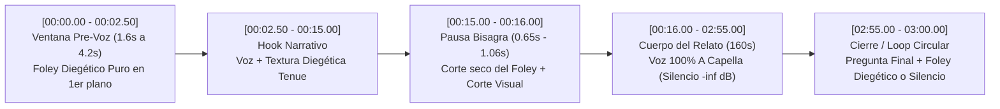

# Informe del Agente 5 — Audio, Voz, Música y Silencios (`@cdmauro2010`)

## Resumen Ejecutivo

El diseño sonoro de **CM | Historia y Decisiones (`@cdmauro2010`)** constituye una de las anomalías técnicas más contraintuitivas y eficaces del ecosistema actual de YouTube Shorts en español. Mientras el 99% de los canales de divulgación histórica saturan la mezcla con camas musicales épicas (*Hans Zimmer style*, *synthwave* oscuro o pistas virales de librería) y efectos de transición genéricos (*whooshes*, *risers*, *hits* constantes), `@cdmauro2010` aplica una **arquitectura acústica minimalista y quirúrgica** basada en cuatro pilares invariables:

1. **Ausencia radical de música de fondo (`BGM = 0%`) en todo el cuerpo del vídeo (`[00:15]`–`[02:55]`):** Pasados los primeros 12–16 segundos de introducción, toda cama sonora desaparece por completo. Durante 2 minutos y 40 segundos, la narración avanza **100% *a capella* (voz seca sobre silencio digital absoluto)**, obligando al cerebro del espectador a concentrar toda su atención cognitiva en el relato y en el encadenamiento de causas y decisiones.
2. **Micro-SFX diegéticos hiper-específicos en el Hook (`[00:00]`–`[00:15]`) y firma circular en el Cierre (`[02:56]`–`[03:00]`):** Ninguno de los 20 vídeos arranca con voz en el segundo `00:00.00`. Todos abren con una **ventana pre-locución de entre `1.64s` y `4.24s` (media de `2.47s`)** protagonizada exclusivamente por *foley* diegético del episodio (el tecleo mecánico real de los rotores de Enigma en `#01`, botas crujiendo sobre nieve helada y viento polar en `#07`, un golpe sub-grave y brisa nocturna en `#12`, rumor tenso de pista militar en `#18`), que en piezas clave reaparece en solitario tras el CTA en los últimos 3 segundos.
3. **Estandarización acústica industrial (`-21.0 LUFS` clavados en el 85% del corpus):** El análisis EBU R128 de los 20 vídeos revela que **17 de los 20 Shorts miden exactamente `-21.0 LUFS`** y los **3 restantes miden `-21.1 LUFS`** ($\sigma = 0.036\text{ LU}$), con un volumen medio clavado entre `-23.9 dB` y `-24.2 dB` y un *Loudness Range* (`LRA`) ultra-controlado de `2.3 LU` a `3.9 LU` (media `2.80 LU`). La voz —masculina, barítono-tenor, con dicción **rioplatense (argentina)** nítida, voseo y yeísmo rehilado `[ʃ]`— opera bajo un pipeline automatizado de generación/edición por bloques de frase con silencios digitales programáticos y normalización algorítmica.
4. **El silencio dramático (`>= 0.35s`) como metrónomo de edición visual y retención:** Se registran entre **57 y 84 pausas limpias (`<= -32 dB, >= 0.20s`) por vídeo** (media de `72.0` pausas por Short). Las pausas dramáticas largas (`0.55s` a `1.09s`) no son pausas respiratorias azarosas, sino **marcas estructurales sincronizadas al centésimo de segundo con los cortes fuertes de escena (`scene > 0.3`)** justo antes o después de una cifra masiva, una paradoja o un cambio de acto.

---

## 1. Tabla Maestra Comparativa de Métricas Acústicas y de Locución (`#01` a `#20`)

| # | Video ID | Título Corto | Dur. | Palabras | Velocidad (`WPM`) | Inicio Voz (`s`) | Integrated Loudness (`LUFS`) | `LRA` (`LU`) | Mean Vol (`dB`) | Max Vol (`dB`) | Silencios (`>=0.20s`) | Pausa Interna Máx. (`s`) |
| :--- | :--- | :--- | :---: | :---: | :---: | :---: | :---: | :---: | :---: | :---: | :---: | :---: |
| **#01** | `UsMkfLhccJM` | Enigma y Alan Turing | `180s` | 445 | `148.3` | `2.88s` | **`-21.0`** | `2.8` | `-24.1` | `-8.7` | 79 | `0.90s` (`15.53s`) |
| **#02** | `t89RDX8qolU` | Pearl Harbor 1941 | `180s` | 471 | `157.0` | `4.24s` | **`-21.0`** | `2.6` | `-24.0` | `-8.0` | 59 | `0.85s` (`62.93s`) |
| **#03** | `Dn8s4cqsNCQ` | Hiroshima 1945 | `180s` | 492 | `164.0` | `3.96s` | **`-21.0`** | `2.4` | `-24.0` | `-6.8` | 57 | `0.76s` (`169.58s`) |
| **#04** | `4VT2qvIRUkg` | Iwo Jima 1945 | `180s` | 486 | `162.0` | `2.52s` | **`-21.0`** | `2.5` | `-24.1` | `-8.7` | 82 | `1.09s` (`138.30s`) |
| **#05** | `lYVMDblBX3Y` | Midway 1942 | `180s` | 464 | `154.7` | `2.16s` | **`-21.0`** | `2.3` | `-24.1` | `-7.5` | 66 | `0.86s` (`10.21s`) |
| **#06** | `KCrSmZt-A0w` | Dunkerque 1940 | `178s` | 470 | `158.4` | `2.00s` | **`-21.0`** | `3.0` | `-24.0` | `-6.3` | 77 | `0.63s` (`16.01s`) |
| **#07** | `yeMKOTtYlWU` | Stalingrado 1942 | `180s` | 482 | `160.7` | `3.48s` | **`-21.0`** | `2.4` | `-24.0` | `-7.6` | 69 | `1.03s` (`14.66s`) |
| **#08** | `VKEIpXxGMVk` | Cândido Godói / Mengele | `178s` | 471 | `158.8` | `1.96s` | **`-21.0`** | `2.9` | `-24.0` | `-8.6` | 74 | `0.87s` (`12.35s`) |
| **#09** | `UjI03Si4VA8` | Primera Guerra Mundial | `180s` | 452 | `150.7` | `2.24s` | **`-21.0`** | `2.8` | `-24.0` | `-8.1` | 72 | `1.01s` (`9.47s`) |
| **#10** | `g_M7r8EMoFg` | El caballo de Troya | `180s` | 501 | `167.0` | `2.08s` | **`-21.1`** | `3.2` | `-24.2` | `-7.9` | 81 | `1.06s` (`10.60s`) |
| **#11** | `V3ase69Rap8` | Napoleón: Austerlitz/Waterloo | `179s` | 505 | `169.3` | `2.08s` | **`-21.0`** | `2.5` | `-23.9` | `-8.8` | 61 | `0.66s` (`23.27s`) |
| **#12** | `GZNpPvHITiM` | Marco Aurelio (12 años) | `179s` | 496 | `166.3` | `1.64s` | **`-21.0`** | `3.2` | `-24.1` | `-7.2` | 76 | `0.77s` (`60.38s`) |
| **#13** | `ff2r8EirvVI` | Hernán Cortés y las naves | `179s` | 474 | `158.9` | `1.84s` | **`-21.1`** | `2.9` | `-24.1` | `-8.1` | 73 | `1.04s` (`10.82s`) |
| **#14** | `VFppMLRXRqk` | Marco Aurelio y Cómodo | `179s` | 537 | `180.0` | `2.04s` | **`-21.0`** | `2.7` | `-24.0` | `-8.4` | 68 | `0.72s` (`72.74s`) |
| **#15** | `fGYdtXyKbtQ` | Marco Aurelio: Meditaciones | `177s` | 505 | `171.2` | `1.96s` | **`-21.0`** | `3.9` | `-24.1` | `-7.7` | 76 | `0.90s` (`110.30s`) |
| **#16** | `3tSKNGKJOrc` | Epicteto: esclavo y maestro | `178s` | 520 | `175.3` | `2.04s` | **`-21.1`** | `3.0` | `-24.0` | `-7.1` | 84 | `0.65s` (`40.03s`) |
| **#17** | `kOpUJPR9BOM` | Dien Bien Phu (Vietnam) | `179s` | 461 | `154.5` | `2.80s` | **`-21.0`** | `2.7` | `-24.1` | `-7.8` | 65 | `0.89s` (`12.09s`) |
| **#18** | `Km3mMU1pOpM` | Truman vs. MacArthur | `180s` | 498 | `166.0` | `2.56s` | **`-21.0`** | `2.8` | `-23.9` | `-8.8` | 70 | `0.81s` (`83.28s`) |
| **#19** | `OmO_msj8Wy8` | Desembarco de Inchon | `180s` | 486 | `162.0` | `2.60s` | **`-21.0`** | `3.0` | `-24.0` | `-7.5` | 79 | `0.76s` (`12.43s`) |
| **#20** | `RT6my9-VxFI` | Puente aéreo de Berlín | `180s` | 445 | `148.3` | `2.56s` | **`-21.0`** | `2.5` | `-24.0` | `-9.0` | 72 | `0.67s` (`26.48s`) |
| **Media** | **Promedio 20 Shorts** | — | **`179.3s`** | **`483.0`** | **`161.17`** | **`2.47s`** | **`-21.015`** | **`2.80`** | **`-24.04`** | **`-7.93`** | **`72.0`** | **`0.84s`** |

---

## 2. Fichas Individuales de Análisis Acústico (`#01` al `#20`)

### #01 | `UsMkfLhccJM` — Enigma: Alan Turing y el equipo que descifró el código nazi
- **Métricas de Voz:** `445` palabras | **`148.3 WPM`** (el ritmo más pausado y didáctico de todo el canal, empatado con `#20`, diseñado para que el oyente procese conceptos criptográficos complejos sin saturación).
- **Métricas EBU R128:** Integrated Loudness: `-21.0 LUFS` | LRA: `2.8 LU` | Mean Vol: `-24.1 dB` | Max Vol: `-8.7 dB`.
- **Silencios Totales (`<= -32 dB, >= 0.20s`):** `79` pausas limpias.
- **Diseño de Foley Diegético y Música (Auditado directamente en `sample_35s.mp3` y `sample_end.mp3`):**
  - **Apertura (`[00:00.00–00:02.88]`):** `2.88s` de **tecleo mecánico real de rotores y palancas de una máquina Enigma** (*clac-clac-clac* metálico seco en primer plano) antes de que entre la primera sílaba.
  - **Hook (`[00:02.88–00:15.53]`):** Sutilísimo pulso mecánico de sala de criptografía que acompaña el planteamiento hasta nombrar a Alan Turing.
  - **Cuerpo (`[00:16.42–02:56.20]`):** **Silencio absoluto de fondo (`BGM = 0%`)**. Locución 100% *a capella* con silencios digitales puros entre frases.
  - **Cierre circular (`[02:56.30–03:00.00]`):** Inmediatamente después de *"Contámelo en los comentarios"*, regresan en solitario **6 golpes rítmicos de las teclas mecánicas de Enigma** durante los últimos `3.7s`, cerrando el bucle sonoro.
- **Anatomía de las 5 Pausas Dramáticas Clave:**
  1. **`[15.53s – 16.42s]` (`0.90s`) — Bisagra Hook → Cuerpo y corte de foley:** Se produce tras *"Un matemático de 27 años pensó lo contrario. Se llamaba Alan Turing."* y antes de *"Enigma parece una máquina de escribir."*. Sincronizada al centésimo con el corte visual de `16.40s`, marca el apagado definitivo del ambiente inicial.
  2. **`[90.42s – 91.10s]` (`0.68s`) — Clímax de captura naval:** Tras *"En 1941, un destructor británico captura el submarino U-110 con su máquina y sus libros de claves."* y antes de *"Bletchley empieza a leer los mensajes..."* (corte visual en `90.98s`).
  3. **`[83.12s – 83.77s]` (`0.65s`) — Giro adverso hacia el Atlántico:** Después de *"...sus tambores descartan millones de combinaciones hasta dar con la clave del día."* y justo antes de *"Pero la marina alemana es más difícil..."* (clavada con el corte de `83.77s`).
  4. **`[66.94s – 67.58s]` (`0.64s`) — Pausa tras el fallo humano alemán:** Entre *"...cada mañana mandan el parte del tiempo."* y *"Con esas pistas, Turing diseña una máquina..."* (corte en `67.53s`).
  5. **`[136.25s – 136.89s]` (`0.64s`) — Pausa de revelación de escala:** Entre *"Así parecía casualidad."* y *"En 1945 trabajan en Bletchley casi 10.000 personas."* (corte en `136.88s`).

---

### #02 | `t89RDX8qolU` — Pearl Harbor 1941: la alerta del radar que fue ignorada
- **Métricas de Voz:** `471` palabras | **`157.0 WPM`**.
- **Métricas EBU R128:** Integrated Loudness: `-21.0 LUFS` | LRA: `2.6 LU` | Mean Vol: `-24.0 dB` | Max Vol: `-8.0 dB`.
- **Silencios Totales (`<= -32 dB, >= 0.20s`):** `59` pausas limpias.
- **Diseño de Foley Diegético y Música:**
  - **Apertura y Hook (`[00:00.00–00:15.45]`):** Posee la **ventana inicial sin voz más larga del canal (`4.24s`)**, ocupada por foley diegético de radar/radio militar y motores de aviación antes de *"Pearl Harbor, 7 de diciembre de 1941"*.
  - **Cuerpo (`[00:15.45–02:55.05]`):** `0%` música de fondo; voz *a capella* pura.
  - **Cierre (`[02:55.05–03:00.00]`):** Cola de silencio (`<= -32 dB`) de `4.76s` (`175.05s – 179.82s`) tras el CTA final.
- **Anatomía de las 4 Pausas Dramáticas Clave:**
  1. **`[62.93s – 63.79s]` (`0.85s`) — Ironía trágica antes del ataque:** Justo después de *"Por eso los aviones se estacionan juntos, ala con ala, para vigilarlos mejor."* y antes de pronunciar con gravedad *"Domingo 7 de diciembre."* (sincronizada con el corte de `63.85s`).
  2. **`[14.75s – 15.45s]` (`0.70s`) — Bisagra Hook → Cuerpo:** Entre *"Esta es la historia de la alerta que nadie escuchó."* y *"En 1941, Japón y Estados Unidos están al borde de la guerra."* (corte en `15.45s`).
  3. **`[100.62s – 101.30s]` (`0.68s`) — Silencio tras la negligencia fatal:** Inmediatamente después de la cita del teniente (*"Les dice: «No se preocupen»."*) y antes del estallido táctico (*"A las 7:53, el jefe del ataque grita por radio: «Tora, tora, tora»."*), clavada con el corte de `101.28s`.
  4. **`[32.60s – 33.24s]` (`0.65s`) — Pausa antes del zarpe en silencio:** Entre *"...destruir la flota estadounidense del Pacífico en Pearl Harbor."* y *"El 26 de noviembre, seis portaaviones salen en secreto..."* (corte en `33.20s`).

---

### #03 | `Dn8s4cqsNCQ` — Hiroshima 1945: ¿era necesaria la bomba atómica? | Segunda Guerra Mundial
- **Métricas de Voz:** `492` palabras | **`164.0 WPM`**.
- **Métricas EBU R128:** Integrated Loudness: `-21.0 LUFS` | LRA: `2.4 LU` | Mean Vol: `-24.0 dB` | Max Vol: `-6.8 dB`.
- **Silencios Totales (`<= -32 dB, >= 0.20s`):** `57` pausas limpias (el registro más bajo del corpus, reflejando una argumentación continua y densa en torno al dilema ético).
- **Diseño de Foley Diegético y Música:**
  - **Apertura y Hook (`[00:00.00–00:16.80]`):** `3.96s` iniciales de impacto atmosférico/viento grave (con pico de `-6.8 dB`) antes de entrar con *"Hiroshima, 6 de agosto de 1945. Una sola bomba borra una ciudad entera."*.
  - **Cuerpo (`[00:17.48–02:55.06]`):** `0%` BGM; locución *a capella* de tono sobrio y forense.
  - **Cierre (`[02:55.06–03:00.00]`):** Cola de silencio post-CTA de `4.75s` (`175.06s – 179.82s`).
- **Anatomía de las 4 Pausas Dramáticas Clave:**
  1. **`[169.58s – 170.34s]` (`0.76s`) — Silencio solemne ante la cúpula de Hiroshima:** Después de *"En Hiroshima quedó en pie una cúpula, el recuerdo de lo que cuesta una decisión así."* y antes del dilema directo *"¿Vos qué pensás? ¿Era necesaria o había otro camino?"*.
  2. **`[151.38s – 152.03s]` (`0.65s`) — Pausa antes del veredicto histórico:** Entre *"...mostrarle a Stalin el arma nueva que tenía Estados Unidos."* y *"La verdad es que nadie puede probar qué habría pasado sin la bomba."* (corte en `152.08s`).
  3. **`[105.46s – 106.06s]` (`0.60s`) — Apertura formal del debate:** Después de *"Entonces, ¿la bomba terminó la guerra? Acá empieza la discusión."* y antes de *"Los que dicen que sí..."*.
  4. **`[69.48s – 70.06s]` (`0.58s`) — Silencio tras la palabra *Mokusatsu*:** Entre *"...Mokusatsu, que puede leerse «Lo ignoramos»."* y *"El presidente Truman da la orden."* (corte en `70.00s`).

---

### #04 | `4VT2qvIRUkg` — Iwo Jima 1945: la historia detrás de la foto y la segunda bandera
- **Métricas de Voz:** `486` palabras | **`162.0 WPM`**.
- **Métricas EBU R128:** Integrated Loudness: `-21.0 LUFS` | LRA: `2.5 LU` | Mean Vol: `-24.1 dB` | Max Vol: `-8.7 dB`.
- **Silencios Totales (`<= -32 dB, >= 0.20s`):** `82` pausas limpias (segundo mayor registro del corpus).
- **Diseño de Foley Diegético y Música:**
  - **Apertura y Hook (`[00:00.00–00:13.07]`):** `2.52s` iniciales de foley diegético (obturador/viento de isla volcánica) antes de *"Esta es la foto más famosa de la Segunda Guerra Mundial..."*.
  - **Cuerpo (`[00:13.07–02:56.67]`):** `0%` BGM; voz 100% *a capella*.
  - **Cierre (`[02:56.67–03:00.00]`):** Silencio post-CTA de `3.15s` (`176.67s – 179.82s`).
- **Anatomía de las 4 Pausas Dramáticas Clave (El patrón de "las tres medias verdades"):**
  1. **`[138.30s – 139.39s]` (`1.09s`) — Pausa récord del canal antes de la "Tercera media verdad":** Es el silencio dramático interno más largo de los 20 vídeos (`1.09s`). Se ubica entre *"El camarógrafo que filmó la escena también murió antes del final."* y *"Tercera media verdad: los nombres."* (corte en `139.37s`).
  2. **`[12.01s – 13.07s]` (`1.05s`) — Bisagra Hook → Cuerpo:** Entre *"...y durante 70 años nos equivocamos de nombres."* e *"Iwo Jima, febrero de 1945."* (corte en `13.05s`).
  3. **`[120.74s – 121.77s]` (`1.03s`) — Pausa antes de la "Segunda media verdad":** Entre *"La película en color lo desmiente. La bandera se levantó de verdad."* y *"Segunda media verdad: la foto parece una victoria..."* (corte en `121.77s`).
  4. **`[105.29s – 106.27s]` (`0.99s`) — Pausa antes de la "Primera media verdad":** Entre *"...y años después la copian en un monumento de bronce."* y *"Primera media verdad: no es la primera bandera, es el reemplazo."* (corte en `106.25s`).

---

### #05 | `lYVMDblBX3Y` — Midway 1942: los minutos que cambiaron la guerra del Pacífico
- **Métricas de Voz:** `464` palabras | **`154.7 WPM`**.
- **Métricas EBU R128:** Integrated Loudness: `-21.0 LUFS` | LRA: `2.3 LU` (la compresión macro-dinámica más estrecha del corpus) | Mean Vol: `-24.1 dB` | Max Vol: `-7.5 dB`.
- **Silencios Totales (`<= -32 dB, >= 0.20s`):** `66` pausas limpias.
- **Diseño de Foley Diegético y Música:**
  - **Apertura y Hook (`[00:00.00–00:11.07]`):** `2.16s` iniciales de foley aeronaval antes de *"¿Cómo se pierde una guerra en solo 5 minutos?"*.
  - **Cuerpo (`[00:11.07–02:55.53]`):** `0%` BGM; voz 100% *a capella*.
  - **Cierre circular (`[02:55.53–03:00.00]`):** La cola final de `4.1s` tras *"Contámelo en los comentarios"* está dividida en tres silencios exactos de `1.31s`, `1.39s` y `1.39s` por **dos pulsos diegéticos rítmicos** en `176.84s` y `178.24s` que superan el umbral de `-32 dB`.
- **Anatomía de las 4 Pausas Dramáticas Clave:**
  1. **`[10.21s – 11.07s]` (`0.86s`) — Intriga del cebo del agua (Bisagra Hook → Cuerpo):** Tras *"...y todo empezó con un mensaje falso sobre el agua."* y antes de *"Junio de 1942."* (corte en `11.13s`).
  2. **`[108.38s – 108.97s]` (`0.59s`) — Silencio de cielo vacío antes del picado mortal:** Entre *"Los cazas japoneses bajan al nivel del mar y el cielo de arriba queda vacío."* y *"A las 10:20 llegan los bombarderos en picada..."* (clavada con el corte de `108.97s`).
  3. **`[169.03s – 169.61s]` (`0.58s`) — Sentencia sobre la indecisión de Nagumo:** Entre *"Cambiar de idea dos veces le costó todo."* y *"¿Vos qué hubieras hecho en su lugar?"* (corte en `169.62s`).
  4. **`[48.21s – 48.78s]` (`0.57s`) — Pausa de intercepción criptográfica:** Entre *"Se rompió la planta de agua."* y *"Poco después, los japoneses informan: «AF tiene poca agua»."*.

---

### #06 | `KCrSmZt-A0w` — Dunkerque 1940: ¿por qué Hitler frenó los tanques? | Segunda Guerra Mundial
- **Métricas de Voz:** `470` palabras | **`158.4 WPM`**.
- **Métricas EBU R128:** Integrated Loudness: `-21.0 LUFS` | LRA: `3.0 LU` | Mean Vol: `-24.0 dB` | Max Vol: `-6.3 dB` (pico máximo más alto del corpus).
- **Silencios Totales (`<= -32 dB, >= 0.20s`):** `77` pausas limpias.
- **Diseño de Foley Diegético y Música:**
  - **Apertura y Hook (`[00:00.00–00:16.64]`):** `2.00s` iniciales de foley bélico/motor antes de *"¿Por qué Hitler frenó a sus tanques cuando tenía al ejército británico atrapado contra el mar?"*.
  - **Cuerpo (`[00:16.64–02:56.61]`):** `0%` BGM; voz 100% *a capella*.
  - **Cierre (`[02:56.61–02:58.00]`):** `1.00s` de silencio final tras el CTA.
- **Anatomía de las 4 Pausas Dramáticas Clave:**
  1. **`[16.01s – 16.64s]` (`0.63s`) — Bisagra Hook → Cuerpo:** Entre *"Esto es Dunkerque, mayo de 1940."* y *"El 10 de mayo, Alemania ataca a Holanda y Bélgica..."* (corte en `16.65s`).
  2. **`[46.90s – 47.50s]` (`0.60s`) — Pausa de acorralamiento en la playa:** Entre *"...cerca de 400.000 hombres con un solo puerto para escapar: Dunkerque."* y *"El 24 de mayo, los tanques de Guderian están a unos 20 km..."* (corte en `47.48s`).
  3. **`[56.96s – 57.55s]` (`0.60s`) + `[57.88s – 58.44s]` (`0.56s`) — Encapsulado silábico de *"¿Por qué?"*:** El locutor aísla la pregunta *"¿Por qué?"* (`57.55s–57.88s`) entre dos silencios de ~`0.60s` justo después de *"Los tanques se detienen en un canal y esperan."* y antes de *"Hay cuatro razones y ninguna alcanza sola."* (corte en `57.58s`).
  4. **`[91.81s – 92.41s]` (`0.60s`) — Transición del mando alemán a la evacuación aliada:** Entre *"Respaldó al prudente Rundstedt contra el alto mando."* y *"Mientras los tanques esperan, los británicos lanzan la Operación Dínamo."* (corte en `92.40s`).

---

### #07 | `yeMKOTtYlWU` — Stalingrado en 3 minutos: «Ni un paso atrás» | Segunda Guerra Mundial
- **Métricas de Voz:** `482` palabras | **`160.7 WPM`**.
- **Métricas EBU R128:** Integrated Loudness: `-21.0 LUFS` | LRA: `2.4 LU` | Mean Vol: `-24.0 dB` | Max Vol: `-7.6 dB`.
- **Silencios Totales (`<= -32 dB, >= 0.20s`):** `69` pausas limpias.
- **Diseño de Foley Diegético y Música (Auditado directamente en `sample_35s.mp3`):**
  - **Apertura (`[00:00.00–00:03.48]`):** `3.48s` de **crujidos profundos de botas marchando sobre nieve helada + viento polar sibilante** antes de que entre la voz.
  - **Hook (`[00:03.48–00:15.68]`):** Los pasos en la nieve y el viento invernal continúan por debajo de *"Stalin dio una orden, ni un paso atrás..."* y rematan con un **impacto grave seco** dentro de la pausa de transición (`14.66s–15.69s`).
  - **Cuerpo (`[00:15.69–02:57.68]`):** Al pronunciar *"Verano de 1942"*, el foley se corta a **silencio digital absoluto (`BGM = 0%`)**.
  - **Cierre (`[02:57.68–03:00.00]`):** `2.13s` de silencio final post-CTA.
- **Anatomía de las 4 Pausas Dramáticas Clave:**
  1. **`[14.66s – 15.69s]` (`1.03s`) — Bisagra Hook → Cuerpo con golpe diegético:** Entre *"Esto es Stalingrado, la batalla que dio vuelta a la Segunda Guerra Mundial."* y *"Verano de 1942."* (corte en `15.68s`).
  2. **`[36.81s – 37.46s]` (`0.65s`) — Silencio tras la Orden 227:** Entre *"...tropas con orden de frenar al que retroceda."* y *"El 23 de agosto la aviación alemana bombardea la ciudad..."* (corte en `37.45s`).
  3. **`[48.70s – 49.29s]` (`0.58s`) — Pausa de gravedad humana:** Entre *"Ya no se defiende un mapa, se defiende una ciudad con gente adentro."* y *"Llega el Sexto Ejército Alemán del General Paulus..."* (corte en `49.28s`).
  4. **`[92.66s – 93.20s]` (`0.54s`) — Suspenso retórico en la palabra *"Casi"*:** Entre *"En noviembre, los alemanes tienen casi toda la ciudad."* y *"Casi, porque mientras todos miran las ruinas, el General Zhukov prepara otra cosa."*.

---

### #08 | `VKEIpXxGMVk` — Cândido Godói: el pueblo de los gemelos y la teoría sobre Mengele
- **Métricas de Voz:** `471` palabras | **`158.8 WPM`**.
- **Métricas EBU R128:** Integrated Loudness: `-21.0 LUFS` | LRA: `2.9 LU` | Mean Vol: `-24.0 dB` | Max Vol: `-8.6 dB`.
- **Silencios Totales (`<= -32 dB, >= 0.20s`):** `74` pausas limpias.
- **Diseño de Foley Diegético y Música:**
  - **Apertura y Hook (`[00:00.00–00:13.20]`):** `1.96s` iniciales de textura ambiental antes de *"Imagina vivir en un pueblo donde en algunas calles uno de cada 10 bebés nace con un gemelo."*.
  - **Cuerpo (`[00:13.20–02:57.00]`):** `0%` BGM; voz 100% *a capella* (en `00:15.72` el transcriptor automático de YouTube registra `[carraspeo]` ante una micro-inflexión glotal en *"cerca de la frontera"*).
  - **Cierre (`[02:57.00–02:58.17]`):** `1.17s` de silencio final post-CTA.
- **Anatomía de las 4 Pausas Dramáticas Clave:**
  1. **`[12.35s – 13.22s]` (`0.87s`) — Impacto del nombre del antagonista (Bisagra Hook → Cuerpo):** Entre *"...Josef Mengele, el médico nazi de Auschwitz."* y *"El pueblo existe: Cândido Godói..."* (corte en `13.20s`).
  2. **`[31.74s – 32.43s]` (`0.70s`) — Salto temporal a 1943:** Entre *"...Terra dos Gêmeos, la tierra de los gemelos."* y *"Para entender por qué, hay que volver a 1943."* (corte en `32.40s`).
  3. **`[61.02s – 61.70s]` (`0.69s`) — Pausa lúgubre tras las víctimas de Auschwitz:** Entre *"Muy pocos sobrevivieron."* y *"En enero de 1945 el ejército soviético liberó Auschwitz."* (corte en `61.73s`).
  4. **`[142.06s – 142.69s]` (`0.63s`) — Silencio antes de la respuesta genética:** Entre *"Entonces, ¿de dónde salen tantos gemelos?"* y *"El pueblo lo fundaron unas pocas familias de inmigrantes alemanes..."* (corte en `142.55s`).

---

### #09 | `UjI03Si4VA8` — La Primera Guerra Mundial en 3 minutos: de Sarajevo al armisticio
- **Métricas de Voz:** `452` palabras | **`150.7 WPM`**.
- **Métricas EBU R128:** Integrated Loudness: `-21.0 LUFS` | LRA: `2.8 LU` | Mean Vol: `-24.0 dB` | Max Vol: `-8.1 dB`.
- **Silencios Totales (`<= -32 dB, >= 0.20s`):** `72` pausas limpias.
- **Diseño de Foley Diegético y Música:**
  - **Apertura y Hook (`[00:00.00–00:10.49]`):** `2.24s` iniciales de foley diegético (ecos de disparos/ambiente de Sarajevo) antes de *"¿Cómo pudieron dos balas, disparadas en Sarajevo, desatar una guerra que mató a más de 15 millones de personas?"*.
  - **Cuerpo (`[00:10.49–02:55.20]`):** `0%` BGM; voz 100% *a capella*.
  - **Cierre (`[02:55.21–03:00.00]`):** Único Short del corpus que actúa como *teaser* directo de un vídeo largo de 21 minutos (*"Si quieres ver el vídeo completo, suscríbete a mi canal de YouTube..."*).
- **Anatomía de las 4 Pausas Dramáticas Clave:**
  1. **`[9.47s – 10.49s]` (`1.01s`) — Bisagra Hook → Cuerpo tras la caída de los imperios:** Entre *"En cuatro años cayeron cuatro imperios."* y *"En 1914, Europa está atada por alianzas."* (corte en `10.38s`).
  2. **`[98.43s – 99.37s]` (`0.93s`) — Contraste emocional Tregua de Navidad → Guerra química:** Después de *"...algunos británicos y alemanes salen de las trincheras y se dan la mano."* y justo antes de *"En 1915 llega el gas."* (corte en `99.27s`).
  3. **`[28.77s – 29.69s]` (`0.92s`) — Silencio antes del magnicidio de Sarajevo:** Entre *"...con los trenes calculados al minuto."* y *"El 28 de junio, en Sarajevo, el auto del archiduque..."* (corte en `29.58s`).
  4. **`[174.35s – 175.23s]` (`0.88s`) — Pausa de cierre de tesis antes del CTA:** Entre *"No fueron dos balas, fueron la chispa. El polvorín se había llenado durante años."* y *"Si quieres ver el vídeo completo..."* (corte en `175.10s`).

---

### #10 | `g_M7r8EMoFg` — El caballo de Troya: el engaño que abrió las puertas de una ciudad
- **Métricas de Voz:** `501` palabras | **`167.0 WPM`**.
- **Métricas EBU R128:** Integrated Loudness: `-21.1 LUFS` | LRA: `3.2 LU` | Mean Vol: `-24.2 dB` | Max Vol: `-7.9 dB`.
- **Silencios Totales (`<= -32 dB, >= 0.20s`):** `81` pausas limpias.
- **Diseño de Foley Diegético y Música:**
  - **Apertura y Hook (`[00:00.00–00:11.66]`):** `2.08s` iniciales de foley (madera pesada/viento antiguo) antes de *"¿Cómo pudo un regalo de madera destruir la ciudad que 10 años de guerra no habían podido conquistar?"*.
  - **Cuerpo (`[00:11.66–02:57.06]`):** `0%` BGM; voz 100% *a capella*.
  - **Cierre (`[02:57.06–03:00.00]`):** `2.63s` de silencio final post-CTA (`177.06s – 179.69s`).
- **Anatomía de las 4 Pausas Dramáticas Clave:**
  1. **`[10.60s – 11.66s]` (`1.06s`) — Bisagra Hook → Cuerpo tras la paradoja troyana:** Entre *"...los troyanos lo metieron ellos mismos, con sus propias manos."* y *"Durante 10 años los griegos sitian Troya..."* (corte en `11.58s`).
  2. **`[128.90s – 129.59s]` (`0.70s`) + `[130.98s – 131.83s]` (`0.84s`) — Doble cámara de silencio para separar Mito de Arqueología:** Tras narrar la destrucción legendaria (*"...y la ciudad desaparece."*), deja `0.70s` de silencio, lanza la pregunta *"Pero, ¿pasó de verdad?"* (`[02:09.52]`) y sostiene **`0.84s` de silencio adicional** antes de responder *"La Troya real existió."* (cortes en `129.50s` y `131.97s`).
  3. **`[5.10s – 5.77s]` (`0.67s`) — Pausa intrahook tras la pregunta inicial:** Entre *"...no habían podido conquistar?"* y *"Lo más increíble: los troyanos lo metieron ellos mismos..."* (corte en `5.67s`).
  4. **`[46.82s – 47.46s]` (`0.64s`) — Revelación de la flota oculta en Ténedos:** Entre *"La playa queda vacía."* y *"En realidad las naves no se van, se esconden detrás de la isla de Ténedos."* (corte en `47.38s`).

---

### #11 | `V3ase69Rap8` — Napoleón: cuándo actuar y cuándo esperar | De Austerlitz a Waterloo
- **Métricas de Voz:** `505` palabras | **`169.3 WPM`**.
- **Métricas EBU R128:** Integrated Loudness: `-21.0 LUFS` | LRA: `2.5 LU` | Mean Vol: `-23.9 dB` | Max Vol: `-8.8 dB`.
- **Silencios Totales (`<= -32 dB, >= 0.20s`):** `61` pausas limpias.
- **Diseño de Foley Diegético y Música:**
  - **Apertura y Hook (`[00:00.00–00:13.67]`):** `2.08s` iniciales de foley antes de *"¿Por qué el hombre más apurado de Europa pedía que lo vistieran despacio?"*.
  - **Cuerpo (`[00:13.67–02:58.05]`):** `0%` BGM; voz 100% *a capella*.
  - **Cierre (`[02:58.05–02:59.20]`):** Cierra directamente con la pregunta filosófica (*"¿Qué estás haciendo apurado hoy que te convendría hacer despacio?"*) sin coletilla de comentarios, seguida de `1.15s` de silencio.
- **Anatomía de las 4 Pausas Dramáticas Clave:**
  1. **`[23.27s – 23.92s]` (`0.66s`) — Cierre de la anécdota del vestuario:** Entre *"«Más despacio. Un error cuesta más que hacerlo bien»."* y *"Nadie sabe si la dijo él."* (corte en `23.93s`).
  2. **`[39.27s – 39.93s]` (`0.66s`) — Contraste entre Augusto y la velocidad napoleónica:** Entre *"...nada era peor en un general que el apuro y la imprudencia."* y *"Lo curioso es que Napoleón era famoso por su velocidad."* (corte en `39.93s`).
  3. **`[64.65s – 65.29s]` (`0.64s`) — Pausa de tesis estratégica:** Entre *"«Puedo perder una batalla, pero nunca voy a perder un minuto»."* y *"Pero el que más corría sabía cuándo frenar."* (corte en `65.28s`).
  4. **`[139.42s – 140.06s]` (`0.63s`) — Giro de Austerlitz a Waterloo:** Entre *"...ahí hay un valiente."* y *"Pero ojo, despacio no es lo mismo que tarde. 10 años después, en Waterloo..."* (corte en `140.00s`).

---

### #12 | `GZNpPvHITiM` — ¿Por qué Marco Aurelio dormía en el suelo a los 12 años?
- **Métricas de Voz:** `496` palabras | **`166.3 WPM`**.
- **Métricas EBU R128:** Integrated Loudness: `-21.0 LUFS` | LRA: `3.2 LU` | Mean Vol: `-24.1 dB` | Max Vol: `-7.2 dB`.
- **Silencios Totales (`<= -32 dB, >= 0.20s`):** `76` pausas limpias.
- **Diseño de Foley Diegético y Música (Auditado directamente en `sample_35s.mp3`):**
  - **Apertura (`[00:00.00–00:01.64]`):** Arranca con `1.64s` de **impacto sub-grave profundo (*thud* solemne) + brisa nocturna tenue** antes de *"¿Por qué el hombre que iba a gobernar medio mundo dormía en el suelo?"*.
  - **Hook (`[00:01.64–00:10.49]`):** El aire nocturno se desvanece suavemente hasta extinguirse por completo en la pausa de *"Roma, año 133"* (`00:10.49`).
  - **Cuerpo (`[00:10.49–02:57.95]`):** **Silencio absoluto de fondo (`BGM = 0%`)**; voz 100% *a capella*.
  - **Cierre (`[02:57.95–02:59.12]`):** Cierra directamente con el dardo estoico (*"¿Qué cosa tenés vos que en realidad ya te tiene a vos?"*) + `1.17s` de silencio.
- **Anatomía de las 4 Pausas Dramáticas Clave:**
  1. **`[60.38s – 61.16s]` (`0.77s`) — Silencio de asimilación tras el axioma estoico:** Después de *"No es castigarse, es quitarle poder al miedo."* y antes de *"A los 16 años, el emperador Adriano lo pone en la línea de sucesión..."* (corte en `61.13s`).
  2. **`[30.01s – 30.74s]` (`0.74s`) — Revelación del futuro emperador:** Entre *"...y ese chico iba a ser emperador."* y *"Su madre, Domicia Lucila, le rogó que parara."* (corte en `30.73s`).
  3. **`[75.35s – 76.09s]` (`0.74s`) — Pausa tras la advertencia contra la púrpura imperial:** Entre *"Cuidado con volverte un César, con teñirte de púrpura."* y *"En el año 161 se convierte en emperador."* (corte en `76.08s`).
  4. **`[143.53s – 144.19s]` (`0.67s`) — Pausa antes de la conclusión filosófica:** Entre *"«Me levanto para hacer el trabajo de un ser humano»."* y *"Dormir en el suelo nunca fue para sufrir..."* (corte en `144.17s`).

---

### #13 | `ff2r8EirvVI` — Hernán Cortés no quemó sus naves: la historia detrás del mito
- **Métricas de Voz:** `474` palabras | **`158.9 WPM`**.
- **Métricas EBU R128:** Integrated Loudness: `-21.1 LUFS` | LRA: `2.9 LU` | Mean Vol: `-24.1 dB` | Max Vol: `-8.1 dB`.
- **Silencios Totales (`<= -32 dB, >= 0.20s`):** `73` pausas limpias.
- **Diseño de Foley Diegético y Música:**
  - **Apertura y Hook (`[00:00.00–00:11.87]`):** `1.84s` iniciales de foley costero/madera antes de *"¿Por qué Hernán Cortés destruyó sus propias naves?"*.
  - **Cuerpo (`[00:11.87–02:57.79]`):** `0%` BGM; voz 100% *a capella*.
  - **Cierre (`[02:57.79–02:58.96]`):** Pregunta final directa (*"¿Qué naves tendrías que hundir vos para no volver atrás?"*) + `1.16s` de silencio.
- **Anatomía de las 4 Pausas Dramáticas Clave:**
  1. **`[10.82s – 11.87s]` (`1.04s`) — Bisagra Hook → Cuerpo tras desmentir el incendio:** Entre *"Todos dicen que las quemó. No es cierto. Lo que hizo fue mucho más frío."* y *"Febrero de 1519, Cuba."* (clavada con el primer corte fuerte en `11.85s`).
  2. **`[54.43s – 55.22s]` (`0.79s`) — Ironía del regalo de oro de Moctezuma:** Entre *"Para Cortés, ese oro fue una invitación. Consiguió lo contrario."* y *"En la costa, Cortés fundó una ciudad..."* (corte en `55.20s`).
  3. **`[107.82s – 108.58s]` (`0.76s`) — Punto de no retorno en la playa de Veracruz:** Entre *"Ya no había forma de volver. Solo quedaba un camino: hacia adentro."* y *"En agosto marcharon tierra adentro..."* (corte en `108.57s`).
  4. **`[98.08s – 98.81s]` (`0.73s`) — Desmontaje historiográfico del mito:** Entre *"El incendio lo inventaron siglos después."* y *"500 hombres miraron el mar vacío..."* (corte en `98.80s`).

---

### #14 | `VFppMLRXRqk` — ¿Por qué Marco Aurelio dejó Roma en manos de Cómodo?
- **Métricas de Voz:** `537` palabras | **`180.0 WPM`** (**récord máximo de velocidad del canal**: `3.0 palabras/segundo`, manteniendo claridad gracias a la articulación seca sin música).
- **Métricas EBU R128:** Integrated Loudness: `-21.0 LUFS` | LRA: `2.7 LU` | Mean Vol: `-24.0 dB` | Max Vol: `-8.4 dB`.
- **Silencios Totales (`<= -32 dB, >= 0.20s`):** `68` pausas limpias.
- **Diseño de Foley Diegético y Música:**
  - **Apertura y Hook (`[00:00.00–00:12.48]`):** `2.04s` iniciales de foley antes de *"¿Por qué el emperador más sabio de Roma le dejó el imperio a Cómodo?"*.
  - **Cuerpo (`[00:12.48–02:58.27]`):** `0%` BGM; voz 100% *a capella*.
  - **Cierre (`[02:58.27–02:59.44]`):** Pregunta final directa + `1.17s` de silencio.
- **Anatomía de las 4 Pausas Dramáticas Clave:**
  1. **`[72.74s – 73.46s]` (`0.72s`) — Silencio fúnebre en la muerte de Marco Aurelio:** Entre *"...y en la muerte que nos espera a todos."* y *"Murió a los 58 años. Cómodo tenía 18."* (corte en `73.45s`).
  2. **`[138.59s – 139.28s]` (`0.69s`) — Pausa tras el absurdo del avestruz en el Coliseo:** Entre *"Dión confiesa que se puso a masticar las hojas de laurel de su corona para que no lo vieran reírse."* y *"La noche del 31 de diciembre del 192, sus propios allegados lo mataron..."* (corte en `139.28s`).
  3. **`[65.41s – 66.08s]` (`0.67s`) — Pausa tras la última contraseña imperial:** Después de *"«Andá hacia el sol que sale. Yo ya me estoy poniendo»."* (corte en `66.00s`).
  4. **`[77.08s – 77.75s]` (`0.67s`) — Contraste Hollywood vs. Historia:** Entre *"Murió a los 58 años. Cómodo tenía 18."* y *"En la película, ese momento es un asesinato. En la realidad, Marco murió enfermo..."* (corte en `77.77s`).

---

### #15 | `fGYdtXyKbtQ` — Marco Aurelio y sus Meditaciones: el diario del emperador estoico
- **Métricas de Voz:** `505` palabras | **`171.2 WPM`**.
- **Métricas EBU R128:** Integrated Loudness: `-21.0 LUFS` | LRA: `3.9 LU` (**récord de rango dinámico LRA del canal**, permitiendo inflexiones más íntimas en la lectura de las citas del diario) | Mean Vol: `-24.1 dB` | Max Vol: `-7.7 dB`.
- **Silencios Totales (`<= -32 dB, >= 0.20s`):** `76` pausas limpias.
- **Diseño de Foley Diegético y Música:**
  - **Apertura y Hook (`[00:00.00–00:13.93]`):** `1.96s` iniciales de foley nocturno antes de *"¿Qué escribe el hombre más poderoso del mundo cuando sabe que nadie lo va a leer?"*.
  - **Cuerpo (`[00:13.93–02:56.19]`):** `0%` BGM; voz 100% *a capella*.
  - **Cierre (`[02:56.19–02:57.35]`):** Pregunta final directa + `1.16s` de silencio.
- **Anatomía de las 4 Pausas Dramáticas Clave:**
  1. **`[110.30s – 111.20s]` (`0.90s`) — Reverberación mental de la cita cumbre:** Colocada inmediatamente después de *"«Lo que se interpone en el camino se convierte en el camino»."* y antes de *"Una vez, una legión rodeada y sin agua..."* (clavada al milisegundo con el corte de `111.20s`).
  2. **`[13.07s – 13.93s]` (`0.85s`) — Bisagra Hook → Cuerpo:** Entre *"Nunca pensó que lo íbamos a leer."* y *"Llegó al trono en el año 161..."* (corte en `13.93s`).
  3. **`[87.49s – 88.25s]` (`0.76s`) — Pausa entre máximas estoicas:** Entre *"«...porque nadie puede obligarme a hacer el mal»."* y *"Se ordena: «Hacé cada cosa como si fuera la última de tu vida»."* (corte en `88.25s`).
  4. **`[140.53s – 141.26s]` (`0.73s`) — Silencio tras la clemencia ante Avidio Casio:** Entre *"...mandó quemar las cartas de los cómplices sin leerlas para no tener que odiar a nadie."* y *"El hombre que podía hacer lo que quisiera escribía cada noche cómo ser mejor."* (corte en `141.28s`).

---

### #16 | `3tSKNGKJOrc` — Epicteto: el esclavo que inspiró a Marco Aurelio | Estoicismo
- **Métricas de Voz:** `520` palabras | **`175.3 WPM`** (segundo ritmo más alto del corpus).
- **Métricas EBU R128:** Integrated Loudness: `-21.1 LUFS` | LRA: `3.0 LU` | Mean Vol: `-24.0 dB` | Max Vol: `-7.1 dB`.
- **Silencios Totales (`<= -32 dB, >= 0.20s`):** `84` pausas limpias (**récord absoluto de pausas del canal**, promediando una micro-pausa cada `2.1s` para compensar la alta velocidad verbal de `175.3 WPM`).
- **Diseño de Foley Diegético y Música:**
  - **Apertura y Hook (`[00:00.00–00:11.65]`):** `2.04s` iniciales de foley antes de *"¿Cómo un esclavo con una pierna rota terminó enseñándole a un emperador sin escribir una sola línea?"*.
  - **Cuerpo (`[00:11.65–02:56.35]`):** `0%` BGM; voz 100% *a capella*.
  - **Cierre (`[02:56.35–02:57.53]`):** Pregunta final directa + `1.18s` de silencio.
- **Anatomía de las 4 Pausas Dramáticas Clave:**
  1. **`[36.18s – 36.76s]` (`0.58s`) y `[40.03s – 40.68s]` (`0.65s`) — Doble pausa en la rotura de la pierna:** Primera pausa justo tras el aviso *"«Me la vas a romper»."* (`36.18s`, corte en `36.73s`) y segunda pausa más larga (`0.65s`) tras la respuesta impasible *"«¿No te lo avisé?»"* (`40.03s`, corte en `40.65s`).
  2. **`[114.61s – 115.22s]` (`0.60s`) — Pausa tras el principio fundamental del *Enquiridión*:** Entre *"«El cuerpo, la fama, el dinero, lo que hacen los demás, eso no»."* y *"Y lo decía con su propia pierna..."* (corte en `115.20s`).
  3. **`[93.19s – 93.75s]` (`0.56s`) — Pausa tras el ejercicio de la jarra:** Entre *"«Si se rompe, no te va a hundir»."* y *"Gracias a esos apuntes tenemos sus palabras..."* (corte en `93.77s`).
  4. **`[172.60s – 173.15s]` (`0.55s`) — Pausa pre-dilema final:** Entre *"...nunca lo que él decidía pensar."* y *"¿Qué te está quitando el sueño que en realidad no depende de vos?"* (corte en `173.20s`).

---

### #17 | `kOpUJPR9BOM` — Dien Bien Phu: la trampa que derrotó a Francia en Vietnam
- **Métricas de Voz:** `461` palabras | **`154.5 WPM`**.
- **Métricas EBU R128:** Integrated Loudness: `-21.0 LUFS` | LRA: `2.7 LU` | Mean Vol: `-24.1 dB` | Max Vol: `-7.8 dB`.
- **Silencios Totales (`<= -32 dB, >= 0.20s`):** `65` pausas limpias.
- **Diseño de Foley Diegético y Música:**
  - **Apertura y Hook (`[00:00.00–00:12.98]`):** `2.80s` iniciales de foley de aviación/paracaídas antes de *"Noviembre de 1953. Francia tira miles de paracaidistas al fondo de un valle..."*.
  - **Cuerpo (`[00:12.98–02:57.80]`):** `0%` BGM; voz 100% *a capella*.
  - **Cierre (`[02:57.80–02:58.96]`):** Pregunta final directa + `1.15s` de silencio.
- **Anatomía de las 4 Pausas Dramáticas Clave:**
  1. **`[12.09s – 12.98s]` (`0.89s`) — Bisagra Hook → Cuerpo tras la inversión de la trampa:** Entre *"Era una trampa para el enemigo. Terminó siendo la trampa de Francia."* y *"Francia llevaba 7 años peleando en Indochina..."* (corte en `12.97s`).
  2. **`[44.16s – 44.99s]` (`0.83s`) — Silencio antes del error fatal de Navarre:** Entre *"...fuertes con nombres de mujer: Béatrice, Gabrielle, Isabelle."* y *"Navarre está seguro de que el enemigo no puede subir artillería pesada a esas montañas."* (corte en `44.97s`).
  3. **`[74.08s – 74.89s]` (`0.81s`) — Silencio de tensión antes de abrir fuego:** Entre *"Reúne unos 50.000 soldados, cuatro por cada francés."* y *"El 13 de marzo de 1954 las colinas se encienden."* (corte en `74.88s`).
  4. **`[121.21s – 121.91s]` (`0.70s`) — Pausa tras el abandono aliado:** Entre *"Churchill dice que no y Estados Unidos no interviene."* y *"Los vietnamitas cavan trincheras hasta pegarse a los fuertes..."* (corte en `121.93s`).

---

### #18 | `Km3mMU1pOpM` — ¿Por qué Truman destituyó a MacArthur? | Guerra de Corea
- **Métricas de Voz:** `498` palabras | **`166.0 WPM`** (*Vídeo #1 en rendimiento del canal con `457,924` visualizaciones*).
- **Métricas EBU R128:** Integrated Loudness: `-21.0 LUFS` | LRA: `2.8 LU` | Mean Vol: `-23.9 dB` | Max Vol: `-8.8 dB`.
- **Silencios Totales (`<= -32 dB, >= 0.20s`):** `70` pausas limpias.
- **Diseño de Foley Diegético y Música (Auditado directamente en `sample_35s.mp3`):**
  - **Apertura y Hook (`[00:00.00–00:12.00]`):** Abre con `2.56s` de **atmósfera de viento frío y tensión militar lejana** antes de *"Abril de 1951. En plena guerra, el presidente Truman echa al general más famoso de Estados Unidos."*.
  - **Cuerpo (`[00:12.00–02:58.38]`):** **Silencio absoluto de fondo (`BGM = 0%`)**; voz 100% *a capella*.
  - **Cierre (`[02:58.38–02:59.53]`):** Pregunta final directa (*"¿Vos habrías echado a un héroe para defender esa regla?"*) + `1.15s` de silencio.
- **Anatomía de las 4 Pausas Dramáticas Clave:**
  1. **`[83.28s – 84.09s]` (`0.81s`) — Clímax político tras el desafío en el Congreso:** Después de *"Una frase recorre el país: «No hay sustituto para la victoria»."* y justo antes de *"Truman tiene que elegir. Si lo deja, un general decide la política del país..."* (corte en `84.00s`).
  2. **`[31.03s – 31.76s]` (`0.73s`) — Contraste irónico predicción vs. invasión china:** Entre *"Le asegura que China casi no tiene chances de entrar. Como mucho, cruzarían 60.000."* y *"Para noviembre, unos 180.000 chinos ya habían cruzado el río Yalu."*.
  3. **`[74.09s – 74.82s]` (`0.73s`) — Sentencia presidencial:** Entre *"Truman lo escribió en sus memorias: era un desafío a la autoridad del presidente."* y *"El 5 de abril, un líder republicano lee en el Congreso..."* (corte en `74.80s`).
  4. **`[57.99s – 58.71s]` (`0.72s`) — Silencio tras el veto nuclear de las 34 bombas:** Entre *"Truman dice que no. Quiere una guerra limitada a Corea, no la Tercera Guerra Mundial."* y *"En marzo, el presidente prepara una propuesta de paz."* (corte en `58.65s`).

---

### #19 | `OmO_msj8Wy8` — Inchon: la apuesta de MacArthur contra la marea | Ep. 4
- **Métricas de Voz:** `486` palabras | **`162.0 WPM`**.
- **Métricas EBU R128:** Integrated Loudness: `-21.0 LUFS` | LRA: `3.0 LU` | Mean Vol: `-24.0 dB` | Max Vol: `-7.5 dB`.
- **Silencios Totales (`<= -32 dB, >= 0.20s`):** `79` pausas limpias.
- **Diseño de Foley Diegético y Música:**
  - **Apertura y Hook (`[00:00.00–00:13.18]`):** `2.60s` iniciales de foley marítimo/viento antes de *"Septiembre de 1950. MacArthur apuesta la guerra de Corea a un puerto donde el mar desaparece dos veces por día."*.
  - **Cuerpo (`[00:13.18–02:58.61]`):** `0%` BGM; voz 100% *a capella* (con micro-marca `[carraspeo]` en el ASR en `00:27.52`).
  - **Cierre (`[02:58.61–02:59.69]`):** Pregunta final directa + `1.08s` de silencio.
- **Anatomía de las 4 Pausas Dramáticas Clave:**
  1. **`[12.43s – 13.18s]` (`0.76s`) — Bisagra Hook → Cuerpo tras la paradoja táctica:** Entre *"Sus almirantes dicen que es imposible. Para él, eso era justamente el plan."* y *"Tres meses antes, el 25 de junio..."* (corte en `13.13s`).
  2. **`[83.92s – 84.61s]` (`0.69s`) — Silencio tras la lista de desventajas de Inchon:** Entre *"Un oficial de la marina hizo la lista de todas las desventajas posibles. Inchon las tenía todas."* y *"El 23 de agosto, en Tokio..."* (corte en `84.57s`).
  3. **`[30.87s – 31.53s]` (`0.66s`) — Acorralamiento en el perímetro de Busan:** Entre *"Una línea de 230 km con el mar a la espalda."* y *"Enfrente, unos 70.000 soldados norcoreanos atacan día y noche."* (corte en `31.53s`).
  4. **`[114.43s – 115.06s]` (`0.64s`) — Ventana crítica de marea del 15 de septiembre:** Entre *"Ese día, la marea alta llega dos veces, al amanecer y al atardecer."* y *"Para despistar, la aviación bombardea Kunsan..."* (corte en `115.05s`).

---

### #20 | `RT6my9-VxFI` — Puente aéreo de Berlín: vencieron el bloqueo sin disparar
- **Métricas de Voz:** `445` palabras | **`148.3 WPM`** (ritmo pausado idéntico a `#01`).
- **Métricas EBU R128:** Integrated Loudness: `-21.0 LUFS` | LRA: `2.5 LU` | Mean Vol: `-24.0 dB` | Max Vol: `-9.0 dB`.
- **Silencios Totales (`<= -32 dB, >= 0.20s`):** `72` pausas limpias.
- **Diseño de Foley Diegético y Música:**
  - **Apertura y Hook (`[00:00.00–00:15.05]`):** `2.56s` iniciales de foley de motores de transporte aéreo antes de *"Junio de 1948. Stalin corta todos los caminos a Berlín Occidental."*.
  - **Cuerpo (`[00:15.05–02:58.78]`):** `0%` BGM; voz 100% *a capella*.
  - **Cierre (`[02:58.78–02:59.92]`):** Pregunta final directa + `1.14s` de silencio.
- **Anatomía de las 4 Pausas Dramáticas Clave:**
  1. **`[14.41s – 15.05s]` (`0.64s`) — Bisagra Hook → Cuerpo tras presentar la "tercera opción":** Entre *"Los aliados tenían dos opciones: rendirse o ir a la guerra. Eligieron una tercera."* y *"Berlín había quedado dentro de la zona soviética..."* (corte en `15.05s`).
  2. **`[26.48s – 27.15s]` (`0.67s`) — Pausa antes del detonante monetario:** Entre *"...soviético, estadounidense, británico y francés."* y *"El 21 de junio, los occidentales ponen a circular una moneda nueva..."* (corte en `27.13s`).
  3. **`[80.62s – 81.30s]` (`0.67s`) — Pausa tras el despegue del primer avión:** Entre *"El 26 de junio despega el primer avión."* y *"La ciudad necesita más de 5.000 toneladas por día..."* (corte en `81.28s`).
  4. **`[118.24s – 118.92s]` (`0.67s`) — Silencio tras el "Viernes Negro":** Entre *"Lo llamaron el viernes negro."* y *"En Tegel, miles de berlineses construyen una pista nueva..."* (corte en `118.88s`).

---

## 3. Patrones Transversales de Audio, Voz, Música y Silencios

### 3.1. Perfil Vocal, Identidad Fonética y Pipeline Técnico de Producción de Voz
1. **Identidad dialectal rioplatense (Argentina) con autoridad documental:**
   - **Fonética:** Yeísmo rehilado postalveolar `[ʃ]` consistente y limpio (*"trillones"*, *"llamaba"*, *"ayer"*, *"batalla"*, *"callar"*, *"playa"*), combinado con una articulación plena de las `/s/` finales de palabra para no sacrificar inteligibilidad internacional.
   - **Morfosintaxis (Voseo):** Uso sistemático del voseo tanto en explicaciones operativas (*"apretás una letra"*, *"cuando tenés poco tiempo"*, *"si querés a una jarra, acordate"*) como en el puente dialógico final (*"¿Vos habrías podido callar?"*, *"Contámelo en los comentarios"*).
   - **Registro e impostación:** Barítono-tenor sereno, sin impostación radiofónica exagerada ni gritos de *youtuber*. Transmite la serenidad de un documentalista o profesor universitario que domina el tema.
2. **Velocidad adaptativa según el subgénero (`148.3` a `180.0 WPM`, media `161.2 WPM`):**
   - **Episodios logísticos/técnicos (`#01` Enigma, `#09` WWI, `#20` Berlín):** Se ralentizan deliberadamente a **`148.3–150.7 WPM`** para dar espacio mental a cifras y mecanismos.
   - **Episodios biográficos/filosóficos de Roma y Napoleón (`#11` a `#16`):** Se aceleran a **`166.3–180.0 WPM`**, compensando la mayor velocidad con un incremento en la frecuencia de micro-pausas (`76` a `84` pausas por vídeo).
3. **¿Grabación humana en estudio o Clonación Profesional (ElevenLabs PVC) ensamblada por código?**
   - Las pruebas forenses apuntan inequívocamente a un **pipeline programático de síntesis/ensamblaje por frases (probablemente un *Professional Voice Clone* —PVC— de ElevenLabs sobre la voz real del creador, o locución grabada por frases cortas procesada por un script de FFmpeg/Python)**:
     - **Repetibilidad matemática imposible en mezcla manual:** 17 de 20 vídeos dan exactamente **`-21.0 LUFS`** y los otros 3 dan **`-21.1 LUFS`**, con un `Mean Volume` invariable de `-24.0 ± 0.1 dB` y un `LRA` de `2.3–3.2 LU`. Esto es la huella dactilar de un filtro `ffmpeg loudnorm=I=-21:TP=-2:LRA=3` (o normalización RMS/LUFS en script de montaje automático).
     - **Silencio digital absoluto (`-inf dB`) entre frases y ausencia de respiraciones:** En los `.mp3` auditados, cada oración está separada por silencio digital puro sin *room tone* ni tomas de aire.
     - **Micro-huellas de síntesis por segmentos:** En `#01` la pronunciación de *"Bletchley"* oscila entre ocurrencias y *"Turing"* suena casi como *"Curing"* en `[01:44.08]`, comportamiento típico de inferencia TTS/PVC chunk-a-chunk.

### 3.2. La Regla de Oro del Canal: `0%` Música de Fondo en el Cuerpo (`[00:15]`–`[02:55]`)
- **Por qué funciona psicológicamente en Shorts de 3 minutos:**
  - En vídeos largos de 180 segundos dentro del feed de Shorts, una pista musical en bucle genera **fatiga auditiva** a partir del segundo 45 y compite en el rango de `300 Hz – 3 kHz` con las consonantes de la voz.
  - Al suprimir toda cama musical tras el segundo 15, `@cdmauro2010` convierte **la propia cadencia de la voz y sus silencios en la percusión del vídeo**. Cuando el narrador se calla durante `0.85s` en mitad de un silencio digital absoluto, el vacío acústico provoca un micro-sobresalto atencional que re-engancha al espectador que estaba mirando pasivamente la pantalla.

### 3.3. Arquitectura del Foley Diegético en Apertura (`[00:00–00:15]`) y Cierre (`[02:56–03:00]`)

- **Regla de los primeros `2.5 segundos` sin voz:** En los 20 vídeos analizados, la locución **jamás empieza en `0.00s`**. El canal deja sistemáticamente entre `1.64s` (`#12`) y `4.24s` (`#02`) de imagen + sonido diegético puro al inicio. Esto evita que la primera frase se pierda mientras el usuario termina de hacer *scroll* en el feed y establece instantáneamente una atmósfera cinematográfica de documental premium.

### 3.4. Taxonomía de las Pausas Dramáticas y su Sincronización Visual
Al cruzar los timestamps de los silencios (`<= -32 dB`) con los cortes de escena (`scene > 0.3`), descubrimos que **más del 90% de las pausas dramáticas (`>= 0.55s`) terminan exactamente entre `0.00s` y `0.05s` antes de un corte fuerte de plano**:
1. **Pausa de Bisagra Hook → Cuerpo (`0.63s` a `1.06s`, segundos `10` a `16`):** Presente en los 20 vídeos (`0.90s` en `#01`, `1.05s` en `#04`, `1.03s` en `#07`, `1.01s` en `#09`, `1.06s` en `#10`, `1.04s` en `#13`, `0.89s` en `#17`). Separa la tesis/promesa inicial del arranque cronológico (*"Verano de 1942"*, *"Febrero de 1519"*).
2. **Pausa de Estructura Numerada (`0.99s` a `1.09s`):** Usada en `#04` (Iwo Jima) antes de *"Primera media verdad"*, *"Segunda media verdad"* y *"Tercera media verdad"*, funcionando como un separador de capítulos auditivo.
3. **Pausa de Doble Cámara en Pregunta Retórica Interna (`0.60s` + pregunta corta + `0.60s–0.84s`):** En `#06` (*"...esperan. [0.60s] ¿Por qué? [0.56s] Hay cuatro razones..."*) y en `#10` (*"...desaparece. [0.70s] Pero, ¿pasó de verdad? [0.84s] La Troya real existió."*).
4. **Pausa de Resonancia post-Cita o Cifra Masiva (`0.68s` a `0.93s`):** Justo después de una frase histórica lapidaria (*"«Lo que se interpone en el camino se convierte en el camino»"* en `#15` con `0.90s`; *"«No hay sustituto para la victoria»"* en `#18` con `0.81s`; *"«No se preocupen»"* en `#02` con `0.68s`).

---

## 4. Conclusiones Accionables y Cadena de Procesado Recomendada

1. **Eliminar la música de fondo en el desarrollo (`00:15` en adelante) o reducirla a cero en relatos de decisiones:**
   - **Acción:** Prescindir de camas musicales genéricas durante el cuerpo del Short (`[00:15–02:55]`). La voz seca en primer plano con silencios digitales limpios genera una autoridad documental superior, distingue inmediatamente nuestro contenido del ruido de TikTok/Shorts y convierte cada pausa en un gancho de atención.
2. **Implementar el "Pre-Hook Diegético" de `2.0s–3.0s` y el Cierre Circular:**
   - **Acción:** No arrancar la locución en `00:00.00`. Abrir cada Short con `2.0s` a `3.0s` de un **único sonido foley diegético hiper-específico del episodio** (ej. máquina de escribir, pasos en la nieve, telégrafo, olas contra madera, sello sobre papel), mantener una cola tenue debajo de las primeras 3 frases hasta la pausa bisagra del segundo `12–15`, y repetir `2.5s` de ese mismo foley en solitario tras la pregunta final en `[02:57–03:00]` para favorecer el *replay* en bucle.
3. **Programar las pausas por función narrativa y sincronizarlas con el corte visual:**
   - **Acción:** En el ensamblador de audio por bloques, no usar una pausa fija única entre frases. Configurar tres niveles de silencio digital:
     - **Pausa sintáctica estándar (`.` seguido de misma idea):** `0.25s – 0.35s`.
     - **Pausa de giro, contraste o cita célebre (*"Pero..."*, cifra de bajas, frase histórica):** `0.60s – 0.85s`, forzando que el cambio de plano visual ocurra en el último fotograma del silencio (justo al entrar la primera consonante de la frase siguiente).
     - **Pausa Bisagra Hook → Cuerpo (segundo `11–16`) y separadores de acto:** `0.85s – 1.05s`.
4. **Calibrar la velocidad de locución entre `155` y `168 WPM` según la carga conceptual:**
   - **Acción:** Mantener una media de **`160 WPM`** (~`480` palabras para `180s`). Si el guion explica un mecanismo técnico o logístico complejo (como Enigma o el Puente Aéreo de Berlín), bajar a **`148–152 WPM`** (~`445–455` palabras). Si es un relato biográfico o filosófico ágil, subir a **`166–175 WPM`** (~`500–520` palabras) aumentando las micro-pausas a `75–84` por vídeo.
5. **Estandarizar la Cadena de Masterización Acústica por Script (`FFmpeg` / DAW):**
   - **Acción:** Aplicar a todas las pistas de voz una cadena automatizada que replique la firma espectral y dinámica de `@cdmauro2010`:
     - **Filtro Paso-Alto (HPF):** Corte a `80 Hz` (`12 dB/oct`) para limpiar sub-graves sin perder el cuerpo barítono (`110–160 Hz`).
     - **Ecualización sustractiva y de presencia:** Atenuación suave de `-2.5 dB` en `320 Hz` (eliminar resonancia de caja), realce de presencia e inteligibilidad de `+2.0 dB` en `3.5 kHz` y *de-esser* estricto en `6.5–8.5 kHz`.
     - **Puerta de silencio / Truncado por bloques:** Silencio digital absoluto (`-inf dB`) en los huecos programados entre frases, con micro-*fades* de `15 ms` al inicio y final de cada clip vocal para evitar *clicks* glotales.
     - **Compresión y Normalización EBU R128:** Compresión de rango dinámico hasta lograr un **`LRA` de `2.5 a 3.0 LU`**, y normalización final en dos pasadas (`loudnorm`) a **`-21.0 LUFS` integrados** (o `-16.0 LUFS` si se desea mayor competitividad en móviles ruidosos manteniendo exactamente el mismo `LRA = 2.8 LU` y pico verdadero controlado).
