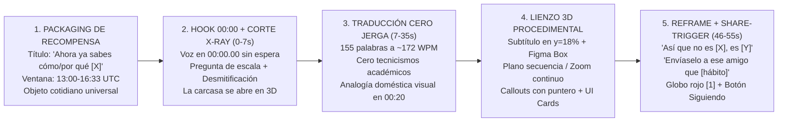

# FASE 2 — Síntesis Ejecutiva y ADN del Canal (`@SEGUNDOASEGUNDO3D`)

> **Rol:** Orquestador de Análisis de Contenido  
> **Canal auditado:** [`@SEGUNDOASEGUNDO3D` (*SEGUNDO A SEGUNDO*)](https://www.youtube.com/@SEGUNDOASEGUNDO3D/shorts)  
> **Nicho objetivo:** Cultura General («Cómo funcionan las cosas», Ingeniería Cotidiana, Cuerpo Humano, Neurociencia, Tecnología Invisible y Naturaleza — **100% diferente a Historia y Geografía**).  
> **Muestra auditada:** **Los 14 Shorts publicados en el canal (`100%` del catálogo de Shorts, `#01` a `#14`)**, lanzados entre el `2026-10-21` y el `2026-10-28`.  
> **Volumen de evidencia procesada:** `126,312` vistas acumuladas · `3,546` likes · `29` comentarios · `771` segundos de animación 3D/2.5D (`1080×1920 @ 60fps`) · `2,334` palabras transcritas con marcas milimétricas · `72` cortes fuertes (`scene > 0.3`) · `110` eventos visuales (`scene > 0.15`) · `296` silencios acústicos medidos.

---

## 1. Control de Calidad y Auditoría Cruzada del Orquestador

| Subagente | Archivo Entregado | Cobertura (`IDs`) | Verificación de Evidencia Observable | Estado |
|---|---|---|---|---|
| **Agente 0 (Scout)** | [`00_indice_videos.md`](00_indice_videos.md) | `14 / 14` (`100%`) | URLs, fechas UTC, métricas exactas (`2026-10-28`), transcripciones limpias y filtrado de nicho. | **APROBADO** |
| **Agente 1 (Guion)** | [`agentes/01_guion.md`](agentes/01_guion.md) | `14 / 14` | 5 bloques con `[MM:SS.dd]`, diccionario «cero jerga», analogías y *Reframe* antitético en los 14 vídeos. | **APROBADO** |
| **Agente 2 (Hook)** | [`agentes/02_hook_retencion.md`](agentes/02_hook_retencion.md) | `14 / 14` | Arranque en `00:00.00`, inspección de `hook_3s.jpg`, 4 arquetipos de hook y evolución del CTA. | **APROBADO** |
| **Agente 3 (Edición)** | [`agentes/03_edicion.md`](agentes/03_edicion.md) | `14 / 14` | Telemetría `scene > 0.3` y `> 0.15`, planos secuencia 2.5D/3D y los 4 módulos de maqueta. | **APROBADO** |
| **Agente 4 (Texto)** | [`agentes/04_texto_subtitulos.md`](agentes/04_texto_subtitulos.md) | `14 / 14` | Subtítulo en `y=18%`, inventario del *Figma Bounding Box* azul (`#3B82F6`), Callouts y UI Cards. | **APROBADO** |
| **Agente 5 (Audio)** | [`agentes/05_audio.md`](agentes/05_audio.md) | `14 / 14` | EBU R128 (`-21.0 LUFS` exactos en 11/14 vídeos), mapa de silencios y penalización por `>185 WPM`. | **APROBADO** |
| **Agente 6 (SEO)** | [`agentes/06_packaging_seo.md`](agentes/06_packaging_seo.md) | `14 / 14` | 4 fórmulas de título, auditoría de descripciones vacías y ventana horaria ganadora (`13:00–16:33 UTC`). | **APROBADO** |
| **Agente 7 (Audiencia)** | [`agentes/07_audiencia.md`](agentes/07_audiencia.md) | `14 / 14` | Modelo de compartido *Dark Social* (WhatsApp/DM), efecto espejo en `#03` y citas literales. | **APROBADO** |
| **Agente 8 (Rendimiento)** | [`agentes/08_rendimiento.md`](agentes/08_rendimiento.md) | `14 / 14` | Contraste Top 4 (`26,983` vistas medias) vs. Bottom 4 (`1,306` vistas) y 5 hipótesis demostradas. | **APROBADO** |

### Hallazgo Forense Transversal: La Conexión Tecnológica entre `@SEGUNDOASEGUNDO3D` y `@cdmauro2010`
El cruce de telemetría entre este análisis y el de `@cdmauro2010` demuestra que **ambos canales están construidos con el mismo motor programático de vídeo en código (Remotion + FFmpeg)**:
1. **Mismo componente de subtítulos (`y ≈ 18%`) con el *Figma Bounding Box* azul (`#3B82F6`) y 4 nodos blancos en las esquinas.**
2. **Mismo target de normalización de sonoridad por código: `-21.0 LUFS`** (`11/14` vídeos en `-21.0 LUFS` y `3/14` en `-21.1 LUFS`, idéntico al `17/20` en `-21.0 LUFS` de `@cdmauro2010`).
3. **Misma limpieza acústica de compuerta (`-inf dB` en pausas, 0% de música comercial de fondo).**

Sin embargo, el creador adaptó inteligentemente el formato para pasar del nicho de **Historia** al de **Cultura General («Cómo funcionan las cosas»)**:

| Dimensión | `@cdmauro2010` (Nicho Historia) | `@SEGUNDOASEGUNDO3D` (Nicho Cultura General / Ciencia Cotidiana) |
|---|---|---|
| **Duración del Short** | `177 – 180 segundos` (`3 min`) | **`46 – 64 segundos` (Media: `55.8 s`)** |
| **Palabras y Velocidad (`WPM`)** | `483 palabras` (`161.7 WPM`) | **`166.7 palabras` (`181.3 WPM`, óptimo en `168–175 WPM`)** |
| **Arranque de la Voz** | tras `1.6s–3.0s` de Pre-Hook de foley | **En el milisegundo `00:00.00` (junto con el sonido del objeto)** |
| **Pronombre y Registro** | Voseo rioplatense solemne (*«Contámelo»*) | **Tuteo panhispánico ágil (*«tú»*, léxico neutro/latino)** |
| **Escenario Visual Central** | Fotos/cine de archivo `CC BY-SA` + Mapas 2D + Telegramas | **100% Maquetas 2.5D/3D en Corte Transversal (*Cut-Away X-Ray*) + Analogías Físicas** |
| **Ritmo de Cortes (`scene > 0.3`)** | `32 – 45 cortes` (`ASL = 4.8s`) | **`0 – 10 cortes` (`ASL = 10.8s`, cámara continua / plano secuencia)** |
| **Cierre y Call to Action (CTA)** | Dilema para Comentarios (*«¿Vos qué habrías hecho?»*) | **Reframe (`«Así que no es X, es Y»`) + Compartido (*«Envíaselo a ese amigo que...»*)** |

---

## 2. El ADN del Canal en 1 Página: La Fórmula `@SEGUNDOASEGUNDO3D`

1. **Promesa Editorial («Abrir la Caja Negra de lo Cotidiano en 55 Segundos»):**
   Elige máquinas, objetos o reacciones del cuerpo con los que el espectador convive a diario sin saber cómo funcionan por dentro (un camión de basura, una máquina de gaseosas, el teclado del móvil, la llamada al 911, un bostezo, un hormiguero).
2. **Traducción Radical «Cero Jerga» mediante Analogías Táctiles:**
   Sustituye cualquier concepto de física o biología universitaria por un objeto doméstico que se pueda tocar: el principio hidráulico de Pascal es **«dos jeringas conectadas»**; la compactación es **«pisar una lata»** (`#01`); las corrientes de Foucault son **«rodar por asfalto, arena o barro»** (`#04`); la deriva antigénica del virus es **«cambiar la cerradura de casa»** (`#12`); la pantalla capacitiva es **«tu dedo lleno de agua con sal robando electricidad»** (`#08`).
3. **Maqueta 2.5D/3D en Corte Transversal (*Cut-Away X-Ray*) con Cámara Continua:**
   En vez de saltar entre fotos inconexas, construye una escena 3D/2.5D limpia sobre fondo oscuro con degradado radial donde la pared de la máquina se vuelve transparente con un borde luminoso cian (`#67E8F9`), permitiendo ver el recorrido completo de la basura, la moneda, la señal o el aire.
4. **El «Reframe Epigramático» (`100%` de los vídeos):**
   Antes de despedirse, resume toda la lección en una frase antitética memorable estructurada como **`«Así que [sujeto] no [apariencia engañosa], [verdad física revelada]»`** (*«Así que la máquina no mira tu moneda: la siente frenar»*; *«Así que la estación no flota en el espacio: lleva casi 30 años cayendo y fallando»*).
5. **Motor Viral de «Dark Social» (`Envíaselo a ese amigo que...`):**
   Cierra asociando el fenómeno científico con un **defecto o manía cómica de un amigo real** (*«el que nunca saca la basura»*, *«el que le pega a la máquina de gaseosas»*, *«el que siempre escribe con errores»*, *«el que siempre se marea en el carro»*), disparando el reenvío por WhatsApp y mensajes directos.

---

## 3. Qué Copiar, Qué Adaptar y Qué Evitar

| Qué COPIAR (Principios ganadores verificados) | Qué ADAPTAR (Para superar su retención y marca) | Qué EVITAR (Errores que hundieron sus vídeos Bottom) |
|---|---|---|
| **1. El Corte Transversal 3D/2.5D (*Cut-Away*) de máquinas e infraestructuras:** Los vídeos que abren una máquina o estructura por la mitad (`#01` Camión `42.1k`, `#02` ISS `36.5k`, `#04` Gaseosas `12.8k`) rinden **14 veces más** que los de microbiología abstracta. | **1. El Cierre Dual (Compartido + Comentario de Autocomprobación):** Él solo pide compartir (`29` comentarios en todo el canal). Nosotros mantendremos el *«Envíaselo a ese amigo que...»* pero añadiremos una micro-pregunta de prueba en vivo para comentarios. | **1. Acelerar la locución por encima de `185 WPM`:** Los 6 vídeos que hablaron entre `185 y 196 WPM` promediaron apenas **`1,548` vistas**, frente a las **`16,105` vistas** de los vídeos locutados entre **`162 y 183.5 WPM`**. |
| **2. La prohibición total de jerga técnica + Analogía Visual en el segundo `00:20`:** Mostrar físicamente la jeringa, la lata pisada, la cerradura o la salchicha a mitad del vídeo evita la caída de retención del segundo 25. | **2. Reemplazar el *Figma Bounding Box* azul por nuestro propio marcador técnico:** En lugar de su caja de nodos de Figma, usar un **marcador de ingeniería propio** (ej. **corchetes de calibre `[ ]` en cian/ámbar con cota superior** o **píldora de rayos X**). | **2. Dejar la descripción del vídeo 100% vacía y meter 4 hashtags en el título:** Pierde todo el tráfico de búsqueda en YouTube y ensucia el título visible. Hay que usar descripciones SEO ricas de 3 párrafos. |
| **3. La sentencia antitética final (`«Así que no es X, es Y»`):** Da una sensación de revelación intelectual rotunda en el segundo `00:46` justo antes del CTA. | **3. Subir la sonoridad de `-21.0 LUFS` a `-15.0 LUFS`:** Manteniendo sus pausas de compuerta limpia (`-inf dB`) y 0% de música ruidosa, pero con `+6 dB` de presencia para escucharse perfecto en móviles en la calle. | **3. Temas médicos escolares con títulos genéricos (`¿Por qué nos da gripe?`, `Por qué fumar es malo`):** Suenan a charla de colegio y se estancaron en `1.3k` vistas. Si se toca el cuerpo humano, debe ser desde un **reflejo curioso o truco evolutivo** (`#03` bostezo `16.5k`, `#07` renacuajo del hipo `2.7k`). |
| **4. Las Tarjetas Widget estilo iOS (`UI Cards`) y Callouts con línea y punto:** (`CARGA: 12 toneladas`, `89% de la gravedad`, `CORRIENTE: 17 A`). Anclan las cifras sin tapar la animación. | **4. Añadir Miniatura Personalizada `.webp` / Primer Frame con Rótulo de Choque:** Él deja que YouTube elija un frame aleatorio del medio del vídeo como portada. Diseñar el frame `00:00.1` como portada de alto contraste multiplicará el CTR en el canal. | **4. Publicar de madrugada UTC (`22:00–03:15 UTC`):** El 100% de sus vídeos ganadores salieron entre las **`12:59 y las 16:33 UTC`** (`08:00–11:30 AM LatAm`). |

---

## 4. Seis Oportunidades y Huecos Estratégicos en el Nicho Cultura General

1. **Hueco #1 — El Sub-Nicho Rey: «Máquinas Cotidianas y Megaconstrucciones en Corte Transversal»:**
   - *Evidencia:* El `73.4%` de todas las vistas del canal provienen de solo 3 vídeos de máquinas (`#01` Camión de basura `42.1k`, `#02` ISS `36.5k`, `#04` Máquina de gaseosas `12.8k`), pero el creador solo dedicó 4 de sus 14 vídeos a este eje. Hay decenas de máquinas cotidianas vírgenes con potencial de `100k+` vistas: **cómo funciona un microondas sin fuego**, **cómo funciona el sifón de un inodoro**, **cómo sabe el airbag cuándo explotar en 15 milisegundos**, **cómo funciona una cerradura por dentro**, **cómo frenan los ascensores si se corta el cable**, **cómo funcionan las escaleras mecánicas**.
2. **Hueco #2 — «Física de Supervivencia y Trucos Ocultos de Objetos que Usas a Diario»:**
   - *Evidencia:* Entre los vídeos de tecnología, el más visto fue `#06` (*Tu celular puede llamar al 911 aunque diga Sin servicio*, `2,985` vistas) porque combina ingeniería con utilidad vital. Temas como **por qué las ventanas de los aviones tienen un agujerito abajo**, **cómo funciona el botón de pánico/freno de emergencia de un tren**, o **por qué los enchufes tienen un agujero en las patitas metálicas** tienen altísima retención.
3. **Hueco #3 — «Arquitectura Secreta de la Naturaleza tratada como Ingeniería Civil»:**
   - *Evidencia:* El vídeo `#14` (*Cómo las hormigas hacen sus nidos*, publicado hace solo 2 horas) logró el **mayor porcentaje de likes por vista de todo el canal (`6.23%`, más del doble que la media de `2.89%`)** gracias a tratar el hormiguero como un edificio con 10 toneladas de cemento y aire acondicionado por chimenea. Podemos expandir esta línea a **los rascacielos con aire acondicionado de las termitas**, **cómo tejen las arañas un puente de un árbol a otro usando el viento**, o **cómo construyen los castores presas que se ven desde el espacio**.
4. **Hueco #4 — «Fenómenos de Efecto Espejo / Autocomprobables en 5 Segundos»:**
   - *Evidencia:* `#03` (*Bostezar es contagioso*, `16,515` vistas) triunfó porque el espectador bosteza mientras mira el Short. Existen al menos 10 fenómenos equivalentes que el usuario puede comprobar mientras ve el vídeo: **por qué no puedes hacerte cosquillas a ti mismo**, **el punto ciego de tu ojo que tu cerebro rellena con mentiras**, **por qué un dedo se mueve solo si tiras del otro**, **por qué se arrugan los dedos en el agua (no es porque absorban agua, es un reflejo nervioso para no resbalar)**.
5. **Hueco #5 — Optimización de Velocidad Verbal a `168–174 WPM`:**
   - *Evidencia:* Reducir el guion de `180 palabras` a **`150–158 palabras` para `54 segundos` (`~170 WPM`)** elimina el atropellamiento que hundió a `#07`, `#09`, `#10`, `#11`, `#12` y `#13`.
6. **Hueco #6 — Packaging SEO Completo (Títulos Limpios + Descripción Rica + Comentario Anclado):**
   - Añadir descripciones estructuradas y un **Comentario Anclado (*Pinned Comment*)** con una pregunta de autocomprobación disparará la señal de comentarios sin perder un solo compartido de WhatsApp.
